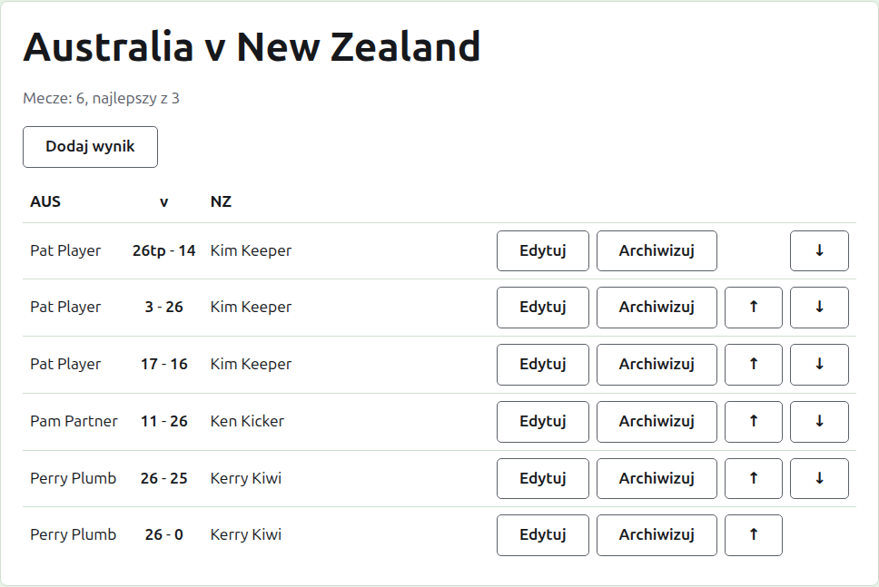
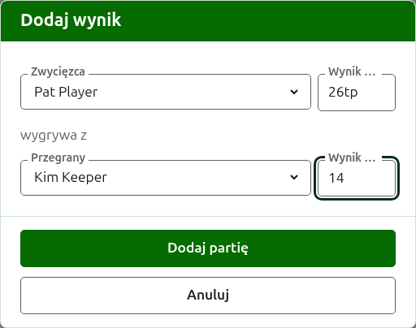

# Wyniki

Stronę testu otwiera się z jego nazwy na karcie Testy albo z ciemnozielonego paska. Jej nagłówkiem są pełne nazwy jego drużyn, jak „Australia v New Zealand", a pod nim to, ile meczów test ma mieć i z ilu gier każdy jest najlepszy. Jego wyniki są całą stroną, bez kart. Organizator i osoba wprowadzająca wyniki widzą tę samą stronę, bo osoba wprowadzająca wyniki może zrobić z wynikiem wszystko to, co organizator.

## Jak ułożone są wyniki

Wyniki są ułożone według drużyn, a nie według tego, kto wygrał, w tabeli, której nagłówkiem jest skrót nazwy pierwszej drużyny, „v" i skrót drugiej. Każdy wynik to wiersz: zawodnik pierwszej drużyny, potem oba wyniki, z wynikiem pierwszej drużyny jako pierwszym, jak „26tp - 14", potem zawodnik drugiej drużyny, niezależnie od tego, który z nich wygrał. Zarchiwizowane wyniki są ułożone tak samo poniżej.

## Wprowadzanie wyniku {#entering-a-score}

Naciśnij **Dodaj wynik**, nad listą. Okno czyta się tak, jak mówi się rezultat na głos: zwycięzca i jego wynik, potem „wygrywa z", potem przegrany i jego wynik.

Zwycięzcę wybiera się spośród zawodników w użyciu obu drużyn, pod nazwą każdej drużyny, najpierw zawodników pierwszej drużyny, a zawodników każdej drużyny w kolejności drużyny. Na początku nikt nie jest wybrany. Gdy zwycięzca jest wybrany, przegrany jest oferowany tylko z drugiej drużyny, bo gra między dwoma zawodnikami tej samej drużyny nie jest grą między drużynami. Zarchiwizowany zawodnik nie jest oferowany.

Wynik wpisuje się tak, jak zapisał go sędzia: liczba punktów i to, co po niej następuje, co jest zachowywane i pokazywane tak, jak wpisano, jak „26tp" dla 26 bramek i triple peela. Liczba to cyfry, od których wynik się zaczyna; wynik, który nie zaczyna się od cyfry, jest odrzucany.

Gra wygrana przy równych punktach, jak wtedy, gdy przerwano ją z powodu czasu i rozstrzygnięto w inny sposób, mówi, kto ją wygrał, oznaczeniem po wyniku zwycięzcy: „6w" wygrywa z „6". Oznaczenia to „w", „won" i „winner". Wynik zwycięzcy musi być wyższy niż przegranego albo oznaczony, chyba że turniej dopuszcza remisy – wtedy równe punkty bez oznaczenia są zachowywane jako remis.

Naciśnij **Dodaj grę**. Gra zostaje dodana, okno mówi która, a pola są opróżniane dla następnej, bo wyniki przychodzą grami, odczytane z tablicy na koniec sesji. Naciśnij **Anuluj**, gdy wszystkie są już wprowadzone.

## Mecze

Dwoje zawodników, którzy się spotykają, rozgrywa mecz najlepszy z tylu gier, ile ustalono dla testu. Gry między nimi są grami tego meczu, a gra między dwoma zawodnikami, których mecz jest już rozstrzygnięty, jest odrzucana: jeden z nich wygrał więcej gier, niż drugi mógłby jeszcze wygrać, albo rozegrano każdą grę meczu.

Mecz jest rozpoczęty, gdy jego dwoje zawodników ma grę w użyciu. Test nie rozpoczyna więcej meczów, niż ma mieć: gdy rozpoczęło się ich tyle, gra między dwoma zawodnikami, którzy się nie spotkali, jest odrzucana, a kolejna gra już rozpoczętego meczu jest przyjmowana. Gdy test ma mieć więcej meczów, zmień go na karcie Testy, by ich oczekiwał.

## Poprawianie wyniku {#correcting-a-score}

**Edytuj** otwiera to samo okno na tym wyniku, zatytułowane Edytuj wynik, z wybranymi zawodnikami i wynikami takimi, jak je wpisano. Można zmienić zarówno jego zawodników, jak i wyniki, wybierając ich tak jak przy dodawaniu. Naciśnij **Zapisz**, by zachować poprawkę i zamknąć okno. Poprawka zachowuje rezultat: wygrana gra pozostaje wygrana, a zremisowana – zremisowana. Grę, której rezultat był błędny, archiwizuje się i wprowadza ponownie.

## Ustawianie wyników w kolejności

Wyniki przychodzą w takiej kolejności, w jakiej je wprowadzono, więc każdy wynik w użyciu oferuje **W górę** i **W dół**, które zamieniają go z sąsiednim wynikiem, by listę można było ustawić w kolejności, w jakiej rozegrano gry.

## Archiwizowanie wyniku

**Archiwizuj** odkłada wynik na bok, by nie liczył się do niczego. Jest wymieniony pod **Zarchiwizowane wyniki**, przekreślony, i oferuje tylko **Przywróć**. Żadne z nich nie pyta najpierw, bo każde cofa drugie. Każdy wynik w teście można zarchiwizować, bo test nie ma rund zależnych od siebie.

Wynik, którego zawodnika od tego czasu zarchiwizowano, nie zostaje przywrócony, dopóki nie przywróci się zawodnika, a strona o tym mówi.

Dalej: [Notatki](notes.md).
