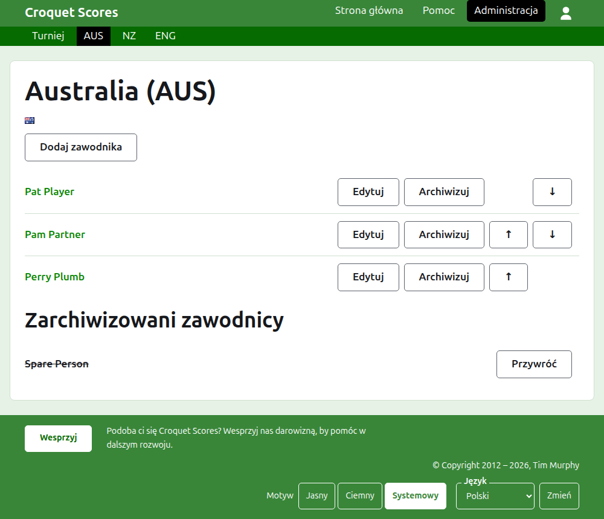
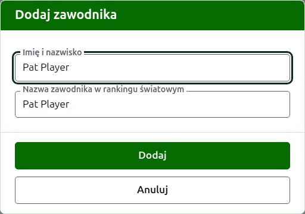

# Zawodnicy drużyny

Stronę drużyny otwiera się z jej nazwy albo jej **Zobacz** na karcie Drużyny. Jej nagłówkiem jest nazwa drużyny ze skrótem nazwy w nawiasie i jej flaga, by organizator, który trafił do niewłaściwej drużyny, zobaczył to od razu. Ma jedną rzecz do pokazania, zawodników drużyny, więc lista jest całą stroną.

Ciemnozielony pasek na stronie drużyny prowadzi do turnieju i do każdej drużyny w użyciu po jej skrócie, by zawodników zgłaszać drużyna po drużynie bez wracania do karty Drużyny.

Zawodnik w drużynie należy tylko do tej drużyny, reprezentuje ją i gra pod jej flagą, a nie pod własną. Ta sama osoba grająca w dwóch drużynach albo w dwóch turniejach jest zawodnikiem w każdej z nich.

## Dodawanie zawodnika

Naciśnij **Dodaj zawodnika**, nad listą. Nad stroną otwiera się okno dialogowe.

**Imię i nazwisko** jest wymagane, od 3 do 254 znaków. Dwóch zawodników w jednej drużynie nie może mieć tej samej nazwy, niezależnie od wielkości liter; zawodnik w innej drużynie może ją mieć.

**Nazwa zawodnika w rankingu światowym** to nazwa, pod którą zawodnika znają rankingi światowe. Pytanie o nią pojawia się tylko w turnieju Association Croquet lub Golf Croquet, dwóch dyscyplin, których zawodników rankingi światowe mają na liście. Zawodnicy American Six-Wicket są znani rankingom pod własnymi nazwami, więc się o nią tam nie pyta, a nazwą każdego zawodnika w rankingu światowym jest zawsze jego nazwa. Podczas dodawania zawodnika podąża ona za nazwą, którą wpisujesz, i przestaje podążać, gdy wpiszesz w nią cokolwiek. Zostawiona pusta, jest zachowywana jako nazwa zawodnika. Gdy wpisujesz, podpowiadani są zawodnicy znani rankingom światowym, których nazwy tak się zaczynają, a obok nazwy w rankingu światowym znacznik mówi, że rankingi znają tę nazwę, a znak zapytania – że nie. To tylko podpowiedź: nazwa nieznana rankingom jest zachowywana tak samo chętnie jak znana.

Zawodnik nigdy nie nazywa się „Bye" (angielskie słowo na wolny los): nazwa, której pierwszym słowem jest „bye", jest odrzucana.

Naciśnij **Dodaj**. Zawodnik zostaje dodany, okno o tym mówi, a jego pola są opróżniane dla następnego, z kursorem z powrotem w nazwie. Dodaj w ten sposób całą drużynę, a potem naciśnij **Anuluj**, by zamknąć okno.

## Poprawianie zawodnika

Naciśnij nazwę zawodnika albo jego **Edytuj**, by otworzyć to samo okno na tym zawodniku, zatytułowane Edytuj zawodnika. Naciśnij **Zapisz**, by zachować zmianę. Zawodnik, którego nazwę poprawiono, zachowuje nazwę w rankingu światowym, którą miał, z wyjątkiem American Six-Wicket, gdzie nazwą zawodnika w rankingu światowym jest zawsze jego nazwa.

## Kolejność

Zawodnicy są wymienieni w kolejności drużyny, czyli w kolejności, w jakiej są oferowani przy wprowadzaniu wyniku testu. **W górę** i **W dół** przesuwają zawodnika o jedno miejsce w obrębie drużyny.

## Archiwizowanie zawodnika

**Archiwizuj** odkłada zawodnika na bok: zgłoszonego przez pomyłkę albo takiego, który nie jest już w drużynie. Zarchiwizowany zawodnik jest wymieniony pod **Zarchiwizowani zawodnicy**, przekreślony, po zawodnikach w użyciu, i oferuje tylko **Przywróć**. Archiwizowanie nigdy nie pyta najpierw, bo zawodnik w drużynie nie jest zgłoszony do niczego innego, a przywrócenie go przywraca wszystko.

Zawodnika, który rozegrał w teście jakąkolwiek partię w użyciu, nie można zarchiwizować, bo partie byłyby wtedy przeciwko komuś, kogo już nie ma, więc takiemu zawodnikowi nie oferuje się Archiwizuj. Zawodnika, którego wszystkie partie są zarchiwizowane, można.

Dalej: [Testy](tests.md).
