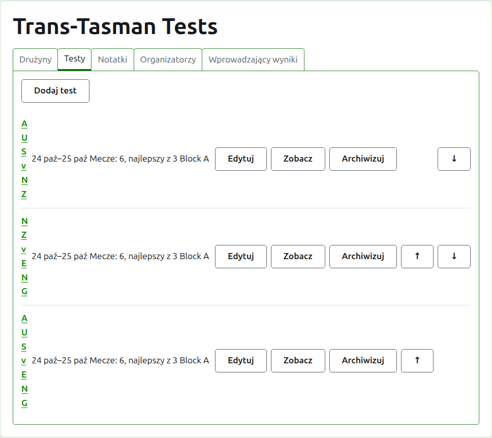
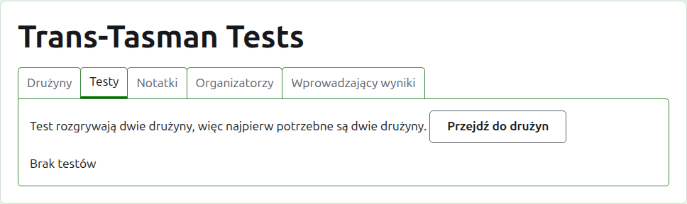
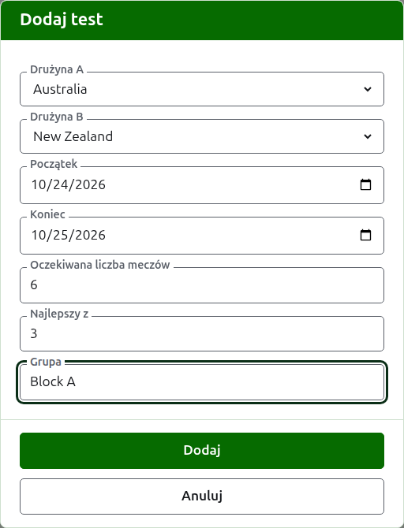
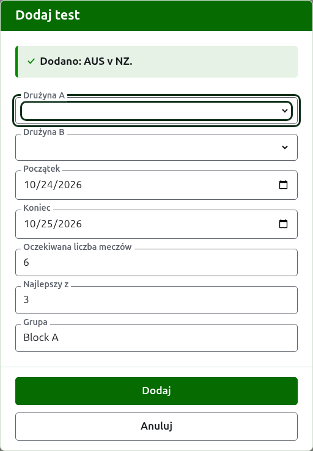
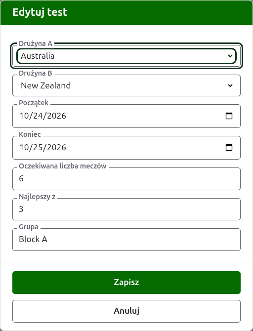

# Testy

Karta **Testy** na stronie turnieju to miejsce, gdzie dodaje się testy między jego drużynami, zmienia je, ustawia w kolejności i odkłada na bok. Test jest jedną z konkurencji turnieju: pojedynkiem dwóch drużyn, nazywanym ich skrótami, jak „AUS v NZ", rozgrywanym jako pewna liczba meczów między zawodnikiem jednej i drugiej drużyny. Każdy test ma własną stronę, na której wprowadza się jego wyniki.

Każdy test podaje swoją nazwę, dni, w których jest rozgrywany, ile meczów ma mieć i z ilu gier każdy jest najlepszy, jak „Mecze: 6, najlepszy z 3", oraz swoją grupę, jeśli w jakiejś jest.

## Najpierw dwie drużyny

Test rozgrywają dwie drużyny w użyciu, więc gdy turniej ma mniej niż dwie, karta mówi o tym tam, gdzie byłoby Dodaj test, i prowadzi do karty Drużyny.

## Dodawanie testu

Naciśnij **Dodaj test**, nad listą. Nad stroną otwiera się okno dialogowe, które czyta się w kolejności, w jakiej mówi się o teście na głos.

**Drużyna A** i **Drużyna B** są wybierane spośród drużyn turnieju w użyciu, po nazwie, w kolejności turnieju. Na początku żadna nie jest wybrana, by test nigdy nie został dodany między drużynami, których nie wybrano. Drużyna B oferuje każdą drużynę poza wybraną jako Drużyna A, bo drużyna nie rozgrywa testu przeciwko sobie. Drużyna A jest pierwszą drużyną: jej zawodnicy są po lewej na stronie testu i na stronie publicznej. Test nie ma własnej nazwy do wpisania; nazywa się go skrótami nazw jego drużyn.

**Początek** i **Koniec** to dni, w których rozgrywany jest test, na początku ustawione na pierwszy dzień turnieju. Test rozgrywa się w obrębie jego turnieju, więc dni przed początkiem turnieju albo po jego końcu są odrzucane.

**Oczekiwana liczba meczów** to liczba meczów, jakie ma mieć test, ustalona przez wydarzenie przed jego rozpoczęciem, by ten, kto czyta jego wyniki, widział, jak daleko zaszedł. Jest liczbą całkowitą od 1 w górę. Jest też ograniczeniem: gdy zaczęło się tyle meczów, ile test ma mieć, gra, która zaczęłaby kolejny, jest odrzucana, a już rozpoczęte mecze rozgrywa się do końca. Test, który ma mieć więcej, zmienia się tak, by ich oczekiwał.

**Do wygranych gier** to liczba gier, z których najlepszy jest każdy mecz. Może być parzysta, bo mecz może zakończyć się podziałem.

**Rozgrywany z handicapem**, **Dopuszcza remisy** i **Liczy się do rankingów światowych** są pytane tak jak w każdej konkurencji. Ostatnie pojawia się tylko tam, gdzie może się liczyć: w teście krokieta klasycznego lub krokieta golfowego, który nie jest rozgrywany z handicapami ani nie dopuszcza remisów. Na początku jest zaznaczone.

**Grupa** to grupa, w której jest test, gdy wydarzenie rozgrywa się w grupach, jak „Block A". Jest opcjonalna: zostawiona pusta, test nie jest w żadnej. Testy w grupie mają własną stronę na stronie publicznej, pokazującą, jak stoją drużyny grupy.

Naciśnij **Dodaj**. Test zostaje dodany, okno mówi który, podając jego nazwę, a drużyny są opróżniane dla następnego, z dniami, oczekiwaną liczbą meczów, liczbą gier i grupą pozostawionymi tak, jak były: testy dodaje się runda po rundzie, między drużynami, które spotykają się tego samego dnia, więc następny test rundy to tylko jego dwie drużyny. Naciśnij **Anuluj**, gdy wszystkie są już dodane.

## Zmiana testu

**Edytuj** otwiera to samo okno na teście, zatytułowane Edytuj test, wypełnione tak, jak test wygląda teraz. Naciśnij **Zapisz**, by zachować zmianę.

Test z grami w użyciu zachowuje swoje drużyny: okno je pokazuje, ale nie można ich zmienić. Resztę można zmienić w granicach tego, co rozegrano: oczekiwana liczba meczów mniejsza niż liczba już rozpoczętych jest odrzucana, podobnie jak liczba gier mniejsza niż najwięcej gier, jakie rozegrało ze sobą dwoje zawodników.

## Kolejność

Testy są wymienione w kolejności turnieju, czyli w kolejności, w jakiej pojawiają się na stronach publicznych i na ciemnozielonym pasku. **W górę** i **W dół** przesuwają test o jedno miejsce.

## Przejście do testu

Nazwa testu albo **Zobacz** otwiera jego stronę, na której wprowadza się jego wyniki. Ciemnozielony pasek też tam prowadzi, ze strony turnieju albo każdego innego testu.

## Archiwizowanie testu

**Archiwizuj** odkłada test na bok, a **Przywróć** to cofa, więc żadne z nich nie pyta najpierw. Zarchiwizowany test jest wymieniony pod **Zarchiwizowane testy**, przekreślony, oferuje tylko Przywróć i nie ma go na stronach publicznych.

Test z grami w użyciu został rozegrany i nie można go zarchiwizować, dopóki nie zarchiwizuje się jego gier. Test, którego wszystkie gry są zarchiwizowane, można, bo zarchiwizowana gra nie liczy się do niczego. Test, którego drużynę od tego czasu zarchiwizowano, nie zostaje przywrócony, dopóki nie przywróci się drużyny, a karta o tym mówi.

Dalej: [Wyniki](scores.md).
