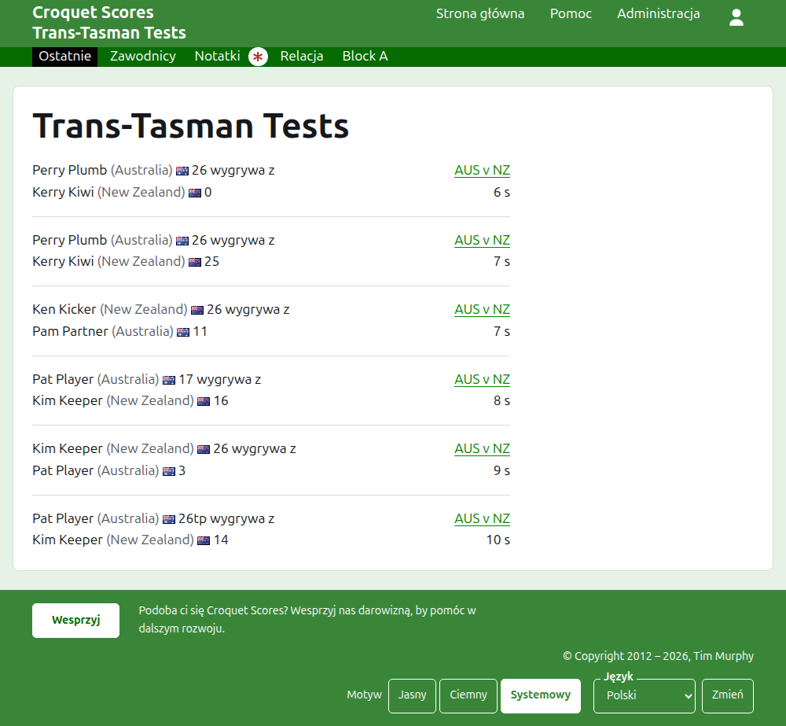
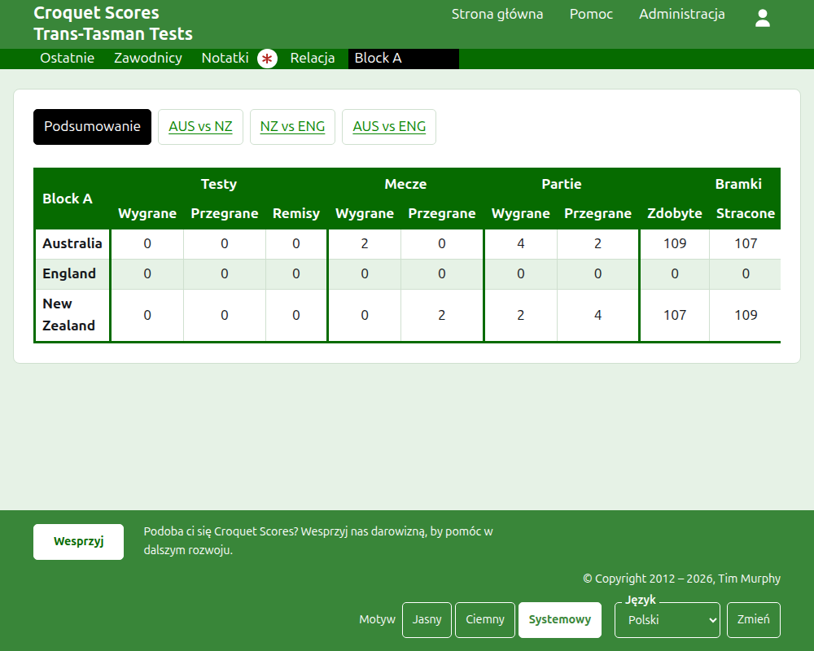
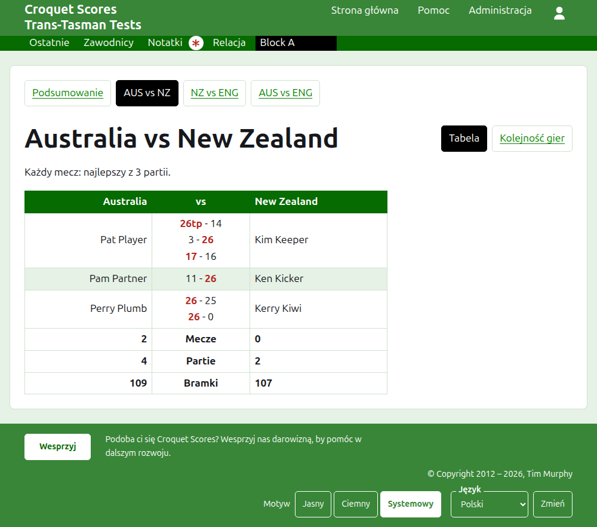
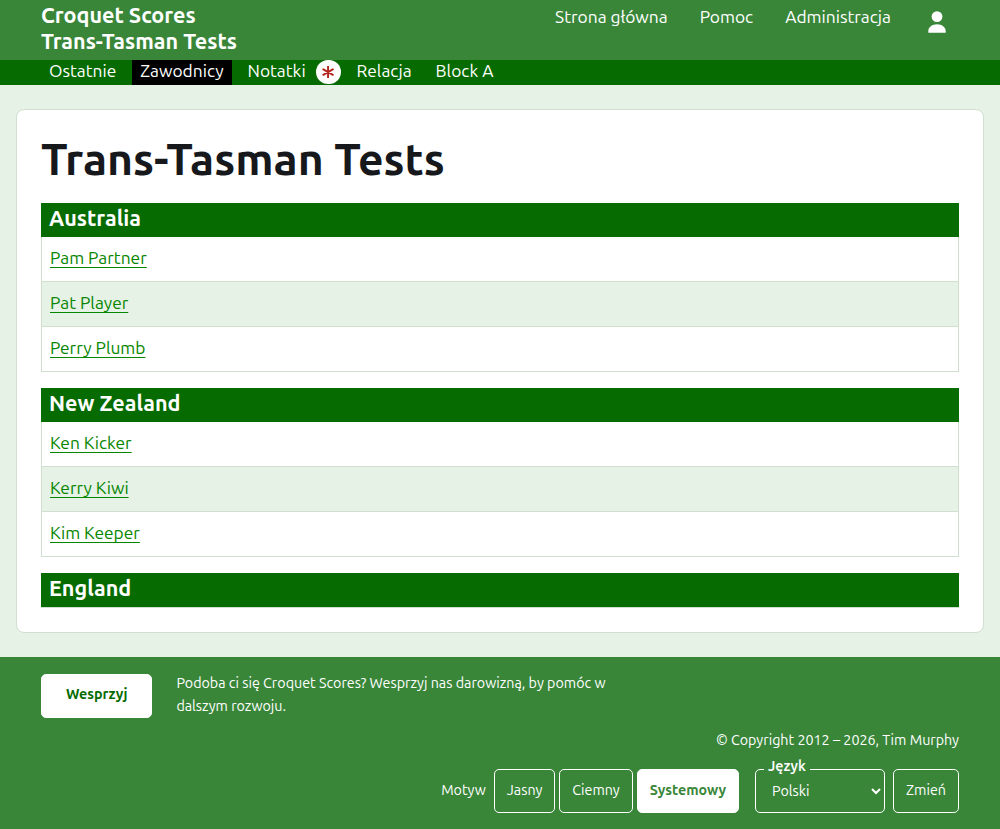

# Co widzą odbiorcy

Nic nie jest publikowane: strony publiczne są rysowane z tego, co przechowuje administracja, więc wprowadzony wynik jest na nich od razu. Nie wymagają konta ani skryptów i są ułożone pod telefon.

## Strona turnieju

Strona turnieju jest pod jego rokiem, dyscypliną i nazwą, jak `/2026/ac/trans-tasman-tests`. Jej nagłówkiem jest nazwa turnieju, a pod nią podtytuł. Wymienia każdą partię w użyciu, od ostatnio dodanej, by czytelnik, który wraca, widział, co wydarzyło się od tego czasu. Każda partia mówi zwycięzcę, jego drużynę i wynik, potem przegranego i jego, razem z testem, w którym rozegrano partię, i tym, jak dawno ją dodano.

Ciemnozielony pasek oferuje sekcje turnieju: **Ostatnie**, czyli tę stronę, **Podsumowanie**, **Zawodnicy**, **Notatki** i **Relacja**, a potem testy. Test jest podany jako skróty nazw jego drużyn z „vs" pomiędzy, jak „AUS vs NZ". Testy w grupie nie są oferowane pojedynczo: grupa jest jedną sekcją, nazwaną tak jak grupa, stojącą tam, gdzie byłby jej pierwszy test. Notatki są oznaczone czerwoną gwiazdką, dopóki jest notatka, której czytelnik nie przeczytał.

## Podsumowanie

Turniej, którego testy nie są w żadnej grupie, ma **Podsumowanie**: jedną tabelę wszystkich drużyn, uszeregowanych, z wygranymi, przegranymi i zremisowanymi testami, wygranymi i przegranymi partiami oraz bramkami zdobytymi, straconymi i bilansem. Gdy mecze któregokolwiek testu są najlepsze z więcej niż jednej partii, wygrane i przegrane mecze idą po testach. Podsumowanie to miejsce, gdzie czytelnik szuka każdej drużyny jako całości.

Turniej z testem w grupie nie ma Podsumowania. Zamiast tego strona każdej grupy pokazuje, jak stoją drużyny tej grupy, bo jedna tabela drużyn z różnych grup, które nigdy ze sobą nie grały, nie szeregowałaby nic.

## Grupa

Strona grupy pokazuje, jak stoją drużyny grupy, licząc tylko testy grupy, w tabeli, której używa podsumowanie. Nad tabelą, w osobnym rzędzie, oferuje **Podsumowanie**, czyli tę stronę, i każdy z testów grupy, prowadzący do strony testu.

## Test

Nagłówkiem strony testu są pełne nazwy jego drużyn, jak „Australia vs New Zealand", a strona mówi, z ilu partii najlepszy jest każdy mecz. Nagłówkiem jej tabeli są dwie drużyny, pierwsza po lewej. Każdy rozegrany mecz to wiersz, w kolejności rozpoczęcia, z zawodnikiem pierwszej drużyny po lewej, zawodnikiem drugiej po prawej i partiami meczu między nimi, każda jako wynik pierwszej strony, a potem drugiej, z oznaczonym zwycięzcą. Pod meczami są partie i bramki każdej drużyny oraz, gdy każdy mecz jest najlepszy z więcej niż jednej partii, jej wygrane mecze, po jej stronie.

Test jest pokazywany na dwa sposoby, oferowane w wierszu z jego nazwą: **Tabela**, czyli ta tabela, i **Kolejność gier**, która wymienia każdą partię testu od najstarszej. Test w grupie oferuje Podsumowanie i testy swojej grupy w rzędzie nad nagłówkiem, z tym testem oznaczonym.

## Zawodnicy

Strona Zawodnicy wymienia zawodników drużyna po drużynie: każda drużyna pod nagłówkiem ze swoją nazwą, w kolejności drużyn turnieju, a jej zawodnicy pod nim w kolejności alfabetycznej.

## Notatki

Strona Notatki wymienia notatki turnieju, od ostatnio napisanej, każda prowadzi do własnej strony i mówi, jak dawno ją napisano. Notatka, której czytelnik nie przeczytał, jest oznaczona czerwoną gwiazdką, dopóki jej nie otworzy.

## Adresy, które się przenoszą

Turniej zachowuje swój adres, gdy poprawia się jego nazwę. Gdy się przenosi, bo zmienił się jego rok albo dyscyplina, jego stary adres prowadzi do nowego, by zachowany wcześniej link nadal działał. Stron zarchiwizowanego turnieju nie można znaleźć, dopóki nie zostanie przywrócony.
