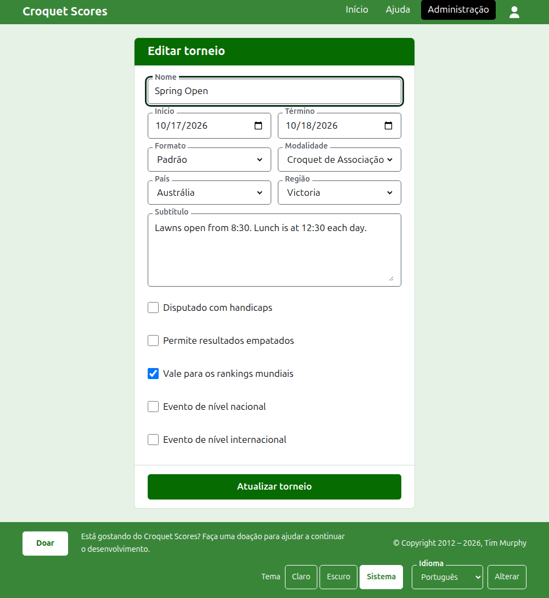
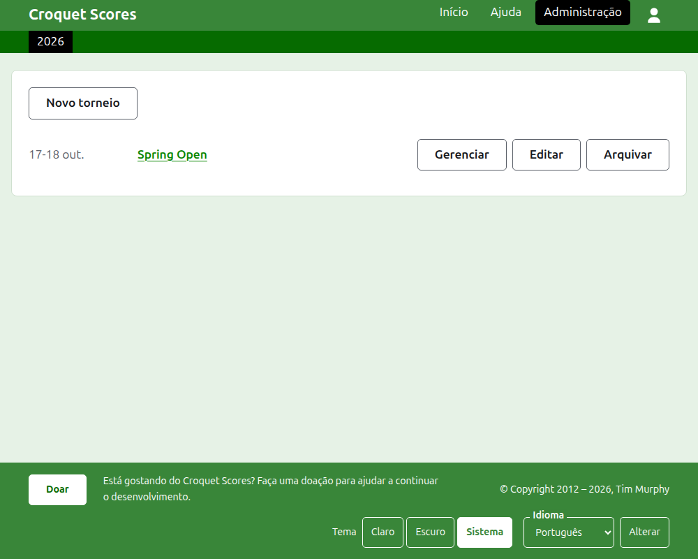
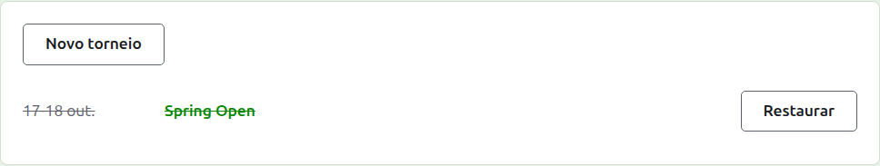

# Alterar, arquivar e restaurar um torneio

## Alterar os detalhes do torneio

Na lista de torneios na administração, pressione **Editar** no torneio. O formulário é o mesmo que o criou, começado como o torneio está. Altere o que está errado e pressione **Atualizar torneio**.

Depois que o torneio tem algum jogador ou competição, contando os arquivados, o seu formato não pode ser mudado para um disputado por equipes, que tem equipes e testes em vez disso.

Um torneio mantém o seu endereço quando o nome é corrigido, para que um link que alguém já enviou continue a encontrá-lo. Ele só muda quando o ano em que começa ou a sua modalidade muda, e então o endereço antigo leva ao novo. Salvar leva você ao torneio onde quer que ele esteja agora.

Só um organizador pode alterar um torneio. Um apontador, ou qualquer outra pessoa, é avisado disso em vez de ver o formulário.

## A lista de torneios

A administração lista um ano de cada vez, começando por este ano, o torneio mais recente primeiro. Os anos em que você tem um torneio são abas na barra verde-escura, o mais recente primeiro; quando há mais do que cabe em um telefone, os mais antigos ficam em uma lista suspensa no fim da linha. O ano está no endereço, então é possível fazer um link para um ano.

## Arquivar um torneio

**Arquivar** em um torneio da lista o põe de lado. Ele continua listado, riscado e depois dos torneios em uso, mas oferece apenas **Restaurar**: a sua página na administração, e as suas páginas públicas, ficam fechadas até que ele seja restaurado. Arquivar não pergunta antes, porque restaurar desfaz.

A seguir: [O que o público vê](what-the-public-sees.md).
