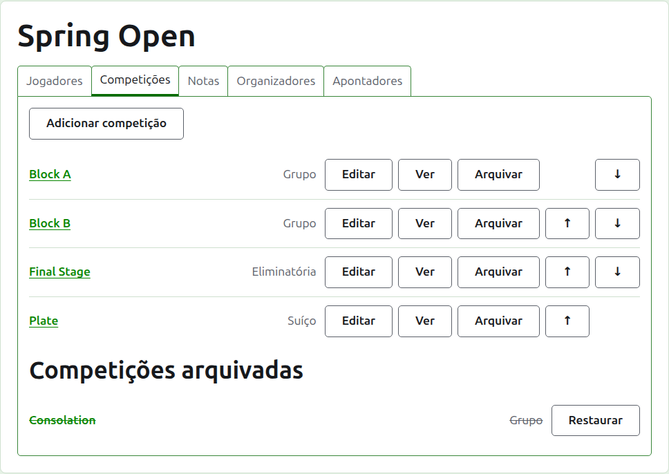
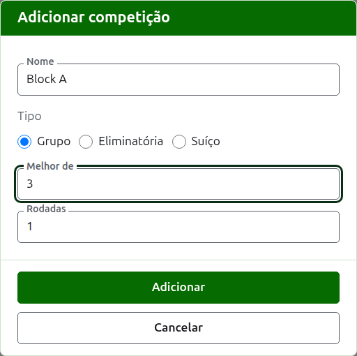
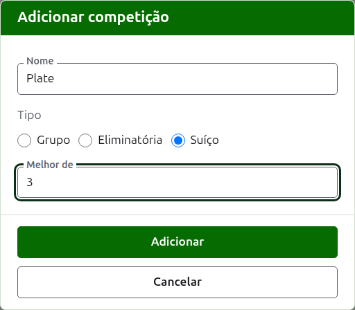
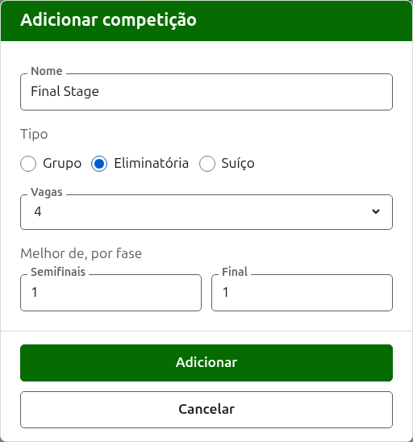

# Competições

A aba **Competições** da página de um torneio é onde as suas competições são adicionadas, colocadas em ordem e postas de lado. Uma competição é um grupo, um mata-mata ou um suíço. Cada uma tem uma página própria, onde os seus jogadores são inscritos e os seus resultados são inseridos.

## Adicionar uma competição

Pressione **Adicionar competição**, acima da lista. Um diálogo abre sobre a página, pedindo o nome da competição, o seu tipo e a forma que esse tipo tem.

**Nome** é o que os jogadores procuram na página do torneio para encontrar os seus jogos. Tem entre 1 e 254 caracteres, e uma letra sozinha basta, porque um grupo costuma ser chamado por uma. Duas competições de um mesmo torneio não podem ter o mesmo nome.

**Tipo** é grupo, mata-mata ou suíço. O diálogo começa em grupo, que é o que a maioria das competições é.

### Um grupo ou um suíço

Um grupo e um suíço perguntam apenas de quantos jogos cada partida é o melhor (**Melhor de**), que começa em 1. Uma melhor de 3 é ganha por quem vence dois jogos. Pode ser um número par, porque em um grupo ou em um suíço um jogador é classificado pelos jogos que ganha, e uma partida de dois jogos dividida um a um é um resultado como qualquer outro.

### Um mata-mata

Um mata-mata pergunta quantas **Vagas** a sua chave tem, e de quantos jogos é cada rodada. As vagas são oferecidas como 2, 4, 8, 16, 32, 64 e 128, porque nenhum outro número poderia ser dividido pela metade rodada a rodada até uma final, e o diálogo começa em 8. As vagas que sobram depois que os jogadores são inscritos são preenchidas com byes, que são adicionados onde os jogadores são.

Uma chave tem tantas rodadas quantas forem necessárias para reduzir as suas vagas pela metade até uma, então uma chave de 8 vagas tem três rodadas. O diálogo pergunta de quantos jogos é cada uma, todas juntas sob **Melhor de, por fase**, na ordem em que são disputadas. As três últimas são chamadas como se fala das rodadas de uma chave, **Quartas**, **Semifinais** e **Final**, e as anteriores pelo número, Rodada 1 primeiro. Escolher mais vagas acrescenta rodadas no início da chave, e escolher menos as tira do início, então o que foi digitado para a final continua sendo da final. Cada rodada é melhor de um número ímpar de jogos, porque a partida de um mata-mata precisa ter um vencedor.

### Como é jogada e contada

Todo tipo pergunta as mesmas três coisas abaixo da sua forma.

**Jogado com handicaps.** Marque para uma competição jogada com handicaps.

**Permite empates.** Marque quando um jogo pode terminar sem que nenhum dos jogadores seja o vencedor. A maioria das competições não permite. Quando está marcado, um resultado inserido com pontos iguais e sem marca é guardado como empate; quando não está, um jogo com pontos iguais precisa dizer quem o ganhou com uma marca depois do resultado do vencedor, como "6w". A partida de um mata-mata sempre tem um vencedor, então um jogo empatado não decide uma.

**Conta para o ranking mundial.** Só é pedido quando pode valer: uma competição de Croquet de Associação ou de Croquet de Golfe que não é jogada com handicaps nem permite empates. Começa marcado, então desmarque-o para uma competição que não deve valer.

### Adicionar várias de uma vez

Pressione **Adicionar**. A competição é adicionada, o diálogo diz isso, e o nome é esvaziado para a próxima, com o tipo e a sua forma deixados como estavam: competições adicionadas juntas são quase sempre parecidas, então "Block B" depois de "Block A" é só o seu nome. Pressione **Cancelar** para fechar o diálogo quando todas estiverem inseridas.

## Alterar uma competição

**Editar** abre o mesmo diálogo na competição, com o título Editar competição, com o seu nome, a sua forma e o modo como é jogada e contada como estão. O tipo não é perguntado, porque um grupo não vira um mata-mata por alteração: uma competição do tipo errado é arquivada e adicionada de novo. Pressione **Salvar** para guardar a alteração e fechar o diálogo.

Um mata-mata que tem um jogo tem jogadores colocados na sua chave, e uma alteração das suas vagas os moveria, então ela é recusada depois que um jogo foi inserido. O melhor de das suas rodadas ainda pode ser alterado.

## Ordem

As competições são listadas na ordem do torneio, que é a ordem em que aparecem nas páginas públicas e na barra verde-escura. **Subir** e **Descer** movem uma competição uma posição.

## Ir a uma competição

O nome de uma competição, ou **Ver**, abre a sua página, onde os seus jogadores são inscritos e os seus resultados são inseridos. A barra verde-escura abaixo do cabeçalho também leva até lá, de qualquer página do torneio.

## Arquivar uma competição

**Arquivar** põe uma competição de lado, tenha ela jogos ou não; eles ficam guardados com ela e voltam quando ela é restaurada. Uma competição arquivada é listada sob **Competições arquivadas**, riscada, oferece apenas **Restaurar**, e não está nas páginas públicas. Arquivar não pergunta antes, porque restaurar desfaz.

A seguir: [Inscrever jogadores em uma competição](entering-players-in-a-competition.md).
