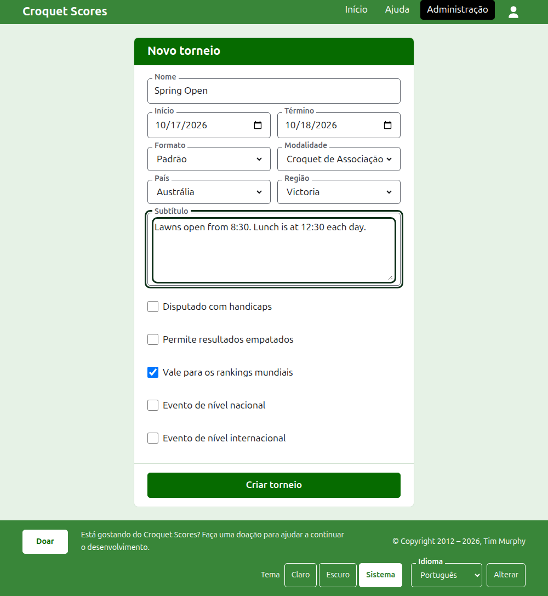

# Criar um torneio

Pressione **Novo torneio**, acima da lista de torneios na administração. Ele fica acima da lista, e não abaixo, para que uma lista longa não o empurre para fora da tela de um telefone.

O formulário pede tudo com que um torneio começa. Um torneio do tipo comum está a um nome, dois dias e um país de distância: todo o resto é decidido por você e pode ser alterado.

## O que o formulário pede

**Nome.** O que os leitores procuram para encontrar o torneio, como "Spring Open". Tem entre 3 e 254 caracteres. Um nome todo em minúsculas, ou todo em maiúsculas, é recusado, porque pareceria um erro em todas as páginas em que aparece. Dois torneios podem ter o mesmo nome, porque o mesmo torneio é disputado todo ano.

**Início** e **Término.** Os dias em que o torneio acontece. Um torneio não pode terminar antes de começar, e não pode começar nem terminar depois do fim do ano que vem. Um torneio pertence ao ano em que começa, que é também o ano no seu endereço, então um torneio que atravessa a passagem de ano é listado no ano em que começa.

**Formato.** Escolha **Padrão** para um torneio disputado entre jogadores. Os outros formatos são para torneios disputados entre equipes, que têm um guia próprio.

**Modalidade.** As modalidades que o site oferece, na sua ordem: Croquet de Associação, Golf Croquet, Croquet Americano de 6 Arcos e Ricochet no Croquet Scores. O Gateball Scores não pede modalidade nem formato, porque todo torneio lá é um torneio padrão de gateball.

**País** e **Região.** Onde o torneio é disputado. A região só é pedida quando o país escolhido é dividido em regiões, como os estados da Austrália; um país que é a sua própria e única região não pede nenhuma. A região não precisa ser escolhida mesmo quando é oferecida.

**Subtítulo.** Tudo o que você quer que os leitores saibam e não tem um campo próprio: onde estacionar, a que hora é o almoço, para quem telefonar. É mostrado abaixo do nome do torneio em todas as páginas públicas. É escrito em Markdown, então uma palavra fica em negrito com asteriscos em volta e uma lista se faz com um traço no início de cada linha. Pode ter até 2000 caracteres, e pode ficar vazio.

**Disputado com handicaps.** Marque para um torneio com handicaps.

**Permite resultados empatados.** Marque quando um jogo pode terminar sem que nenhum dos jogadores seja o vencedor. A maioria dos torneios não permite. Quando está marcado, um placar inserido com pontos iguais e sem marca é guardado como empate; quando não está, um jogo com pontos iguais precisa dizer quem o ganhou com uma marca depois do placar do vencedor, como "6w".

**Vale para os rankings mundiais.** Só é pedido quando pode valer: um torneio de Croquet de Associação ou de Golf Croquet que não é disputado com handicaps nem permite resultados empatados. Começa marcado, então desmarque-o para um torneio que não deve valer.

**Evento de nível nacional** e **Evento de nível internacional.** Um torneio pode ser um, o outro, ou nenhum, mas nunca os dois: marcar um desmarca o outro.

## Criar o torneio

Pressione **Criar torneio**. Você é levado à página do torneio na administração, de onde ele é administrado, e passa a ser o seu primeiro organizador. Ele é listado na administração sob o ano em que começa.

O endereço público do torneio é formado pelo seu ano, a sua modalidade e o seu nome, como `/2026/ac/spring-open`. Ele mantém esse endereço quando o nome é corrigido mais tarde, para que um link já enviado continue a encontrá-lo; ele só muda quando o ano em que começa, ou a modalidade, muda.

## Se algo for recusado

O que é recusado é dito abaixo do campo a que se refere, e o que você digitou continua digitado. Nada é guardado até que todos os campos sejam aceitos. As coisas recusadas com mais frequência são um nome digitado todo em minúsculas, um término antes do início e um país não escolhido.

A seguir: [Jogadores](players.md).
