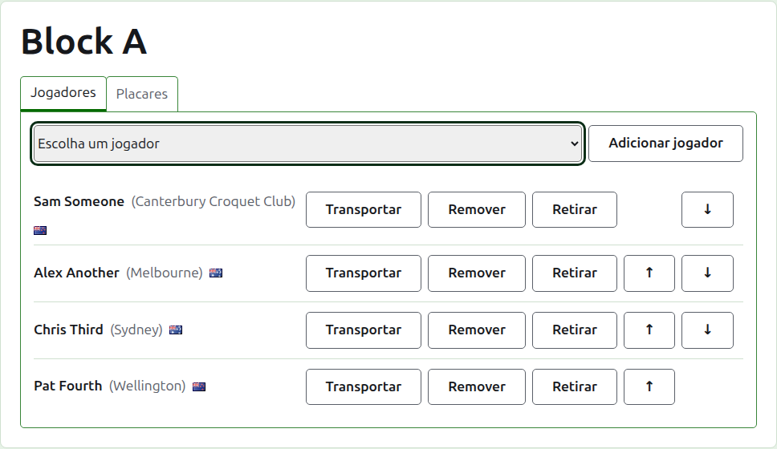
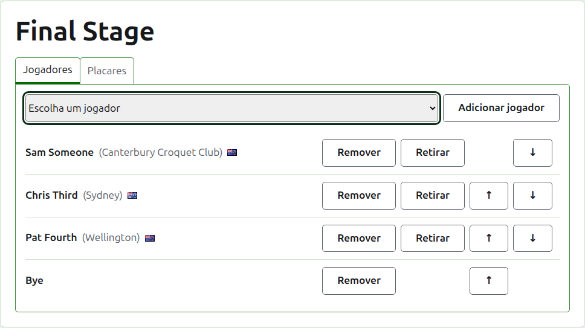
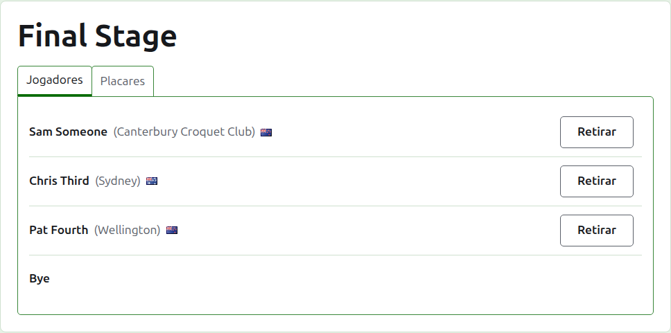
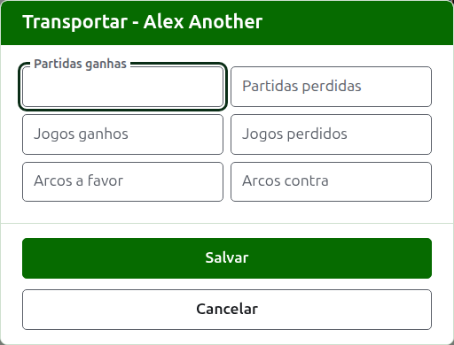
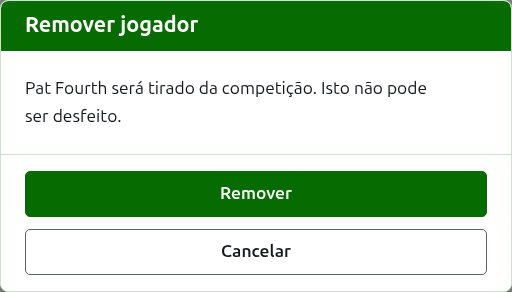
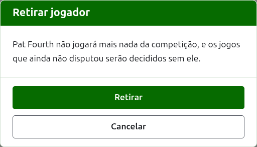
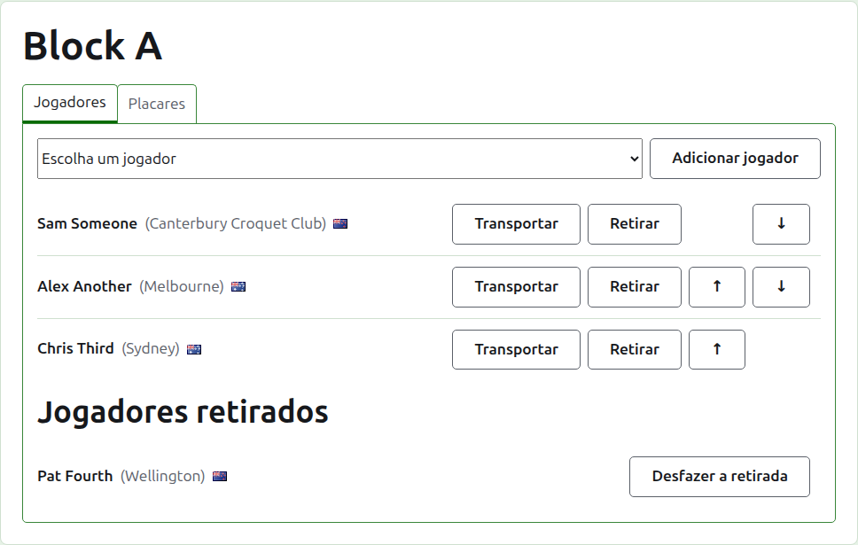

# Inscrever jogadores em uma competição

A página de uma competição é aberta pelo seu nome na aba Competições, ou pela barra verde-escura. Tem como cabeçalho o nome da competição, com duas abas abaixo: **Jogadores** e **Resultados**. Abre em Jogadores, porque os jogadores são inscritos antes que algo seja disputado.

Um jogador de uma competição é um dos jogadores do torneio, então os jogadores são inscritos escolhendo-os, e não digitando-os. Tudo sobre eles, exceto a sua posição na competição e o que transferem para ela, é alterado na aba Jogadores do torneio.

## Adicionar um jogador

Acima da lista, uma lista suspensa oferece todos os jogadores do torneio que ainda não estão na competição, na ordem do torneio. Escolha um e pressione **Adicionar jogador**. O jogador é colocado na ordem do torneio entre os já inscritos, a lista suspensa deixa de oferecê-lo, e o cursor volta à lista suspensa para que o próximo possa ser escolhido pelo teclado. Quando todos os jogadores do torneio estão na competição, a lista suspensa não é mostrada e a aba diz isso.

Os jogadores arquivados do torneio não são oferecidos.

## Byes em um mata-mata {#byes-in-a-knockout}

Um mata-mata só é disputada depois que todas as vagas da sua chave estão preenchidas, e as vagas que os jogadores deixam sobrar são preenchidas com byes. Por isso, em um mata-mata a lista suspensa oferece **Bye** primeiro, antes dos jogadores, e continua a oferecê-lo por mais byes que sejam adicionados, porque uma chave pode precisar de vários.

Um bye é colocado na chave como um jogador: pode ser subido, descido e removido, mas não pode ser retirado, porque não joga nada. Um jogador inscrito em um mata-mata cujas vagas estão todas preenchidas é recusado, e a aba diz isso abaixo da lista suspensa.

A ordem dos jogadores de um mata-mata é a sua chave. As duas primeiras vagas se enfrentam na primeira partida, as duas seguintes na seguinte, e assim por diante. Coloque os jogadores na ordem em que a chave será disputada antes que algum resultado seja inserido, porque depois que o mata-mata tem um jogo em uso os seus jogadores ficam fixos: ninguém pode ser adicionado, removido ou movido. Um jogador ainda pode ser retirado.

## Ordem

Os jogadores são listados na ordem da competição, que é a ordem em que um mata-mata é sorteada e em que um grupo é listado na sua página pública. **Subir** e **Descer** movem um jogador uma posição.

## Transferir {#carry-forward}

**Transferir** diz o que um jogador traz para uma competição de jogos cujo resultado não foi registrado nela: os resultados de uma fase anterior, ou de jogos disputados antes de a competição ter os seus resultados registrados aqui. É oferecido em um grupo e em um suíço, que têm uma classificação em que isso conta, e não em um mata-mata.

O diálogo pede seis contagens: partidas ganhas e perdidas, jogos ganhos e perdidos, e arcos a favor e contra. Todas são opcionais. Uma contagem deixada vazia não transfere nada, o que não é o mesmo que transportar 0, para que quem a alterar depois a veja como foi deixada. Pressione **Salvar** para guardar as seis.

## Remover um jogador {#removing-a-player}

**Remover** tira um jogador inscrito por engano. Ele continua sendo um dos jogadores do torneio, e volta a ser oferecido na lista suspensa, mas nada da sua posição na competição é guardado, então Remover pergunta antes.

Um jogador que tem algum jogo em uso na competição não pode ser removido, porque os jogos passariam a ser contra alguém que não está mais lá, e não recebe Remover. Um jogador cujos únicos jogos estão arquivados pode ser, e os seus resultados arquivados vão com ele.

## Retirar um jogador {#withdrawing-a-player}

**Retirar** é para um jogador que não jogará mais nada da competição. Ele continua nela, com os jogos que disputou, e é listado sob **Jogadores que desistiram**, depois dos que continuam jogando. Em um mata-mata, o seu adversário em uma partida ainda não decidida avança.

Retirar pergunta antes, porque muda o desfecho da competição: os jogos que o jogador não disputou são decididos sem ele.

Um jogador retirado oferece apenas **Recolocar**, que o põe de volta entre os que jogam, depois dos que ficaram, sem perguntar.

A seguir: [Resultados](scores.md).
