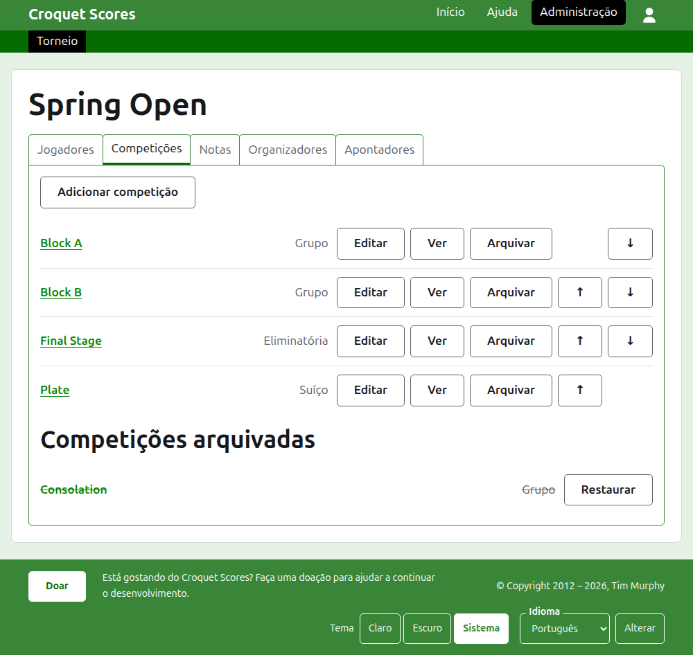

# Administrar um torneio padrão

Um torneio padrão é um torneio disputado entre jogadores inscritos um a um: um fim de semana de clube, um aberto, um campeonato. Os seus jogadores são inscritos em grupos, eliminatórias e suíços, e os seus placares são publicados conforme os jogos são disputados. Este guia leva um organizador desde entrar no site até um torneio cujos resultados estão à disposição do público.

Ele é completo em si mesmo. Nada nele depende do guia de um torneio disputado por equipes, que é escrito à parte.

## Antes de começar

Você precisa de uma conta. Clique [aqui](/account/register) para registrar uma conta.

Tudo o que um organizador faz é feito na seção de administração do site. As páginas públicas, onde jogadores e espectadores acompanham o torneio, são geradas a partir do que a administração guarda, então nada precisa ser publicado: um placar inserido aparece nas páginas públicas na mesma hora.

## As páginas em ordem

1. [Criar um torneio](creating-a-tournament.md): o seu nome, os seus dias, a sua modalidade, onde é disputado e para o que ele vale.
2. [Jogadores](players.md): inscrever os jogadores do torneio, corrigi-los e pôr de lado os que foram inscritos por engano.
3. [Competições](competitions.md): adicionar grupos, eliminatórias e suíços, e colocá-los em ordem.
4. [Inscrever jogadores em uma competição](entering-players-in-a-competition.md): quem joga em cada competição, byes em uma eliminatória, transportes, remoção e retirada.
5. [Placares](scores.md): inserir resultados, corrigi-los e pôr de lado os que foram inseridos por engano.
6. [Notas](notes.md): dizer aos jogadores o que eles precisam saber enquanto o torneio acontece.
7. [Organizadores e apontadores](managers-and-scorers.md): compartilhar a administração do torneio, e deixar que alguém insira placares sem poder alterar mais nada.
8. [Alterar, arquivar e restaurar um torneio](changing-and-archiving.md): corrigir os detalhes do torneio, e pôr um torneio de lado.
9. [O que o público vê](what-the-public-sees.md): as páginas que os seus jogadores acompanham, e como o que você insere aparece nelas.

## Como a administração é organizada

A porta de entrada da administração lista os torneios de que você participa, um ano de cada vez.

Pressionar o nome de um torneio, ou **Gerenciar**, abre a sua página. Tudo o que há para administrar está em cinco abas abaixo do nome: **Jogadores**, **Competições**, **Notas**, **Organizadores** e **Apontadores**. A página abre em Jogadores, porque os jogadores são a primeira coisa a inserir.

A barra verde-escura abaixo do cabeçalho serve para ir de uma página a outra. Ela leva ao torneio, como **Torneio**, e a cada uma das suas competições pelo nome, para que você possa ir do torneio a uma competição e de uma competição a outra sem voltar pela aba Competições. A página em que você está é marcada em preto.

## O que vale em todo lugar

**Nada é excluído de vez, a não ser uma nota.** Jogadores, competições, placares e o próprio torneio são arquivados em vez de excluídos: postos de lado, riscados e listados sob um título próprio, com **Restaurar** para trazê-los de volta. Arquivar, restaurar e subir ou descer nunca pedem confirmação, porque cada um é desfeito pressionando o contrário. As coisas que não podem ser desfeitas, como remover um jogador de uma competição ou excluir uma nota, perguntam antes.

**Um diálogo sobre a página não guarda nada até que você pressione o seu botão.** Cancelar, ou a tecla Escape, fecha-o e deixa tudo como estava. Os diálogos que adicionam coisas, como Adicionar jogador e Adicionar placar, continuam abertos depois de cada adição, para que uma lista possa ser digitada de uma vez, um item após o outro.

**O que é recusado é dito ao lado do campo a que se refere.** Nada do que é recusado é guardado, e o que você digitou continua digitado, para que possa ser corrigido em vez de digitado de novo.

**A administração funciona em um telefone.** Todo botão é grande o bastante para ser pressionado com o polegar, e nada é mais largo do que a tela.

A seguir: [Criar um torneio](creating-a-tournament.md).
