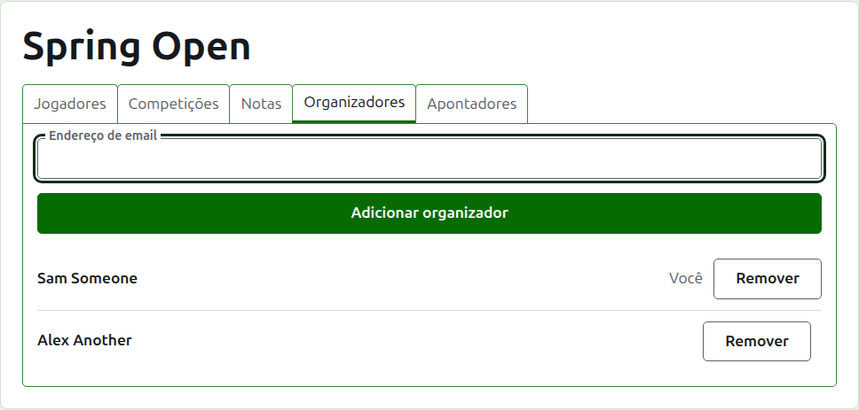
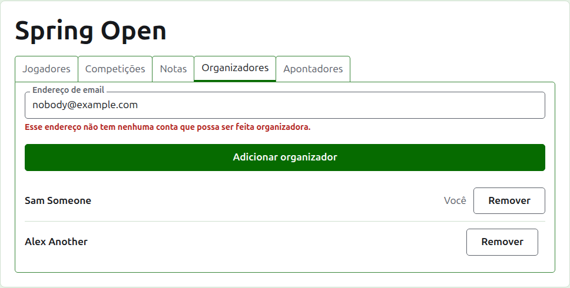
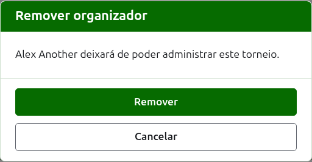
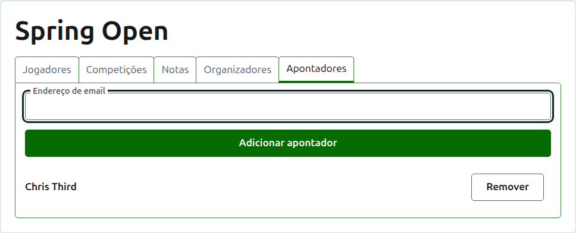
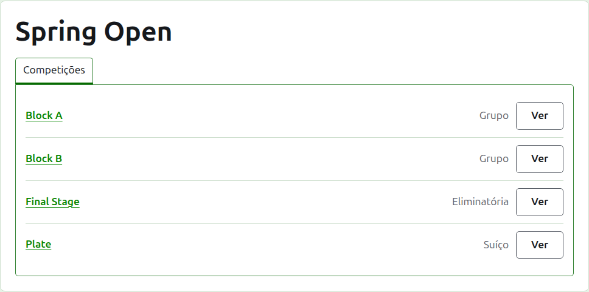

# Organizadores e anotadores

Um torneio tem organizadores, que podem fazer tudo o que pode ser feito nele, e pode ter anotadores, que inserem os seus resultados e nada mais. Quem criou o torneio é o seu primeiro organizador.

## Organizadores {#managers}

A aba **Organizadores** lista quem administra o torneio, na ordem em que foram tornados organizadores, com o seu próprio nome marcado como seu. É onde um torneio é compartilhado, ou passado adiante.

Alguém é tornado organizador pelo seu endereço de e-mail. Digite-o no campo acima da lista e pressione **Adicionar organizador**. O endereço precisa pertencer a uma conta cadastrada e confirmada; um endereço que não tem nenhuma é recusado abaixo do campo, e o site não diz mais do que isso sobre ele. Um anotador tornado organizador deixa de ser anotador.

**Remover** tira um organizador. Nada de um organizador removido é guardado, então Remover pergunta antes; se quiserem a pessoa de volta, ela é tornada organizadora de novo pelo seu endereço. Um torneio sempre tem um organizador, então o último não recebe Remover.

Você pode tirar a si mesmo. A pergunta então diz o que isso significa: você perde o seu próprio caminho de volta ao torneio, e ninguém na página pode desfazer isso por você. Outro organizador pode torná-lo organizador de novo.

## Anotadores {#scorers}

A aba **Anotadores** é a aba Organizadores para anotadores, e funciona do mesmo jeito: um endereço de e-mail e **Adicionar anotador** acima da lista, e **Remover** em cada um.

Um anotador vê o torneio na sua própria lista na administração, com **Resultados** no lugar de Gerenciar, e só recebe as suas competições: nada de jogadores, notas, organizadores, anotadores ou rankings. Na página de uma competição ele vê apenas a aba Resultados, onde pode inserir, corrigir, arquivar e restaurar resultados como um organizador. Quem joga em uma competição é coisa que cabe aos organizadores dizer.

Um organizador não é tornado anotador, porque um organizador já pode fazer tudo o que um anotador pode. Um torneio não precisa de anotador, então todos os anotadores podem ser removidos, inclusive o último.

A seguir: [Rankings](rankings.md).
