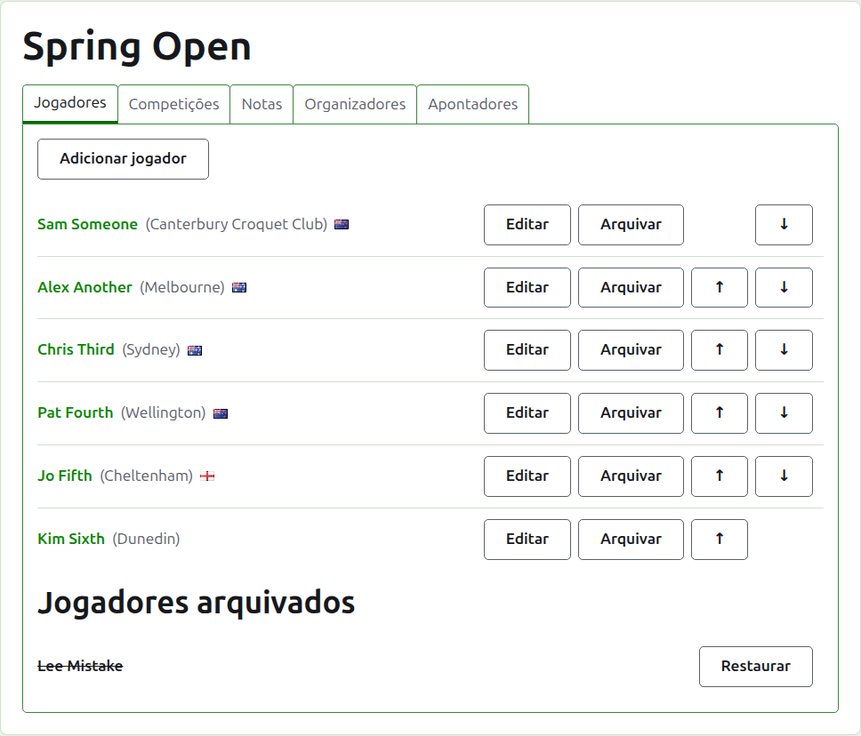
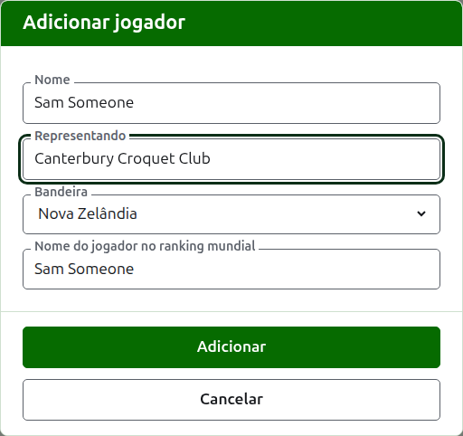
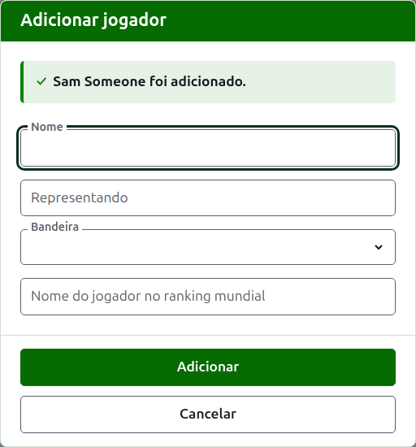
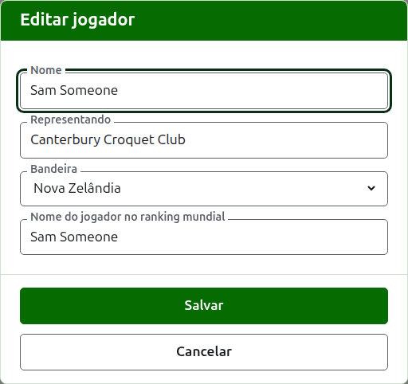
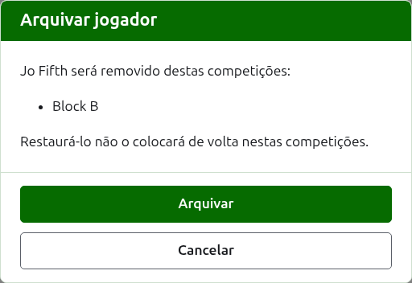

# Jogadores

A aba **Jogadores** da página de um torneio é onde os seus jogadores são inscritos, corrigidos, colocados em ordem e postos de lado. É a aba em que a página abre, porque inscrever os jogadores é a primeira coisa que se faz em um torneio.

Os jogadores são inscritos aqui uma vez, no torneio. Em que competições cada um joga é escolhido depois, na página de cada competição, entre os jogadores inscritos aqui. Veja [Inscrever jogadores em uma competição](entering-players-in-a-competition.md).

## Adicionar jogadores

Pressione **Adicionar jogador**, acima da lista. Um diálogo abre sobre a página.

**Nome** é obrigatório. É o nome do jogador como será mostrado em todas as páginas, entre 3 e 254 caracteres. Dois jogadores de um mesmo torneio não podem ter o mesmo nome, sejam quais forem as maiúsculas; quando dois jogadores realmente têm o mesmo nome, distinga-os no próprio nome, como "Andrew Hobbs (2)".

**Representando** é aquilo por que o jogador joga, escrito como um leitor o diria: um clube, uma região ou um país, como "Canterbury Croquet Club". É mostrado entre parênteses depois do nome. Pode ficar vazio.

**Bandeira** é a bandeira mostrada ao lado do nome do jogador. Pode ficar como nenhuma, como está para a maioria dos jogadores. O que um jogador representa e que bandeira ele leva são coisas separadas, porque um jogador pode jogar por um clube de um país e levar a bandeira de outro.

**Nome do jogador no ranking mundial** é o nome pelo qual os rankings mundiais conhecem o jogador. Só é pedido em um torneio de Croquet de Associação ou de Golf Croquet, as duas modalidades cujos jogadores os rankings mundiais mantêm em uma lista. Os jogadores do Croquet Americano de 6 Arcos são conhecidos nos rankings pelo próprio nome, então ele não é pedido ali, e o nome no ranking mundial de cada jogador é sempre o seu nome. Enquanto você adiciona um jogador, ele acompanha o nome conforme você digita, porque a maioria dos jogadores é conhecida nos rankings pelo próprio nome, e para de acompanhar quando você digita nele. Deixado vazio, é guardado como o nome do jogador.

Conforme você digita um nome, são oferecidos os jogadores que os rankings mundiais conhecem cujos nomes começam daquele jeito, para que você possa tomar o nome como os rankings o escrevem em vez de digitá-lo por inteiro. Ao lado do nome no ranking mundial, uma marca de certo diz que os rankings conhecem o nome, e um ponto de interrogação diz que não: o nome pode estar escrito errado, ou o jogador pode ser novo nos rankings. É só um aviso. Um nome que os rankings não conhecem é guardado tão prontamente quanto um que conhecem.

Pressione **Adicionar**. O jogador é adicionado, o diálogo diz isso, e os seus campos são esvaziados para o próximo jogador, com o cursor de volta no nome. Adicione a lista inteira desse jeito e depois pressione **Cancelar** para fechar o diálogo. Cancelar não guarda nada que ainda não tenha sido adicionado.

Um jogador nunca se chama "Bye". Os byes de uma eliminatória são adicionados na própria eliminatória, onde os seus jogadores são inscritos, então um nome cuja primeira palavra é a palavra inglesa "bye" é recusado, e o diálogo explica por quê.

## Corrigir um jogador

Pressione o nome de um jogador, ou o seu **Editar**, para abrir o mesmo diálogo nesse jogador, com o título Editar jogador. Altere o que está errado e pressione **Salvar**, que guarda a alteração e fecha o diálogo. Um jogador cujo nome é corrigido mantém o nome no ranking mundial que tinha, porque os rankings continuam a conhecê-lo por ele. No Croquet Americano de 6 Arcos o nome de um jogador no ranking mundial é sempre o seu nome, então corrigir o nome o corrige também.

Um jogador corrigido aqui é corrigido em todo lugar: em todas as competições em que está, e em todas as páginas públicas.

## Colocar os jogadores em ordem

Os jogadores são listados na ordem do torneio, que é a ordem em que são oferecidos quando são inscritos nas competições, e a ordem em que uma eliminatória é sorteada. **Subir** e **Descer**, as setas no fim de cada linha, movem um jogador uma posição. O primeiro jogador não recebe Subir, e o último não recebe Descer.

## Arquivar um jogador

**Arquivar** põe um jogador de lado: inscrito por engano, ou retirado do torneio inteiro. Um jogador arquivado é listado sob **Jogadores arquivados**, riscado, depois dos jogadores em uso, e oferece apenas **Restaurar**. Um jogador arquivado não está em nenhuma competição e não aparece em nenhuma página pública.

Um jogador que já disputou algum jogo não pode ser arquivado, porque os jogos passariam a ser contra alguém que não está mais lá, então esse jogador não recebe Arquivar. Um jogador cujos únicos jogos estão arquivados pode ser.

Arquivar um jogador que não está em nenhuma competição não pergunta antes, porque restaurá-lo põe tudo de volta no lugar. Arquivar um jogador que está em alguma competição pergunta antes, porque arquivar o remove de todas as competições em que está, e restaurá-lo não o põe de volta nelas.

A seguir: [Competições](competitions.md).
