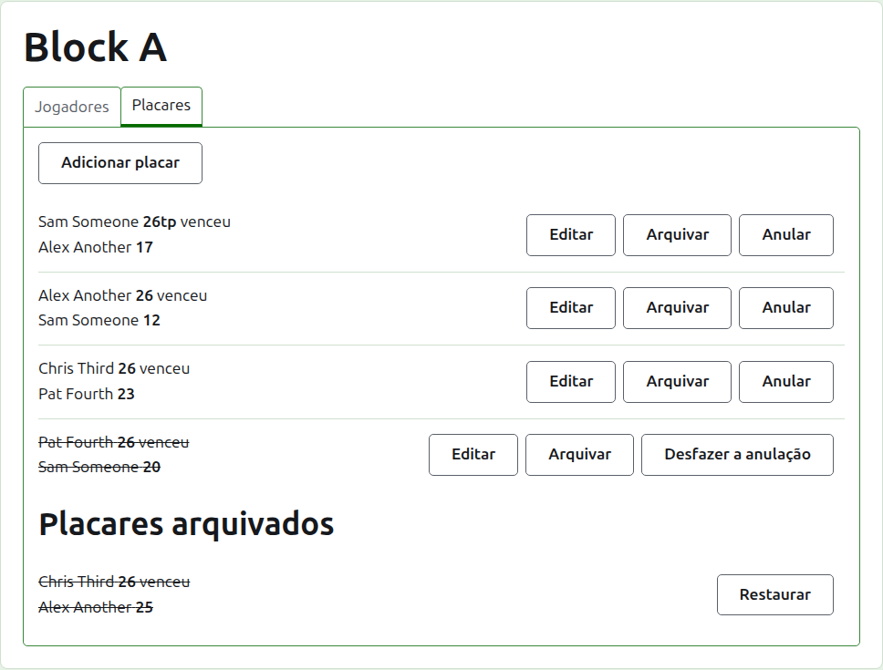
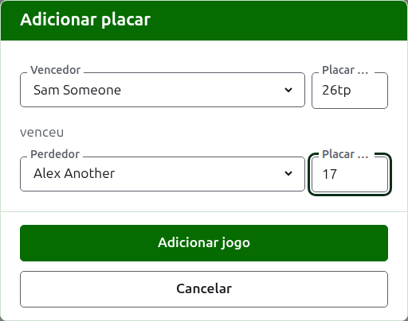
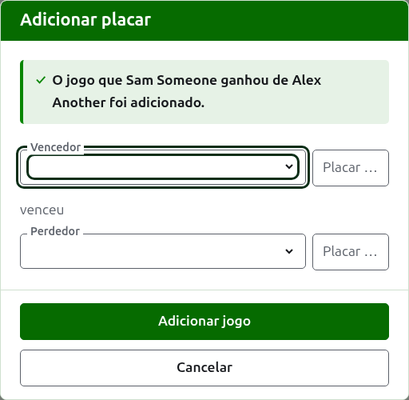
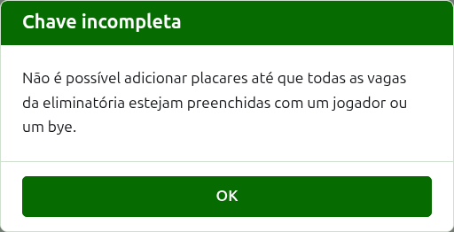
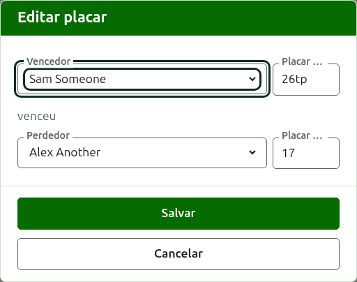

# Resultados

A aba **Resultados** da página de uma competição é onde os seus jogos são inseridos, corrigidos e postos de lado. Um anotador vê apenas esta aba, e pode fazer nela tudo o que um organizador pode.

## Inserir um resultado {#entering-a-score}

Pressione **Adicionar resultado**, acima da lista. O diálogo se lê como um resultado se diz em voz alta: o vencedor e o seu resultado, depois "venceu", depois o perdedor e o seu resultado.

O vencedor e o perdedor são escolhidos, cada um, entre os jogadores da competição que estão jogando, na ordem da competição. Ninguém vem escolhido de início, para que um jogo nunca seja registrado contra um jogador que você não escolheu. Em um mata-mata, escolher o vencedor escolhe como perdedor quem está sorteado para enfrentá-lo, onde você pode ver e escolher outro.

Um resultado é digitado como o anotador o anotou: o seu número de pontos e o que vier depois, que é guardado e mostrado como foi digitado, como "26tp" para 26 arcos e um triple peel. O número são os dígitos com que o resultado começa; um resultado que não começa com um dígito é recusado.

Um jogo ganho com pontos iguais, como quando é interrompido pelo tempo e decidido de outra forma, diz quem o ganhou com uma marca depois do resultado do vencedor: "6w" venceu "6". No Croquet Scores as marcas são "w", "won" e "winner"; o Gateball Scores aceita também "cb" e "so". O resultado do vencedor precisa ser maior que o do perdedor, ou marcado, a menos que o torneio permita resultados empatados, caso em que pontos iguais sem marca são guardados como empate.

Pressione **Adicionar jogo**. O jogo é adicionado, o diálogo diz qual, e os campos são esvaziados para o próximo, porque os resultados chegam em lote, lidos de um quadro no fim de uma rodada. Pressione **Cancelar** quando todos estiverem inseridos.

O que é recusado é dito abaixo do campo a que se refere: um vencedor ou perdedor não escolhido, um resultado não digitado ou que não começa com um dígito, o mesmo jogador nos dois lados, um resultado de perdedor marcado como ganho, ou um resultado de vencedor menor que o do perdedor. Em um mata-mata, dois jogadores que não estão sorteados para se enfrentar são recusados acima dos campos.

## A chave de um mata-mata precisa estar preenchida antes {#draw-filled-first}

Um mata-mata só é disputada depois que todas as vagas da sua chave têm um jogador ou um bye. Até então, Adicionar resultado explica por que não é possível adicionar resultados, em vez de abrir o diálogo.

## A lista de resultados

Os resultados em uso são listados na ordem em que foram inseridos, o mais antigo primeiro, para que a lista se leia como a competição foi disputada. Cada um diz o vencedor e o seu resultado, depois o perdedor e o dele, e oferece **Editar** e **Arquivar**.

## Corrigir um resultado {#correcting-a-score}

**Editar** abre o mesmo diálogo nesse resultado, com o título Editar resultado, com os seus jogadores escolhidos e os seus resultados como foram digitados. Pressione **Salvar** para guardar a correção e fechar o diálogo.

Uma correção mantém o resultado: um jogo ganho continua ganho, e um jogo empatado continua empatado. Um jogo cujo resultado estava errado é arquivado e inserido de novo.

Quando um resultado poderia ser arquivado, os seus jogadores podem ser alterados, além dos resultados. Em um mata-mata, um resultado cujo vencedor já jogou na rodada seguinte mantém os seus jogadores, porque mudar quem o ganhou deixaria o jogo seguinte disputado por alguém que não tinha chegado lá; só os seus resultados podem ser corrigidos.

## Arquivar um resultado

**Arquivar** põe um resultado de lado para que ele não conte para nada. Ele é listado sob **Resultados arquivados**, riscado, e oferece apenas **Restaurar**. Nenhum dos dois pergunta antes, porque cada um desfaz o outro.

Em um mata-mata, o vencedor de uma partida avança para a rodada seguinte, então o resultado de uma partida cujo vencedor já jogou na rodada seguinte não recebe Arquivar. O jogo da rodada seguinte é arquivado primeiro, e então os anteriores podem ser. Quando uma rodada é melhor de 3 ou de 5, todos os jogos da partida são tratados do mesmo jeito. Um grupo e um suíço não têm rodadas que dependam umas das outras, então todos os resultados deles podem ser arquivados.

## Anular um resultado

Um jogador que deixa uma competição costuma ser retirado dela, na aba Jogadores, e isso é tudo o que é preciso: ele não joga mais, e os jogos que disputou permanecem, mas deixam de contar para vitórias/derrotas e arcos. Anular um resultado é para o caso mais raro em que um jogo que foi disputado não deve contar. No President's Eights australiano, por exemplo, os resultados da primeira rodada permanecem quando um jogador se retira, e só os seus jogos da segunda rodada são tirados da conta: anule esses jogos.

Em um grupo ou em um suíço, um resultado que foi disputado mas não deve contar é anulado em vez de arquivado. **Anular** o mantém entre os resultados em uso, na sua posição, mas riscado e sem contar para nada nas páginas públicas. **Desfazer anulação** faz com que ele volte a contar. Nenhum dos dois pergunta antes. Os resultados de um mata-mata não recebem Anular, porque lá um resultado decide mais do que a classificação.

A seguir: [Notas](notes.md).
