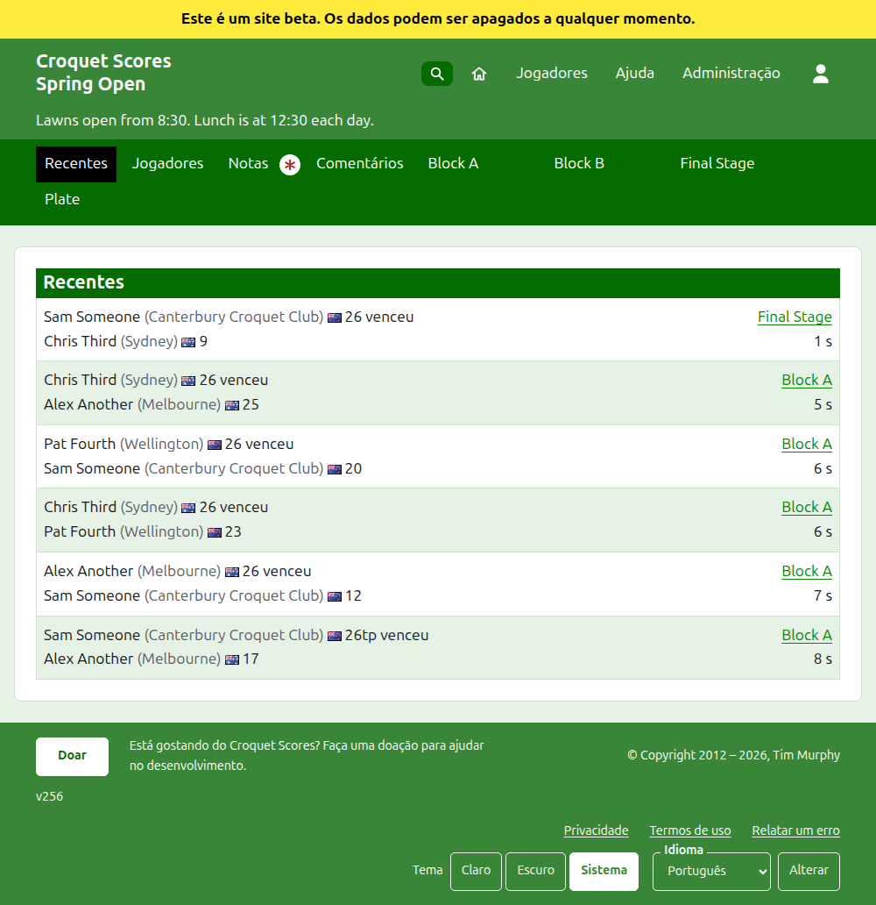
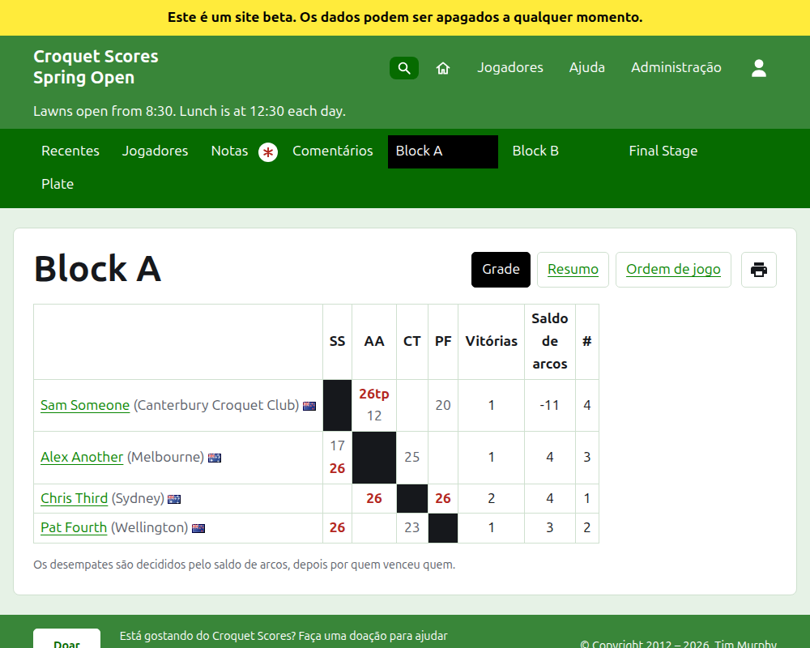
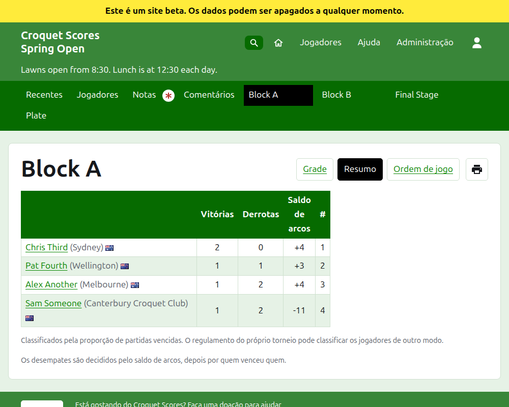
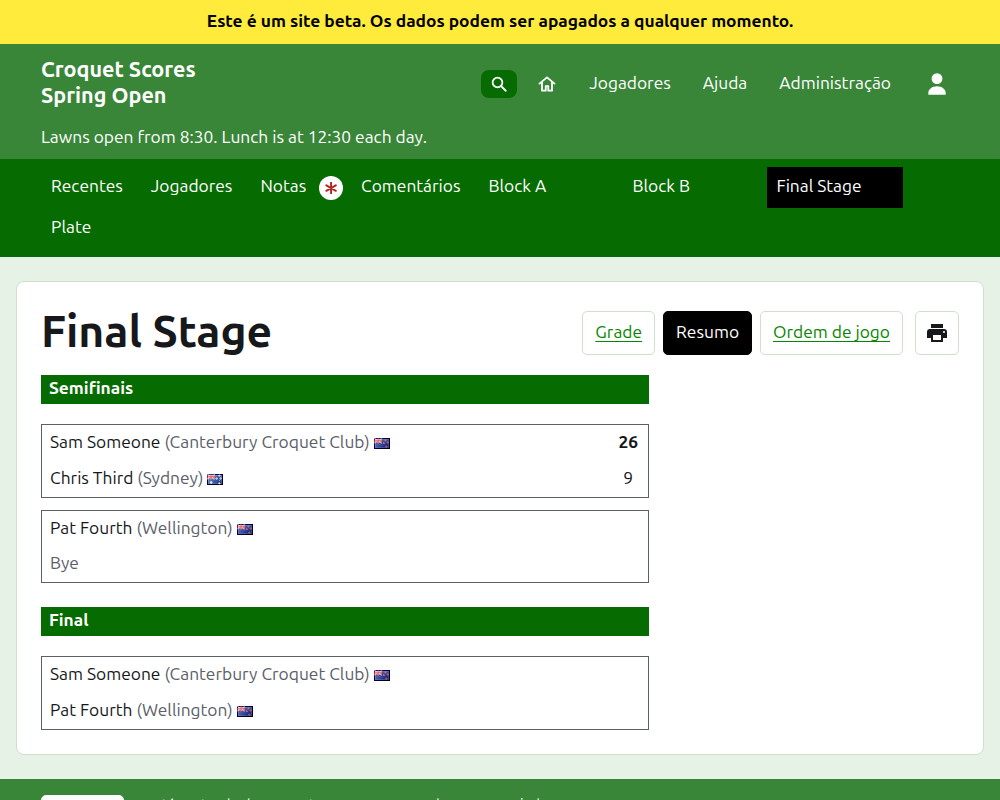
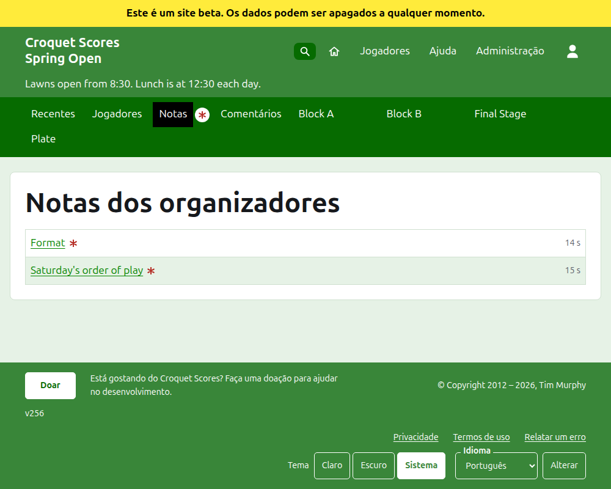

# O que o público vê

Nada é publicado: as páginas públicas são geradas a partir do que a administração guarda, então um resultado inserido aparece nelas na mesma hora. Elas não precisam de conta nem de scripts, e são feitas para um telefone.

## A página do torneio

A página do torneio fica no seu ano, no seu esporte e no seu nome, como `/2026/ac/spring-open`. Tem como cabeçalho o nome do torneio, com o subtítulo abaixo. Lista todos os jogos em uso, o adicionado mais recentemente primeiro, para que um leitor que volta veja o que aconteceu desde então. Cada jogo diz o vencedor, o seu handicap e o que ele representa, a sua bandeira e o seu resultado, depois o perdedor e o dele, com a competição em que foi disputado e há quanto tempo foi adicionado.

A barra verde-escura oferece as seções do torneio: **Recentes**, que é esta página, **Jogadores**, **Notas** e **Comentários**, e depois cada competição em uso, na ordem em que a aba Competições as tem. Notas é marcada com um asterisco vermelho enquanto há uma nota que o leitor não leu.

## Um grupo

A página de um grupo mostra os seus resultados como uma grade: uma linha e uma coluna para cada jogador, na ordem do grupo, com os jogos entre dois jogadores onde a linha encontra a coluna, cada um marcado como vitória, derrota ou empate para o jogador da linha. Depois das colunas dos jogadores vêm os totais de cada jogador. Quando cada partida é um único jogo, são vitórias e saldo de arcos; quando uma partida é melhor de mais de um, são partidas, saldo de jogos, jogos e saldo de arcos. A última coluna, com o título **#**, é a posição de cada jogador: 1 para o primeiro, e =2 quando jogadores não podem ser desempatados e dividem o segundo lugar. Quando jogadores venceram a mesma proporção das suas partidas, uma linha abaixo da grade diz como são desempatados, conforme o critério de desempate do grupo (veja Competições).

Um grupo, um mata-mata e um suíço são mostrados cada um de três formas, oferecidas na linha do nome da competição: **Grade**, **Resumo** e **Ordem de jogo**. Ao lado delas há um botão de impressora, que imprime o nome do torneio, o nome da competição e os seus resultados, e nada mais. O resumo é a forma para um telefone: para um grupo, os jogadores classificados, com as suas vitórias, derrotas, saldo de arcos e posição; para um mata-mata, as partidas listadas rodada por rodada; para um suíço, a tabela da grade sem os seus resultados. A ordem de jogo lista todos os jogos, do mais antigo para o mais novo no começo. Ela tem os títulos **Jogo** e **Data**: apertar **Jogo** ordena os jogos pelo nome do vencedor e depois pelo do perdedor, e apertar **Data** os ordena do mais antigo ou do mais novo primeiro, e apertar o título pelo qual uma lista está ordenada inverte a ordem. A ordem que um leitor escolheu fica lembrada no aparelho dele. Um leitor que escolhe uma visão a mantém em todas as competições até escolher outra.

Uma competição jogada até um número de arcos diferente do habitual do seu esporte diz isso abaixo do seu nome, como "Jogado a 14 arcos" (veja [Competições](competitions.md#adding-a-competition)).

A linha de um jogador retirado diz que ele é desistente. Um resultado anulado é mostrado riscado e não conta para nada. Um resultado arquivado não é mostrado.

## Um mata-mata

A página de um mata-mata desenha a sua chave rodada a rodada, uma coluna para cada rodada, da primeira até a final, com os dois lados de cada partida um acima do outro e uma célula para cada jogo de que a partida é melhor de. A partida de uma rodada posterior fica ao lado das duas partidas cujos vencedores ela enfrenta. Em um telefone a chave rola para o lado, com setas para a final e de volta.

## Um suíço

A página de um suíço classifica os seus jogadores em uma tabela: os seus jogos, as suas vitórias, a sua porcentagem de vitórias e os seus resultados, cada um dito como o adversário e a diferença, como "+4" para um jogo ganho por quatro.

## Jogadores

A página Jogadores lista todos os jogadores do torneio que não estão arquivados, em ordem alfabética, com o seu handicap e o que representam entre parênteses, e a sua bandeira.

## Notas

A página Notas, com o título Notas dos organizadores, lista as notas do torneio, a escrita mais recentemente primeiro, cada uma levando à sua própria página e dizendo há quanto tempo foi escrita. Uma nota que o leitor não leu é marcada com um asterisco vermelho até que ele a abra. Um torneio sem notas diz "Ainda não há notas."

## Onde o torneio é listado

Um torneio fica na página inicial enquanto está sendo disputado ou prestes a começar. A página do seu ano, como `/2026`, lista os meses do ano, e cada um deles, quando apertado, lista os torneios que começam nele. Um controle abaixo do título, **Mostrar tudo** e depois **Ocultar tudo**, abre ou fecha todos os meses. Um torneio marcado como nacional ou internacional aparece em negrito ao longo da sua linha.

## Endereços que mudam

Um torneio mantém o seu endereço quando o nome é corrigido. Quando ele muda, porque o ano ou o esporte mudou, o endereço antigo leva ao novo, para que um link guardado de antes continue a funcionar. As páginas de um torneio arquivado não são encontradas até que ele seja restaurado.
