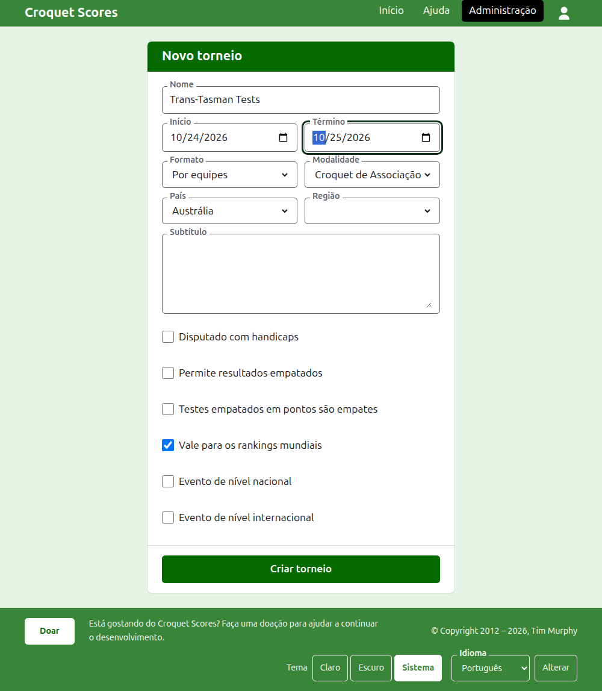
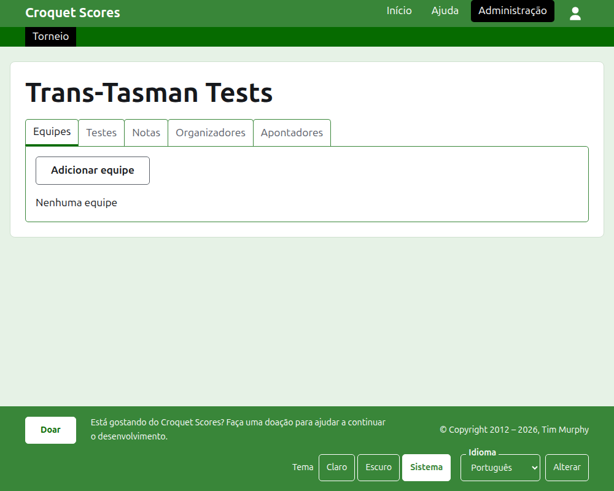

# Criar um torneio

Pressione **Novo torneio**, acima da lista de torneios na administração. Ele fica acima da lista, e não abaixo, para que uma lista longa não o empurre para fora da tela de um telefone.

O formulário pede tudo com que um torneio começa. O que mais importa aqui é o **Formato**, que é o que faz de um torneio um torneio disputado por equipes.

## O que o formulário pede

**Nome.** O que os leitores procuram para encontrar o torneio, como "Trans-Tasman Tests". Tem entre 3 e 254 caracteres. Um nome todo em minúsculas, ou todo em maiúsculas, é recusado, porque pareceria um erro em todas as páginas em que aparece. Dois torneios podem ter o mesmo nome, porque o mesmo torneio é disputado todo ano.

**Início** e **Término.** Os dias em que o torneio acontece. Todos os testes são disputados dentro deles, então defina-os de modo a cobrir o evento inteiro. Um torneio não pode terminar antes de começar, e não pode começar nem terminar depois do fim do ano que vem. Um torneio pertence ao ano em que começa, que é também o ano no seu endereço.

**Formato.** Escolha um dos formatos disputados por equipes:

- **Por equipes** é o formato geral para qualquer evento entre equipes.
- **Eire Cup**, **Interstate Shield** e **GC World Team Championship** são eventos específicos, cada um mantido como um formato próprio para que possa ser administrado do jeito que esse evento é disputado.

Padrão é o único formato não disputado por equipes, e não é o que você quer aqui. O Gateball Scores não oferece formato, porque todo torneio lá é um torneio padrão de gateball; um torneio disputado por equipes é criado no Croquet Scores.

**Modalidade.** As modalidades que o site oferece, na sua ordem: Croquet de Associação, Golf Croquet, Croquet Americano de 6 Arcos e Ricochet.

**País** e **Região.** Onde o torneio é disputado. A região só é pedida quando o país escolhido é dividido em regiões, como os estados da Austrália, e mesmo então não precisa ser escolhida.

**Subtítulo.** Tudo o que você quer que os leitores saibam e não tem um campo próprio: onde estacionar, a que hora é o almoço, para quem telefonar. É mostrado abaixo do nome do torneio em todas as páginas públicas. É escrito em Markdown, então uma palavra fica em negrito com asteriscos em volta e uma lista se faz com um traço no início de cada linha. Pode ter até 2000 caracteres, e pode ficar vazio.

**Disputado com handicaps.** Marque para um evento com handicaps.

**Permite resultados empatados.** Marque quando um jogo pode terminar sem que nenhum dos jogadores seja o vencedor. Quando está marcado, um placar inserido com pontos iguais e sem marca é guardado como empate; quando não está, um jogo com pontos iguais precisa dizer quem o ganhou com uma marca depois do placar do vencedor, como "6w".

**Testes empatados em pontos são empates.** Só é pedido depois que um formato disputado por equipes é escolhido. Um teste é ganho pela equipe que vence mais das suas partidas, e um teste igualado em partidas é decidido pelo saldo de jogos, depois pelo saldo de arcos, a menos que isto esteja marcado, caso em que um teste igualado em partidas é um empate, como alguns eventos por equipes têm. Começa desmarcado para Por equipes, e marcado para o GC World Team Championship, que sempre deu um teste igualado como empate.

**Vale para os rankings mundiais.** Só é pedido quando pode valer: um torneio de Croquet de Associação ou de Golf Croquet que não é disputado com handicaps nem permite resultados empatados. Começa marcado.

**Evento de nível nacional** e **Evento de nível internacional.** Um torneio pode ser um, o outro, ou nenhum, mas nunca os dois: marcar um desmarca o outro.

## Criar o torneio

Pressione **Criar torneio**. Você é levado à página do torneio na administração, aberta na aba Equipes, e passa a ser o seu primeiro organizador. Ele é listado na administração sob o ano em que começa.

O endereço público do torneio é formado pelo seu ano, a sua modalidade e o seu nome, como `/2026/ac/trans-tasman-tests`. Ele mantém esse endereço quando o nome é corrigido mais tarde, para que um link já enviado continue a encontrá-lo; ele só muda quando o ano em que começa, ou a modalidade, muda.

## Se algo for recusado

O que é recusado é dito abaixo do campo a que se refere, e o que você digitou continua digitado. Nada é guardado até que todos os campos sejam aceitos. As coisas recusadas com mais frequência são um nome digitado todo em minúsculas, um término antes do início e um país não escolhido.

A seguir: [Equipes](teams.md).
