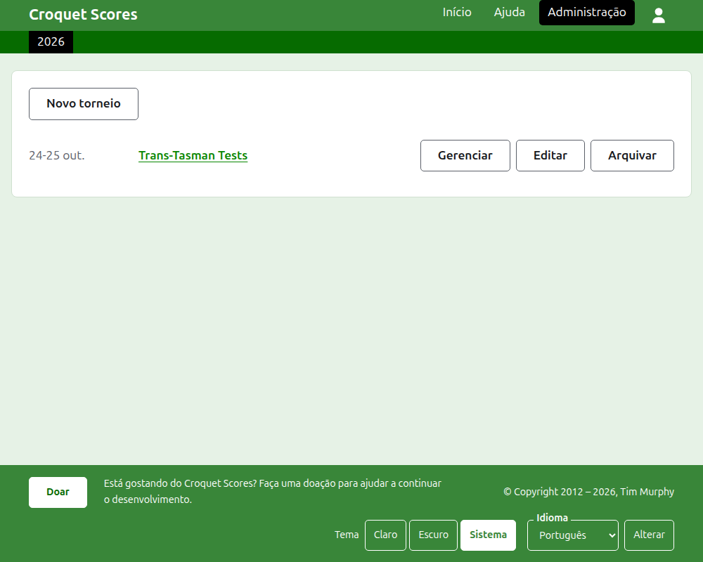
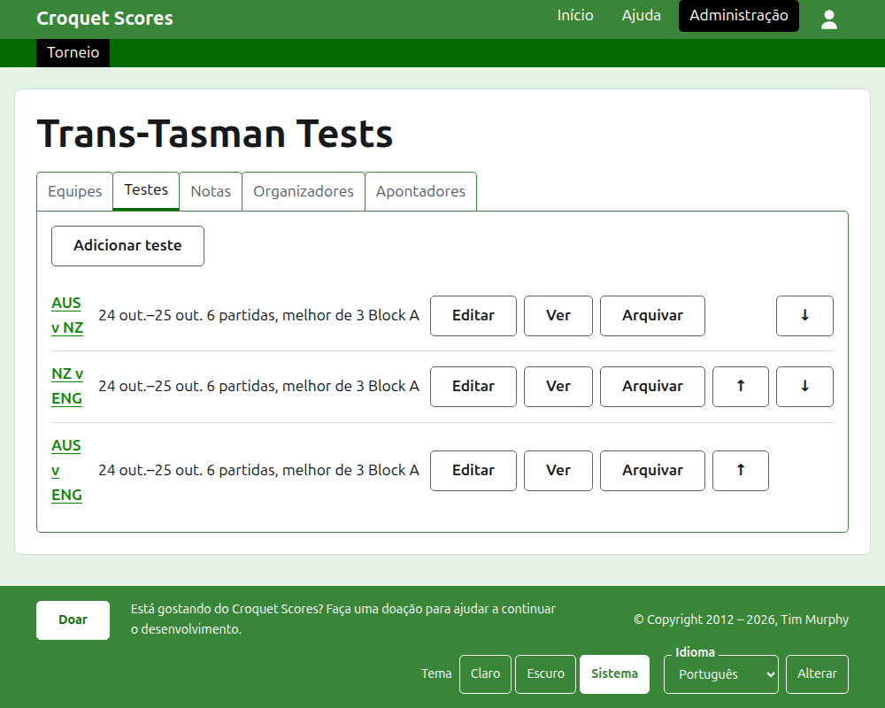

# Administrar um torneio disputado por equipes

Um torneio disputado por equipes é um torneio em que lados se enfrentam, em vez de jogadores inscritos um a um: uma série de testes entre dois países, um interstate shield, um campeonato mundial por equipes. As suas equipes são montadas com os seus jogadores, os testes entre as equipes são adicionados, e os jogos de cada teste são publicados conforme são disputados. Este guia leva um organizador desde entrar no site até um torneio cujos resultados estão à disposição do público.

Ele é completo em si mesmo. Nada nele depende do guia de um torneio padrão, que é escrito à parte.

## Antes de começar

Você precisa de uma conta. Clique [aqui](/account/register) para cadastrar uma conta.

Tudo o que um organizador faz é feito na seção de administração do site. As páginas públicas, onde jogadores e espectadores acompanham o torneio, são geradas a partir do que a administração guarda, então nada precisa ser publicado: um resultado inserido aparece nas páginas públicas na mesma hora.

## As palavras

Uma **equipe** é um lado, como a Austrália, com um nome, um nome abreviado como "AUS" e uma bandeira. Uma equipe tem **jogadores** próprios, que jogam por ela e por mais ninguém. Um **teste** é um confronto entre duas equipes, chamado pelos seus nomes abreviados, como "AUS x ENG", formado por um número de **partidas** entre um jogador de cada equipe, cada partida melhor de um certo número de **jogos**. Os testes podem ser postos em **grupos**, como "Block A", quando muitas equipes jogam entre si.

## As páginas em ordem

1. [Criar um torneio](creating-a-tournament.md): o seu nome, os seus dias, o seu esporte, o seu formato e onde é disputado.
2. [Equipes](teams.md): adicionar as equipes, com os seus nomes abreviados e bandeiras.
3. [Os jogadores de uma equipe](team-players.md): inscrever os jogadores de cada equipe na página da própria equipe.
4. [Testes](tests.md): adicionar os testes entre equipes, os seus dias, quantas partidas cada um tem e os seus grupos.
5. [Resultados](scores.md): inserir os jogos de um teste, corrigi-los e pôr de lado os que foram inseridos por engano.
6. [Notas](notes.md): dizer aos jogadores o que eles precisam saber enquanto o torneio acontece.
7. [Organizadores e anotadores](managers-and-scorers.md): compartilhar a administração do torneio, e deixar que alguém insira resultados sem poder alterar mais nada.
8. [Rankings](rankings.md): o arquivo enviado aos rankings mundiais, e o que fica para você preencher.
9. [Alterar, arquivar e restaurar um torneio](changing-and-archiving.md): corrigir os detalhes do torneio, e pôr um torneio de lado.
10. [O que o público vê](what-the-public-sees.md): as páginas que os seus jogadores acompanham, e como o que você insere aparece nelas.

## Como a administração é organizada

A porta de entrada da administração lista os torneios de que você participa, um ano de cada vez.

Pressionar o nome de um torneio, ou **Gerenciar**, abre a sua página. Tudo o que há para administrar está em seis abas abaixo do nome: **Equipes**, **Testes**, **Notas**, **Organizadores**, **Anotadores** e **Rankings**. A página abre em Equipes, porque as equipes são a primeira coisa a montar.

A barra verde-escura abaixo do cabeçalho serve para ir de uma página a outra. Na página do torneio e na página de um teste, ela leva ao torneio, como **Torneio**, e a cada teste pelo nome. Na página de uma equipe, ela leva ao torneio e a cada equipe pelo nome abreviado, porque um organizador na página de uma equipe está inscrevendo jogadores equipe por equipe. A página em que você está é marcada em preto.

## O que vale em todo lugar

**Nada é excluído de vez, a não ser uma nota.** Equipes, jogadores, testes, resultados e o próprio torneio são arquivados em vez de excluídos: postos de lado, riscados e listados sob um título próprio, com **Restaurar** para trazê-los de volta. Arquivar, restaurar e subir ou descer nunca pedem confirmação, porque cada um é desfeito pressionando o contrário. As coisas que não podem ser desfeitas, como excluir uma nota ou remover um organizador, perguntam antes.

**Um diálogo sobre a página não guarda nada até que você pressione o seu botão.** Cancelar, ou a tecla Escape, fecha-o e deixa tudo como estava. Os diálogos que adicionam coisas, como Adicionar equipe e Adicionar resultado, continuam abertos depois de cada adição, para que uma lista possa ser digitada de uma vez, um item após o outro.

**O que é recusado é dito ao lado do campo a que se refere.** Nada do que é recusado é guardado, e o que você digitou continua digitado, para que possa ser corrigido em vez de digitado de novo.

**A administração funciona em um telefone.** Todo botão é grande o bastante para ser pressionado com o polegar, e nada é mais largo do que a tela.

A seguir: [Criar um torneio](creating-a-tournament.md).
