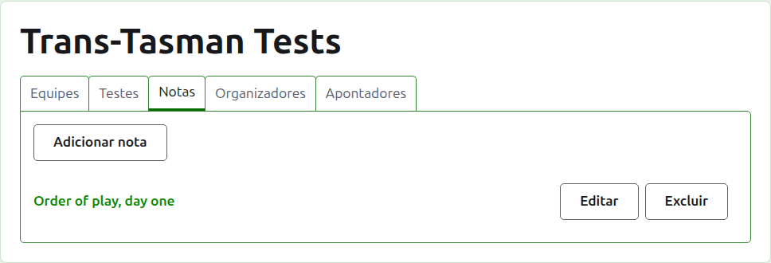
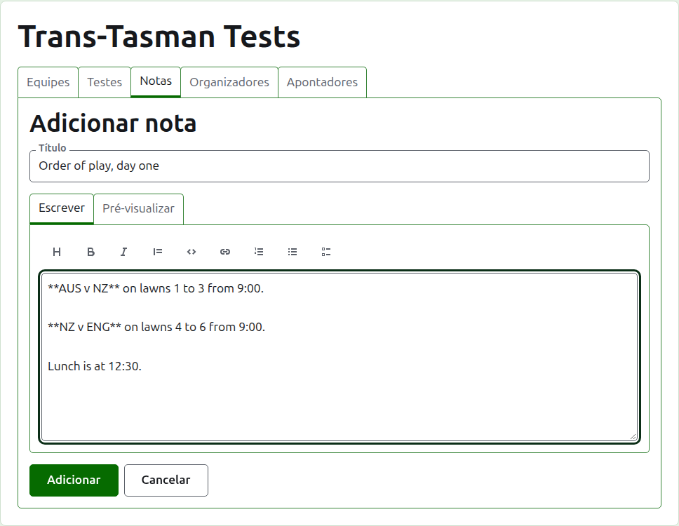
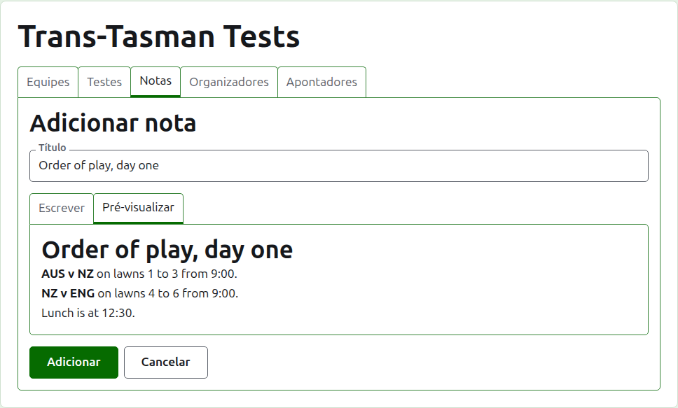
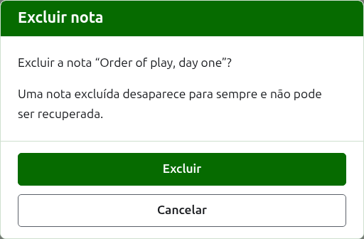

# Notas

A aba **Notas** da página de um torneio é onde os seus organizadores escrevem o que os jogadores precisam saber enquanto o torneio acontece: a ordem de jogo, uma mudança de gramados, a hora do almoço. Os leitores as encontram na página pública Notas do torneio, e uma nota que ainda não leram é marcada lá com um asterisco vermelho, que marca também a seção Notas em todas as páginas do torneio até que a abram.

## Escrever uma nota

Pressione **Adicionar nota**, acima da lista. Um painel toma o lugar da lista, porque uma nota é escrita por extenso e precisa de espaço.

**Título** é obrigatório, e é aquilo pelo que a nota é listada. É texto simples.

**Descrição** é escrita em Markdown e pode ficar vazia quando o título diz tudo o que há a dizer. A barra de ferramentas acima da caixa escreve o Markdown por você: Título, Negrito, Itálico, Citação, Código, Link, Lista numerada, Lista com marcadores e Lista de tarefas. Cada uma age sobre o que está selecionado, ou no início de cada linha selecionada, ou põe o cursor onde as palavras vão.

**Pré-visualizar** mostra a nota como um leitor a verá na sua página.

Pressione **Adicionar**. A nota é guardada, a lista volta com ela no topo, e ela está na página pública Notas na mesma hora.

## Editar uma nota

Pressione o título de uma nota, ou o seu **Editar**, para abrir o painel nessa nota. Pressione **Salvar** para guardar a alteração. Uma nota editada depois que um leitor a leu é marcada para ele de novo.

## Excluir uma nota

Uma nota que não vale mais é excluída. Uma nota excluída desaparece para sempre, então **Excluir** pergunta antes.

A seguir: [Organizadores e apontadores](managers-and-scorers.md).
