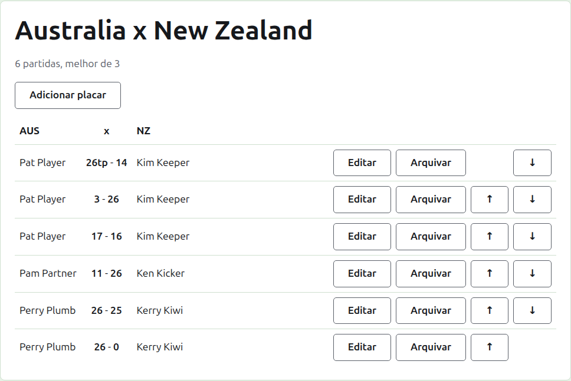
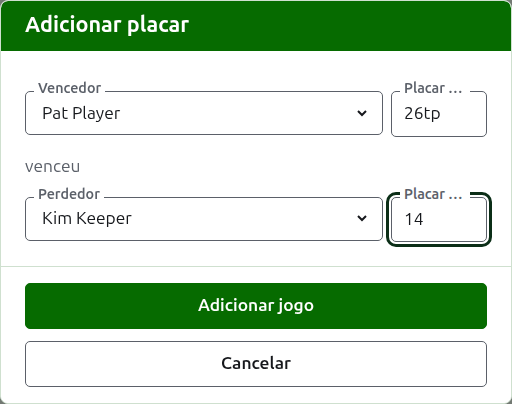

# Resultados

A página de um teste é aberta pelo seu nome na aba Testes, ou pela barra verde-escura. Tem como cabeçalho os nomes completos das suas equipes, como "Australia x New Zealand", com quantas partidas se espera que ele tenha e de quantos jogos é cada uma abaixo. Os seus resultados são a página, sem abas. Um organizador e um anotador veem a mesma página, porque um anotador pode fazer com um resultado tudo o que um organizador pode.

## Como os resultados são dispostos

Os resultados são dispostos por equipe, e não por quem ganhou, em uma tabela encabeçada pelo nome abreviado da primeira equipe, "x" e o da segunda. Cada resultado é uma linha: o jogador da primeira equipe, depois os dois resultados com o da primeira equipe primeiro, como "26tp - 14", depois o jogador da segunda equipe, seja qual deles tenha ganhado. Os resultados arquivados são dispostos do mesmo jeito abaixo.

## Inserir um resultado {#entering-a-score}

Pressione **Adicionar resultado**, acima da lista. O diálogo se lê como um resultado se diz em voz alta: o vencedor e o seu resultado, depois "venceu", depois o perdedor e o seu resultado.

O vencedor é escolhido entre os jogadores em uso das duas equipes, sob o nome de cada equipe, os jogadores da primeira equipe primeiro e os de cada equipe na ordem da equipe. Ninguém vem escolhido de início. Depois que o vencedor é escolhido, o perdedor é oferecido só da outra equipe, porque um jogo entre dois jogadores da mesma equipe não é um jogo entre as equipes. Um jogador arquivado não é oferecido.

Um resultado é digitado como o anotador o anotou: o seu número de pontos e o que vier depois, que é guardado e mostrado como foi digitado, como "26tp" para 26 arcos e um triple peel. O número são os dígitos com que o resultado começa; um resultado que não começa com um dígito é recusado.

Um jogo ganho com pontos iguais, como quando é interrompido pelo tempo e decidido de outra forma, diz quem o ganhou com uma marca depois do resultado do vencedor: "6w" venceu "6". As marcas são "w", "won" e "winner". O resultado do vencedor precisa ser maior que o do perdedor, ou marcado, a menos que o torneio permita resultados empatados, caso em que pontos iguais sem marca são guardados como empate.

Pressione **Adicionar jogo**. O jogo é adicionado, o diálogo diz qual, e os campos são esvaziados para o próximo, porque os resultados chegam em lote, lidos de um quadro no fim de uma sessão. Pressione **Cancelar** quando todos estiverem inseridos.

## Partidas

Dois jogadores que se enfrentam disputam uma partida do melhor de do teste. Os jogos entre eles são os jogos dessa partida, e um jogo entre dois jogadores cuja partida já está decidida é recusado: um deles ganhou mais jogos do que o outro ainda poderia ganhar, ou todos os jogos dela foram disputados.

Uma partida começa quando os seus dois jogadores têm um jogo em uso. Um teste não começa mais partidas do que deve ter: depois que tantas começaram, um jogo entre dois jogadores que não se enfrentaram é recusado, enquanto outro jogo de uma partida já começada é aceito. Quando o teste deve ter mais partidas, altere-o na aba Testes para prevê-las.

## Corrigir um resultado {#correcting-a-score}

**Editar** abre o mesmo diálogo nesse resultado, com o título Editar resultado, com os seus jogadores escolhidos e os seus resultados como foram digitados. Os seus jogadores podem ser alterados, além dos resultados, escolhidos como ao adicionar. Pressione **Salvar** para guardar a correção e fechar o diálogo. Uma correção mantém o resultado: um jogo ganho continua ganho, e um jogo empatado continua empatado. Um jogo cujo resultado estava errado é arquivado e inserido de novo.

## Colocar os resultados em ordem

Os resultados chegam na ordem em que são inseridos, então cada resultado em uso oferece **Subir** e **Descer**, que o trocam de lugar com o resultado vizinho, para que a lista possa ficar na ordem em que os jogos foram disputados.

## Arquivar um resultado

**Arquivar** põe um resultado de lado para que ele não conte para nada. Ele é listado sob **Resultados arquivados**, riscado, e oferece apenas **Restaurar**. Nenhum dos dois pergunta antes, porque cada um desfaz o outro. Todos os resultados de um teste podem ser arquivados, porque um teste não tem rodadas que dependam umas das outras.

Um resultado cujo jogador foi arquivado depois não é restaurado até que o jogador seja, e a página diz isso.

A seguir: [Notas](notes.md).
