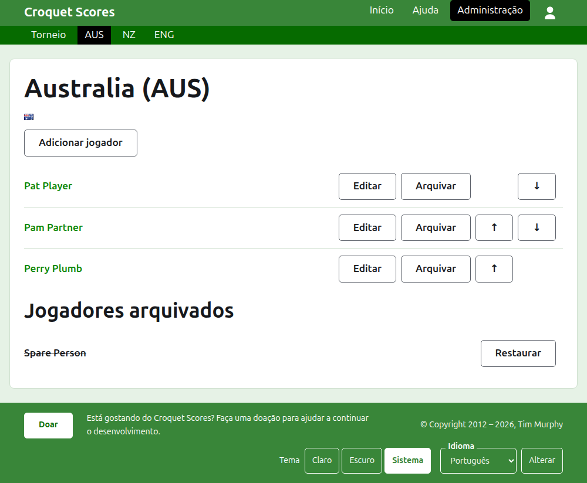
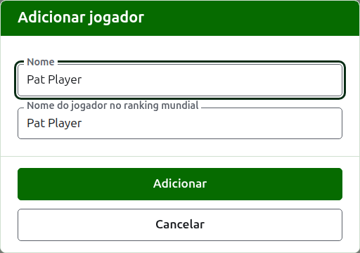

# Os jogadores de uma equipe

A página de uma equipe é aberta pelo seu nome, ou pelo seu **Ver**, na aba Equipes. Tem como cabeçalho o nome da equipe com o nome abreviado entre parênteses, e a sua bandeira, para que um organizador que veio à equipe errada perceba na mesma hora. Ela tem uma única coisa a mostrar, os jogadores da equipe, então a lista é a página.

A barra verde-escura na página de uma equipe leva ao torneio e a cada equipe em uso pelo nome abreviado, para que os jogadores sejam inscritos equipe por equipe sem voltar à aba Equipes.

Um jogador de uma equipe pertence só a essa equipe, representa a equipe e leva a bandeira da equipe, e não uma própria. A mesma pessoa jogando por duas equipes, ou em dois torneios, é um jogador em cada uma.

## Adicionar um jogador

Pressione **Adicionar jogador**, acima da lista. Um diálogo abre sobre a página.

**Nome** é obrigatório, entre 3 e 254 caracteres. Dois jogadores de uma mesma equipe não podem ter o mesmo nome, sejam quais forem as maiúsculas; um jogador de outra equipe pode tê-lo.

**Nome do jogador no ranking mundial** é o nome pelo qual os rankings mundiais conhecem o jogador. Só é pedido em um torneio de Croquet de Associação ou de Golf Croquet, as duas modalidades que têm rankings mundiais. Enquanto você adiciona um jogador, ele acompanha o nome conforme você digita, e para de acompanhar quando você digita nele. Deixado vazio, é guardado como o nome do jogador. Conforme você digita, são oferecidos os jogadores que os rankings mundiais conhecem cujos nomes começam daquele jeito, e ao lado do nome no ranking mundial uma marca de certo diz que os rankings conhecem o nome, e um ponto de interrogação diz que não. É só um aviso: um nome que os rankings não conhecem é guardado tão prontamente quanto um que conhecem.

Um jogador nunca se chama "Bye": um nome cuja primeira palavra é a palavra inglesa "bye" é recusado.

Pressione **Adicionar**. O jogador é adicionado, o diálogo diz isso, e os seus campos são esvaziados para o próximo, com o cursor de volta no nome. Adicione a equipe inteira desse jeito e depois pressione **Cancelar** para fechar o diálogo.

## Corrigir um jogador

Pressione o nome de um jogador, ou o seu **Editar**, para abrir o mesmo diálogo nesse jogador, com o título Editar jogador. Pressione **Salvar** para guardar a alteração. Um jogador cujo nome é corrigido mantém o nome no ranking mundial que tinha.

## Ordem

Os jogadores são listados na ordem da equipe, que é a ordem em que são oferecidos quando o placar de um teste é inserido. **Subir** e **Descer** movem um jogador uma posição dentro da equipe.

## Arquivar um jogador

**Arquivar** põe um jogador de lado: inscrito por engano, ou que não está mais na equipe. Um jogador arquivado é listado sob **Jogadores arquivados**, riscado, depois dos jogadores em uso, e oferece apenas **Restaurar**. Arquivar nunca pergunta antes, porque um jogador de uma equipe não está inscrito em mais nada e restaurá-lo põe tudo de volta no lugar.

Um jogador que disputou algum jogo em uso em um teste não pode ser arquivado, porque os jogos passariam a ser contra alguém que não está mais lá, então esse jogador não recebe Arquivar. Um jogador cujos únicos jogos estão arquivados pode ser.

A seguir: [Testes](tests.md).
