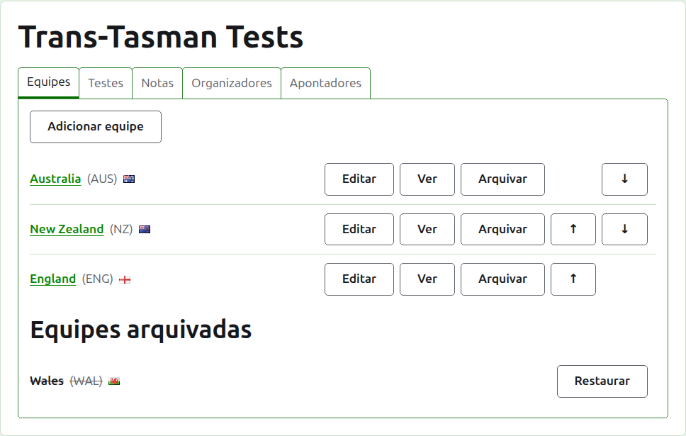
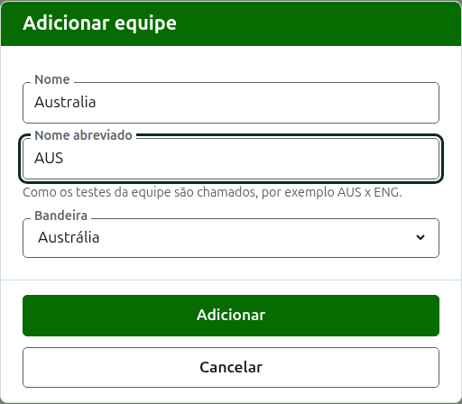
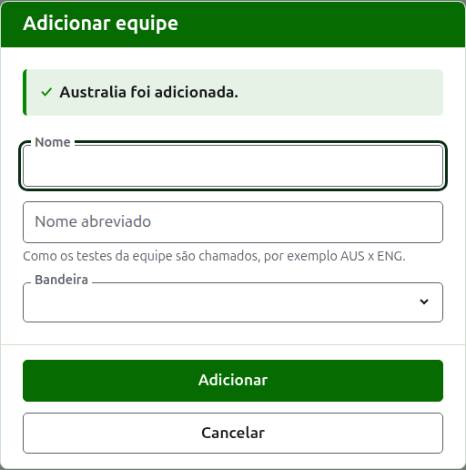
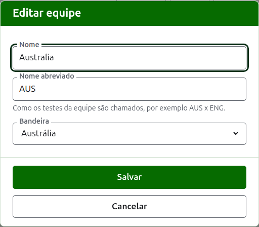

# Equipes

A aba **Equipes** da página de um torneio é onde as suas equipes são adicionadas, corrigidas, colocadas em ordem e postas de lado. É a aba em que a página abre, porque as equipes são a primeira coisa a montar. Um teste é entre duas equipes, então são necessárias pelo menos duas antes que algum teste possa ser adicionado.

## Adicionar uma equipe {#adding-a-team}

Pressione **Adicionar equipe**, acima da lista. Um diálogo abre sobre a página.

**Nome** é obrigatório: o nome completo da equipe, como "Australia", que encabeça a página da equipe e as tabelas das páginas públicas. Duas equipes de um mesmo torneio não podem ter o mesmo nome.

**Nome curto** também é obrigatório: é como os testes da equipe são chamados, como "AUS x ENG", e como a barra verde-escura chama a equipe. Tem no máximo 10 caracteres, e não é mais longo que o nome, porque um nome abreviado mais longo que o nome que abrevia são os dois digitados ao contrário. Duas equipes também não podem ter o mesmo nome abreviado.

**Bandeira** é mostrada ao lado do nome da equipe onde quer que ele apareça. Pode ficar como nenhuma, como para a equipe de um clube ou de uma região.

Pressione **Adicionar**. A equipe é adicionada, o diálogo diz isso, e os seus campos são esvaziados para a próxima. Adicione a lista inteira desse jeito e depois pressione **Cancelar** para fechar o diálogo. Cancelar não guarda nada que ainda não tenha sido adicionado.

## Corrigir uma equipe {#correcting-a-team}

Pressione o **Editar** de uma equipe para abrir o mesmo diálogo nessa equipe, com o título Editar equipe. Altere o que está errado e pressione **Salvar**. Uma equipe cujo nome abreviado muda passa a ser chamada pelo novo em todo lugar, então os seus testes são renomeados com ela.

## Ordem

As equipes são listadas na ordem do torneio, que é a ordem em que são oferecidas quando um teste é adicionado, a ordem em que a barra verde-escura as tem e a ordem em que a página pública Jogadores as lista. **Subir** e **Descer**, as setas no fim de cada linha, movem uma equipe uma posição.

## Ir a uma equipe

O nome de uma equipe, ou **Ver**, abre a página da própria equipe, onde os seus jogadores são inscritos. Veja [Os jogadores de uma equipe](team-players.md).

## Arquivar uma equipe

**Arquivar** põe uma equipe de lado. Os seus jogadores ficam com ela e voltam quando ela é restaurada, então arquivar não pergunta antes. Uma equipe arquivada é listada sob **Equipes arquivadas**, riscada, oferece apenas **Restaurar**, e a sua página fica fechada até que ela seja restaurada.

Uma equipe que joga em um teste em uso não pode ser arquivada, porque o teste passaria a ser contra uma equipe que não está mais lá, então essa equipe não recebe Arquivar. Uma equipe cujos únicos testes estão arquivados pode ser.

A seguir: [Os jogadores de uma equipe](team-players.md).
