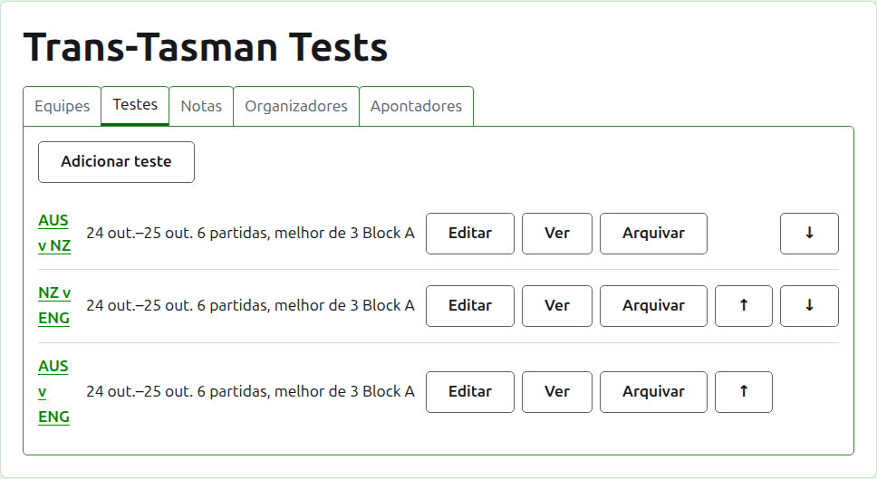
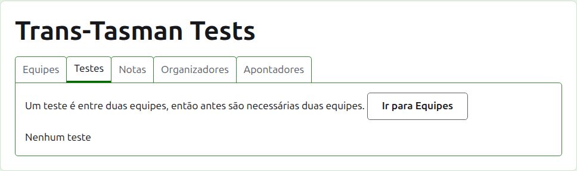
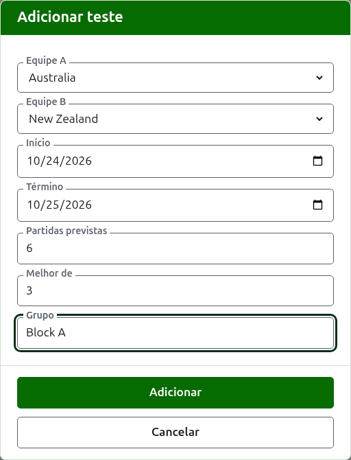
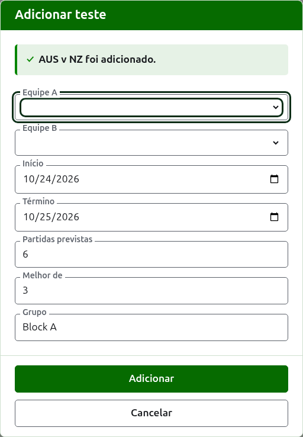
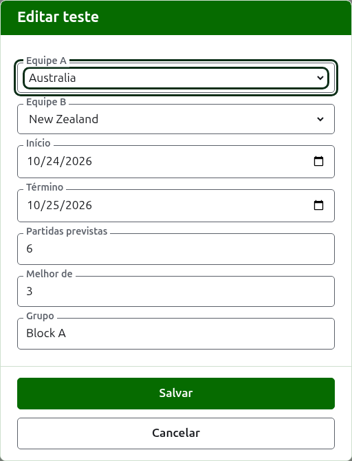

# Testes

A aba **Testes** da página de um torneio é onde os testes entre as suas equipes são adicionados, alterados, colocados em ordem e postos de lado. Um teste é uma das competições do torneio: um confronto entre duas equipes, chamado pelos seus nomes abreviados, como "AUS x NZ", disputado como um número de partidas entre um jogador de cada equipe. Cada teste tem uma página própria, onde os seus resultados são inseridos.

Cada teste diz o seu nome, os dias em que é disputado, quantas partidas se espera que tenha e de quantos jogos é cada uma, como "6 partidas, melhor de 3", e o seu grupo quando está em um.

## Duas equipes antes

Um teste é entre duas equipes em uso, então enquanto o torneio tem menos de duas a aba diz isso onde Adicionar teste estaria, e leva à aba Equipes.

## Adicionar um teste {#adding-a-test}

Pressione **Adicionar teste**, acima da lista. Um diálogo abre sobre a página, lendo-se na ordem em que um teste se diz em voz alta.

**Equipe A** e **Equipe B** são escolhidas, cada uma, entre as equipes em uso do torneio, pelo nome, na ordem do torneio. Nenhuma vem escolhida de início, para que um teste nunca seja adicionado entre equipes que você não escolheu. Equipe B oferece todas as equipes menos a escolhida como Equipe A, porque uma equipe não disputa um teste contra si mesma. A Equipe A é a primeira equipe: os seus jogadores ficam à esquerda na página do teste e na página pública. Um teste não tem um nome próprio a digitar; ele é chamado pelos nomes abreviados das suas equipes.

**Início** e **Término** são os dias em que o teste é disputado, que começam no primeiro dia do torneio. Um teste é disputado dentro do seu torneio, então dias antes de o torneio começar ou depois de ele terminar são recusados.

**Partidas previstas** é quantas partidas o teste deve ter, definido pelo evento antes de começar, para que quem lê os seus resultados veja em que ponto ele está. É um número inteiro a partir de 1. É também um limite: depois que começaram tantas partidas quantas o teste deve ter, um jogo que começaria outra é recusado, enquanto as partidas já começadas são disputadas até o fim. Um teste que deve ter mais é alterado para prevê-las.

**Melhor de** é de quantos jogos é cada partida. Pode ser par, porque uma partida pode ser dividida.

**Jogado com handicaps**, **Permite empates** e **Conta para o ranking mundial** são perguntados como em qualquer competição. O último só é pedido quando pode valer: um teste de Croquet de Associação ou de Croquet de Golfe que não é jogado com handicaps nem permite empates. Começa marcado.

**Grupo** é o grupo em que o teste está, quando o evento é disputado em grupos, como "Block A". É opcional: deixado vazio, o teste não está em nenhum. Os testes de um grupo têm uma página própria no site público, mostrando a classificação das equipes do grupo.

Pressione **Adicionar**. O teste é adicionado, o diálogo diz qual pelo seu nome, e as equipes são esvaziadas para o próximo, com os dias, as partidas previstas, o melhor de e o grupo deixados como estavam: os testes são adicionados uma rodada de cada vez, entre equipes que se enfrentam no mesmo dia, então o próximo teste da rodada é só as suas duas equipes. Pressione **Cancelar** quando todos estiverem inseridos.

## Alterar um teste {#changing-a-test}

**Editar** abre o mesmo diálogo no teste, com o título Editar teste, começado como o teste está. Pressione **Salvar** para guardar a alteração.

Um teste com jogos em uso mantém as suas equipes: o diálogo as mostra, mas elas não podem ser alteradas. O resto pode ser alterado, dentro do que já foi disputado: partidas previstas em menor número que as partidas já começadas são recusadas, e também um melhor de menor que o maior número de jogos que dois jogadores já disputaram.

## Ordem

Os testes são listados na ordem do torneio, que é a ordem em que aparecem nas páginas públicas e na barra verde-escura. **Subir** e **Descer** movem um teste uma posição.

## Ir a um teste

O nome de um teste, ou **Ver**, abre a sua página, onde os seus resultados são inseridos. A barra verde-escura também leva até lá, da página do torneio ou da de qualquer outro teste.

## Arquivar um teste

**Arquivar** põe um teste de lado, e é desfeito por **Restaurar**, então nenhum dos dois pergunta antes. Um teste arquivado é listado sob **Testes arquivados**, riscado, oferece apenas Restaurar, e não está nas páginas públicas.

Um teste com jogos em uso foi disputado, e não pode ser arquivado até que os seus jogos sejam. Um teste cujos jogos estão todos arquivados pode ser, porque um jogo arquivado não conta para nada. Um teste cuja equipe foi arquivada depois não é restaurado até que a equipe seja, e a aba diz isso.

A seguir: [Resultados](scores.md).
