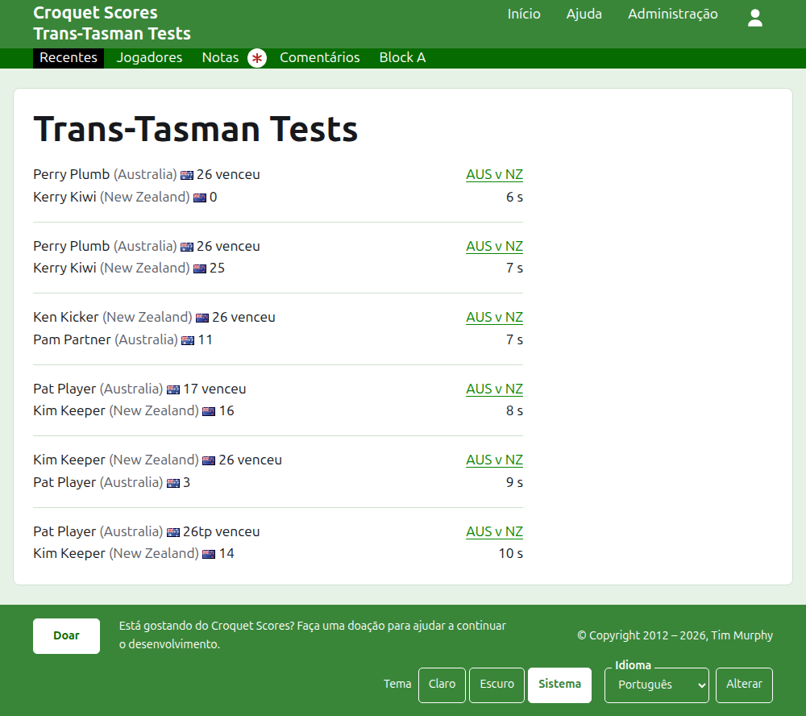
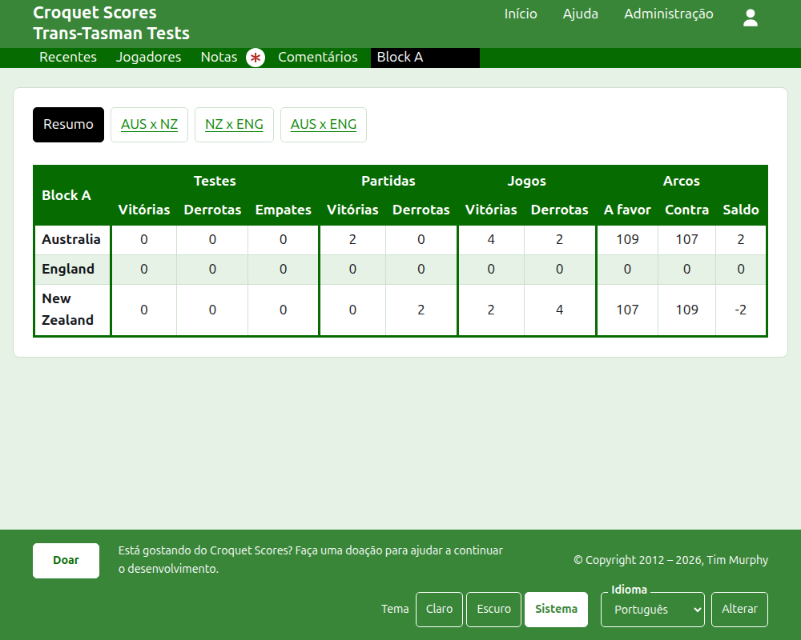
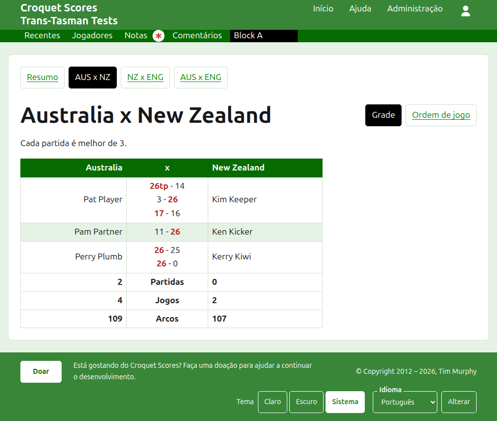
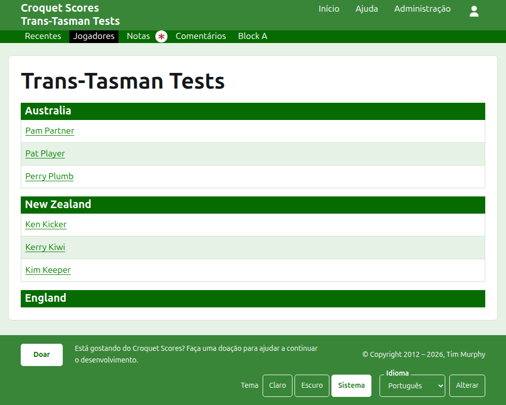

# O que o público vê

Nada é publicado: as páginas públicas são geradas a partir do que a administração guarda, então um resultado inserido aparece nelas na mesma hora. Elas não precisam de conta nem de scripts, e são feitas para um telefone.

## A página do torneio

A página do torneio fica no seu ano, no seu esporte e no seu nome, como `/2026/ac/trans-tasman-tests`. Tem como cabeçalho o nome do torneio, com o subtítulo abaixo. Lista todos os jogos em uso, o adicionado mais recentemente primeiro, para que um leitor que volta veja o que aconteceu desde então. Cada jogo diz o vencedor, a sua equipe e o seu resultado, depois o perdedor e o dele, com o teste em que foi disputado e há quanto tempo foi adicionado.

A barra verde-escura oferece as seções do torneio: **Recentes**, que é esta página, **Resumo**, **Jogadores**, **Notas** e **Comentários**, e depois os testes. Um teste é dito como os nomes abreviados das suas equipes com "x" entre eles, como "AUS x NZ". Os testes de um grupo não são oferecidos um a um: o grupo é uma única seção, com o nome do grupo, no lugar onde o seu primeiro teste estaria. Notas é marcada com um asterisco vermelho enquanto há uma nota que o leitor não leu.

## O resumo

Um torneio cujos testes não estão em nenhum grupo tem um **Resumo**: uma única tabela de todas as equipes, classificadas, com os testes que ganhou, perdeu e empatou, os seus jogos ganhos e perdidos, e os seus arcos a favor, contra e saldo. Quando as partidas de algum teste são melhor de mais de um, as partidas ganhas e perdidas vêm depois dos testes. O resumo é onde um leitor procura cada equipe como um todo.

Um torneio com um teste em um grupo não tem Resumo. A página de cada grupo mostra a classificação das equipes desse grupo, porque uma única tabela de equipes de grupos diferentes que nunca jogaram entre si não classificaria nada.

## Um grupo

A página de um grupo mostra a classificação das equipes do grupo, contando só os testes do grupo, na tabela que o resumo usa. Acima da tabela, em uma linha própria, ela oferece **Resumo**, que é esta página, e cada um dos testes do grupo, levando à página do teste.

## Um teste

A página de um teste tem como cabeçalho os nomes completos das suas equipes, como "Australia x New Zealand", e diz de quantos jogos é cada partida. A sua tabela é encabeçada pelas duas equipes, a primeira à esquerda. Cada partida disputada é uma linha, na ordem em que começou, com o jogador da primeira equipe à esquerda, o da segunda à direita, e os jogos da partida entre eles, cada um com o resultado do primeiro lado e depois o do segundo, o do vencedor marcado. Abaixo das partidas ficam os jogos e os arcos de cada equipe e, quando cada partida é melhor de mais de um, as suas partidas ganhas, cada uma do seu lado.

Um teste é mostrado de duas formas, oferecidas na linha do seu nome: **Grade**, que é esta tabela, e **Ordem de jogo**, que lista todos os jogos do teste, o mais antigo primeiro. Um teste de um grupo oferece o Resumo e os testes do seu grupo em uma linha acima do cabeçalho, com este teste marcado.

## Jogadores

A página Jogadores lista os jogadores equipe por equipe: cada equipe sob um título com o seu nome, na ordem que o torneio dá às equipes, e os seus jogadores abaixo em ordem alfabética.

## Notas

A página Notas lista as notas do torneio, a escrita mais recentemente primeiro, cada uma levando à sua própria página e dizendo há quanto tempo foi escrita. Uma nota que o leitor não leu é marcada com um asterisco vermelho até que ele a abra.

## Endereços que mudam

Um torneio mantém o seu endereço quando o nome é corrigido. Quando ele muda, porque o ano ou o esporte mudou, o endereço antigo leva ao novo, para que um link guardado de antes continue a funcionar. As páginas de um torneio arquivado não são encontradas até que ele seja restaurado.
