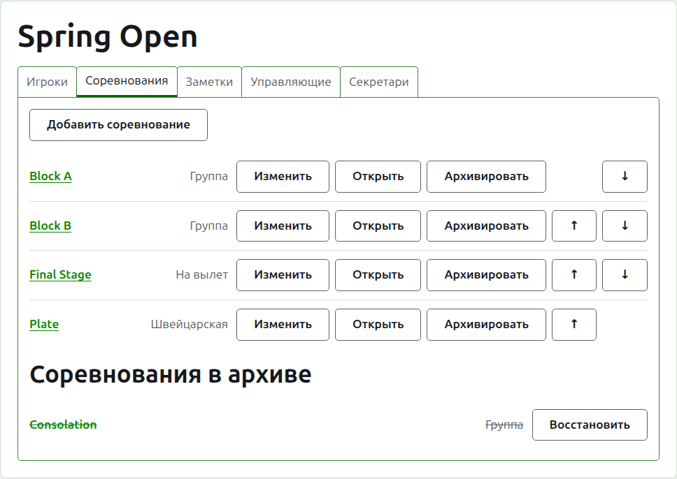
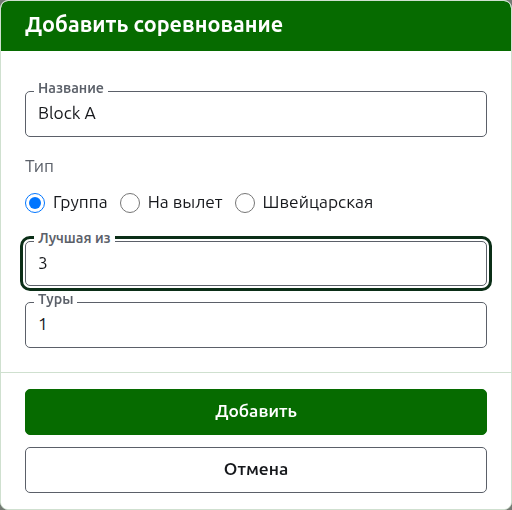
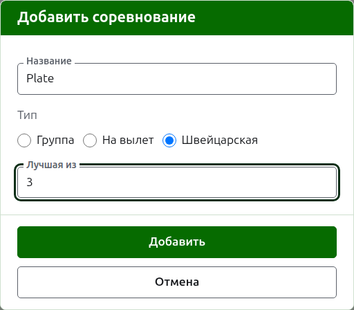
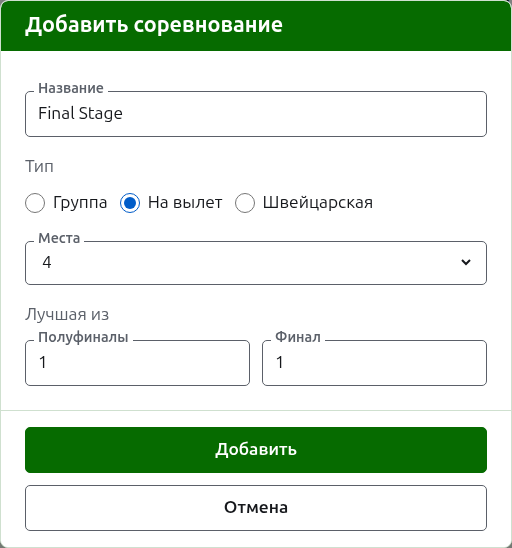

# Соревнования

На вкладке **Соревнования** страницы турнира его соревнования добавляют, расставляют по порядку и убирают в архив. Соревнование — это группа, сетка на вылет или швейцарская система. У каждого есть своя страница, где заявляют его игроков и вводят его результаты.

## Добавление соревнования

Нажмите **Добавить соревнование** над списком. Поверх страницы откроется диалог, который спрашивает название соревнования, его тип и то, как этот тип устроен.

**Название** — то, что игроки ищут на странице турнира, чтобы найти свои партии. От 1 до 254 символов, и одной буквы достаточно, потому что группу часто называют одной буквой. У двух соревнований одного турнира не может быть одного и того же названия.

**Тип** — группа, на вылет или швейцарская. Диалог начинается с группы, потому что большинство соревнований — группы.

### Группа или швейцарская система

Группа и швейцарская система спрашивают только, из скольких партий каждый матч — **Лучшая из**, что изначально равно 1. Лучшую из 3 выигрывает тот, кто выиграл две партии. Число может быть чётным, потому что в группе и в швейцарской системе игроков ранжируют по выигранным партиям, а матч из двух партий, поделённых по одной, — такой же результат, как и любой другой.

### На вылет

Соревнование на вылет спрашивает, сколько в его сетке мест — **Места** — и из скольких партий каждый раунд. Мест предлагается 2, 4, 8, 16, 32, 64 и 128, потому что никакое другое число не делилось бы пополам раунд за раундом до финала, и диалог начинается с 8. Места, оставшиеся после заявки игроков, заполняются баями, которые добавляют там же, где игроков.

В сетке столько раундов, сколько нужно, чтобы делить её места пополам до одного, так что в сетке на 8 мест три раунда. Диалог спрашивает, из скольких партий каждый, все вместе под **Лучшая из**, в порядке, в котором они играются. Последние три названы так, как говорят о раундах сетки — **Четвертьфиналы**, **Полуфиналы** и **Финал**, — а те, что перед ними, своим номером, начиная с раунда 1. Выбор большего числа мест добавляет раунды в начало сетки, а меньшего — убирает их с начала, так что набранное для финала остаётся у финала. Каждый раунд — лучшая из нечётного числа партий, потому что у матча на вылет должен быть победитель.

### Добавление нескольких подряд

Нажмите **Добавить**. Соревнование добавлено, диалог сообщает об этом, а название очищается для следующего, тип же и его устройство остаются как были: соревнования, добавляемые вместе, по большей части похожи, так что «Block B» после «Block A» — это одно лишь название. Нажмите **Отмена**, чтобы закрыть диалог, когда все введены.

## Изменение соревнования

**Изменить** открывает тот же диалог на соревновании, с заголовком «Изменить соревнование», с его названием и устройством как они есть. Тип не спрашивается, потому что группу не превращают в сетку на вылет изменением: соревнование не того типа архивируют и добавляют заново. Нажмите **Сохранить**, чтобы сохранить изменение и закрыть диалог.

У сетки на вылет, в которой есть партия, игроки расставлены по местам, и изменение числа мест их сдвинуло бы, поэтому после ввода партии оно отклоняется. Число партий в раундах всё ещё можно менять.

## Порядок

Соревнования перечислены в порядке турнира — в том порядке, в котором они появляются на публичных страницах и в тёмно-зелёной полосе. **Выше** и **Ниже** перемещают соревнование на одно место.

## Переход к соревнованию

Название соревнования или **Открыть** открывает его страницу, где заявляют его игроков и вводят его результаты. Тёмно-зелёная полоса под шапкой тоже ведёт туда с любой страницы турнира.

## Архивирование соревнования

**Архивировать** убирает соревнование в сторону независимо от того, есть ли в нём партии; они хранятся вместе с ним и возвращаются при восстановлении. Соревнование в архиве показано под заголовком **Соревнования в архиве**, зачёркнутым, ему предлагается только **Восстановить**, и его нет на публичных страницах. Архивирование не спрашивает подтверждения, потому что восстановление его отменяет.

Далее: [Заявка игроков в соревнование](entering-players-in-a-competition.md).
