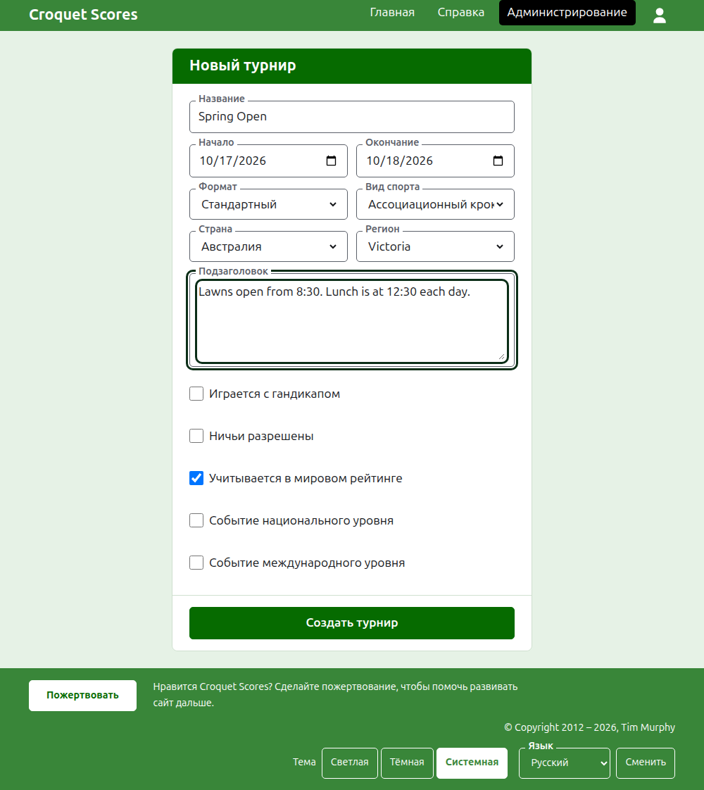

# Создание турнира

Нажмите **Новый турнир** над списком турниров в разделе администрирования. Кнопка стоит над списком, а не под ним, чтобы длинный список не вытеснил её с экрана телефона.

Форма спрашивает всё, с чего начинается турнир. От обычного турнира вас отделяют название, два дня и страна: всё остальное решено за вас, и это можно изменить.

## Что спрашивает форма

**Название.** То, по чему читатели ищут турнир, например «Spring Open». От 3 до 254 символов. Название целиком строчными или целиком заглавными буквами отклоняется, потому что на каждой странице оно выглядело бы как ошибка. У двух турниров может быть одно и то же название, ведь один и тот же турнир проводится каждый год.

**Начало** и **Окончание.** Дни, в которые идёт турнир. Турнир не может закончиться раньше, чем начался, и не может начаться или закончиться позже конца следующего года. Турнир относится к году, в котором начинается, и этот же год стоит в его адресе, так что турнир, идущий через Новый год, показан в том году, в котором начался.

**Формат.** Выберите **Стандартный** для турнира между игроками. Остальные форматы — для турниров между командами, у которых есть своё руководство.

**Вид спорта.** Виды спорта, которые предлагает сайт, в его порядке: Ассоциационный крокет, Гольф-крокет, Американский крокет на 6 воротах и Рикошет на Croquet Scores. Gateball Scores не спрашивает ни вид спорта, ни формат, потому что каждый турнир там — стандартный турнир по гейтболу.

**Страна** и **Регион.** Где проводится турнир. Регион спрашивается только там, где выбранная страна делится на регионы, как штаты Австралии; страна, которая сама себе единственный регион, его не спрашивает. Регион можно не выбирать даже там, где он предлагается.

**Подзаголовок.** Всё, что вы хотите сообщить читателям и для чего нет отдельного поля: где парковаться, когда обед, кому звонить. Он показывается под названием турнира на каждой публичной странице. Он пишется на Markdown, так что слово можно выделить жирным, окружив его звёздочками, а список сделать, поставив дефис в начале каждой строки. Он может быть до 2000 символов, и его можно оставить пустым.

Как играются и учитываются его соревнования — с форой, с ничьими, в мировых рейтингах — каждое соревнование говорит само, когда его добавляют.

**Событие национального уровня** и **Событие международного уровня.** Турнир может быть одним, другим или ни тем ни другим, но никогда обоими: отметка одного снимает другое.

## Создание

Нажмите **Создать турнир**. Вы попадёте на страницу турнира в разделе администрирования, откуда им управляют, и вы — его первый организатор. В разделе администрирования он показан под годом, в котором начинается.

Публичный адрес турнира составляется из его года, вида спорта и названия, например `/2026/ac/spring-open`. Он сохраняет этот адрес, когда название потом исправляют, чтобы уже отправленная ссылка по-прежнему его находила; он переезжает только тогда, когда меняется год начала или вид спорта.

## Если что-то отклонено

Что отклонено, сказано под полем, к которому это относится, а введённое вами остаётся на месте. Ничего не сохраняется, пока не принято каждое поле. Чаще всего отклоняют название, набранное целиком строчными буквами, окончание раньше начала и невыбранную страну.

Далее: [Игроки](players.md).
