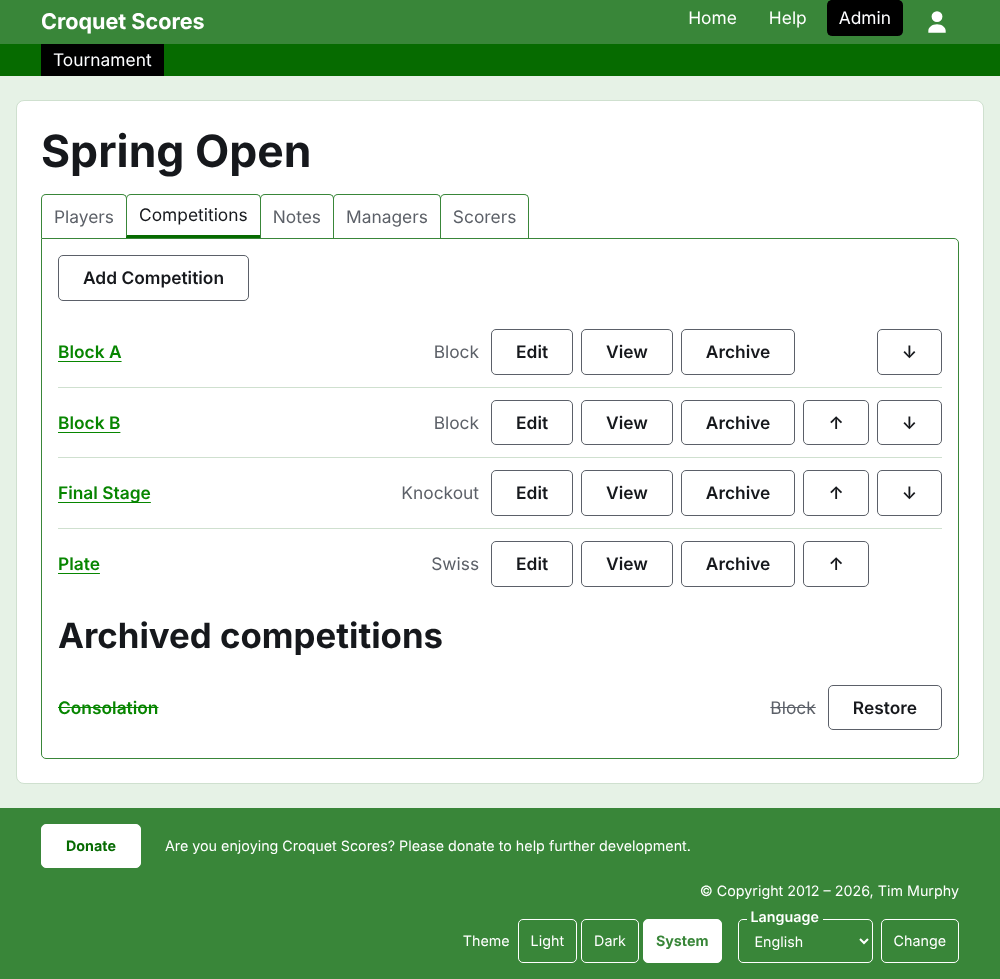

# Проведение стандартного турнира

Стандартный турнир — это турнир между игроками, заявленными по одному: клубные выходные, открытый турнир, чемпионат. Его игроков заявляют в группы, сетки на вылет и соревнования по швейцарской системе, а результаты появляются по мере того, как партии сыграны. Это руководство ведёт управляющего от входа на сайт до турнира, результаты которого открыты публике.

Оно самостоятельно. Ничто в нём не зависит от руководства по командному турниру, которое написано отдельно.

## Прежде чем начать

Вам нужна учётная запись. Нажмите [здесь](/account/register), чтобы зарегистрироваться.

Всё, что делает управляющий, делается в разделе администрирования сайта. Публичные страницы, на которых игроки и зрители следят за турниром, строятся из того, что хранит раздел администрирования, поэтому ничего не нужно публиковать: введённый результат сразу же оказывается на публичных страницах.

## Страницы по порядку

1. [Создание турнира](creating-a-tournament.md): его название, дни, вид спорта, место проведения и то, в чём он учитывается.
2. [Игроки](players.md): как заявить игроков турнира, исправить их и убрать добавленных по ошибке.
3. [Соревнования](competitions.md): как добавить группы, сетки на вылет и соревнования по швейцарской системе и расставить их по порядку.
4. [Заявка игроков в соревнование](entering-players-in-a-competition.md): кто играет в каждом соревновании, баи в сетке на вылет, переносы, исключение и снятие игроков.
5. [Результаты](scores.md): как вводить результаты, исправлять их и убирать введённые по ошибке.
6. [Заметки](notes.md): как сообщать игрокам то, что им нужно знать по ходу турнира.
7. [Управляющие и секретари](managers-and-scorers.md): как разделить управление турниром с другими и позволить кому-то вводить результаты, не давая менять ничего другого.
8. [Изменение, архивирование и восстановление турнира](changing-and-archiving.md): как исправить сведения о турнире и убрать турнир в архив.
9. [Что видит публика](what-the-public-sees.md): страницы, за которыми следят ваши игроки, и как на них появляется то, что вы вводите.

## Как устроен раздел администрирования

Главная страница раздела администрирования показывает турниры, в которых вы участвуете, по одному году за раз.

Нажатие на название турнира или на **Управлять** открывает его страницу. Всё, чем нужно управлять, находится на пяти вкладках под его названием: **Игроки**, **Соревнования**, **Заметки**, **Управляющие** и **Секретари**. Страница открывается на вкладке «Игроки», потому что игроков вводят первыми.

Тёмно-зелёная полоса под шапкой служит для перехода между страницами. Она ведёт к турниру, как **Турнир**, и к каждому из его соревнований по названию, так что от турнира к соревнованию и от соревнования к соревнованию можно переходить, не возвращаясь на вкладку «Соревнования». Страница, на которой вы находитесь, отмечена чёрным.

## Что действует везде

**Безвозвратно удаляется только заметка.** Игроки, соревнования, результаты и сам турнир не удаляются, а архивируются: их убирают в сторону, зачёркивают и показывают под отдельным заголовком, с кнопкой **Восстановить**, чтобы вернуть. Архивирование, восстановление и перемещение выше и ниже никогда не просят подтверждения, потому что каждое из них отменяется нажатием в обратную сторону. То, что отменить нельзя, например исключение игрока из соревнования или удаление заметки, сначала спрашивает.

**Диалог поверх страницы ничего не сохраняет, пока вы не нажмёте его кнопку.** «Отмена» или клавиша Escape закрывает его и оставляет всё как было. Диалоги, которые что-то добавляют, такие как «Добавить игрока» и «Добавить результат», остаются открытыми после каждого добавления, чтобы список можно было ввести подряд.

**Отказ объясняется рядом с полем, к которому он относится.** Отклонённое не сохраняется, а введённое вами остаётся на месте, чтобы его можно было исправить, а не вводить заново.

**Раздел администрирования работает на телефоне.** Каждая кнопка достаточно велика, чтобы нажать её большим пальцем, и ничто не шире экрана.

Далее: [Создание турнира](creating-a-tournament.md).
