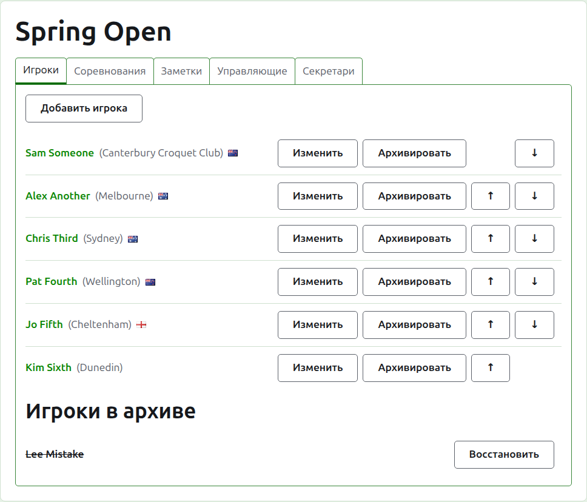
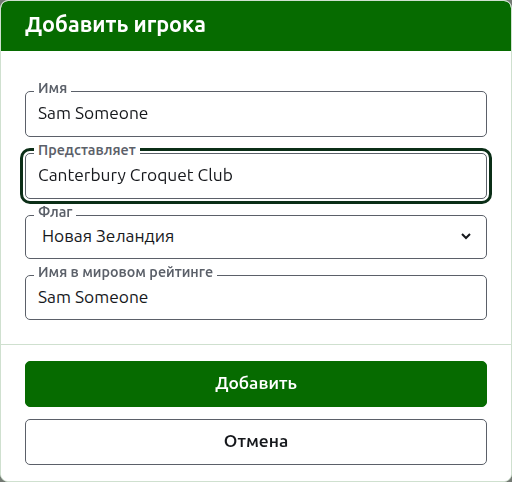
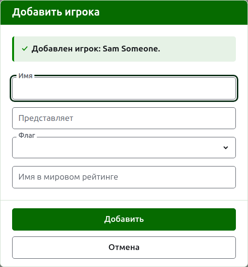
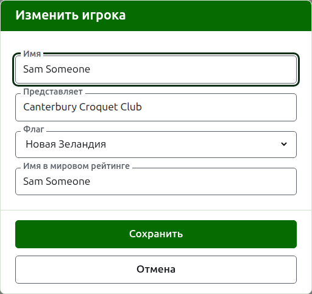
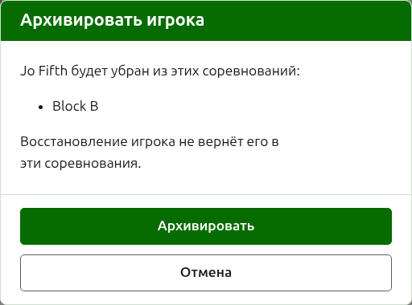

# Игроки

На вкладке **Игроки** страницы турнира его игроков заявляют, исправляют, расставляют по порядку и убирают в архив. Страница открывается на этой вкладке, потому что заявка игроков — первое, что делают с турниром.

Игроков вводят здесь один раз, в турнир. В каких соревнованиях каждый из них играет, выбирают потом, на странице каждого соревнования, из игроков, введённых здесь. См. [Заявка игроков в соревнование](entering-players-in-a-competition.md).

## Добавление игроков

Нажмите **Добавить игрока** над списком. Поверх страницы откроется диалог.

**Имя** обязательно. Это имя игрока, каким оно будет показано на каждой странице, от 3 до 254 символов. У двух игроков одного турнира не может быть одного и того же имени, как бы ни различались заглавные буквы; где два игрока действительно носят одно имя, различите их в самом имени, как «Andrew Hobbs (2)».

**Представляет** — за кого играет игрок, записанное так, как сказал бы читатель: клуб, регион или страна, например «Canterbury Croquet Club». Показывается в скобках после имени. Можно оставить пустым.

**Флаг** — флаг, показываемый рядом с именем игрока. Можно оставить без флага, как у большинства игроков. То, кого игрок представляет, и то, под каким флагом он играет, хранятся отдельно, потому что игрок может играть за клуб в одной стране и под флагом другой.

**Имя в мировом рейтинге** — имя, под которым игрока знает мировой рейтинг. Спрашивается только в турнире по ассоциационному крокету или гольф-крокету — двум видам спорта с мировым рейтингом. Пока вы добавляете игрока, оно повторяет имя по мере того, как вы его набираете, потому что большинство игроков известны рейтингу под собственным именем, и перестаёт повторять, как только вы начнёте набирать в нём. Оставленное пустым, оно сохраняется как имя игрока.

Пока вы набираете имя, предлагаются известные мировому рейтингу игроки, чьи имена так начинаются, чтобы можно было взять имя в написании рейтинга, а не набирать его целиком. Рядом с именем в мировом рейтинге галочка говорит, что рейтинг знает это имя, а вопросительный знак — что не знает: имя может быть написано с ошибкой, или игрок новый в рейтинге. Это только подсказка. Имя, неизвестное рейтингу, сохраняется так же легко, как известное.

Нажмите **Добавить**. Игрок добавлен, диалог сообщает об этом, его поля очищаются для следующего игрока, а курсор возвращается в имя. Добавьте так весь список, затем нажмите **Отмена**, чтобы закрыть диалог. «Отмена» не сохраняет ничего, что ещё не было добавлено.

Игрока никогда не называют «Bye». Баи сетки на вылет добавляются в самой сетке, там, где заявляют её игроков, поэтому имя, первое слово которого — английское «bye», отклоняется, и диалог объясняет почему.

## Исправление игрока

Нажмите на имя игрока или на его **Изменить**, чтобы открыть тот же диалог на этом игроке, с заголовком «Изменить игрока». Исправьте то, что неверно, и нажмите **Сохранить** — изменение сохранится, а диалог закроется. Игрок, чьё имя исправлено, сохраняет прежнее имя в мировом рейтинге, потому что рейтинг по-прежнему знает его под ним.

Игрок, исправленный здесь, исправлен везде: в каждом соревновании, где он есть, и на каждой публичной странице.

## Порядок игроков

Игроки перечислены в порядке турнира — в том порядке, в котором их предлагают при заявке в соревнования и в котором составляется сетка на вылет. **Выше** и **Ниже**, стрелки в конце каждой строки, перемещают игрока на одно место. Первому игроку не предлагается «Выше», а последнему — «Ниже».

## Архивирование игрока

**Архивировать** убирает игрока в сторону: добавленного по ошибке или снявшегося со всего турнира. Игрок в архиве показан под заголовком **Игроки в архиве**, зачёркнутым, после действующих игроков, и ему предлагается только **Восстановить**. Игрок в архиве не состоит ни в одном соревновании и не появляется ни на одной публичной странице.

Игрока, сыгравшего хотя бы одну партию, архивировать нельзя, потому что партии тогда оказались бы против того, кого больше нет, поэтому такому игроку «Архивировать» не предлагается. Игрока, все партии которого в архиве, архивировать можно.

Архивирование игрока, который не состоит ни в одном соревновании, не спрашивает подтверждения, потому что восстановление возвращает всё обратно. Архивирование игрока, который состоит хотя бы в одном соревновании, сначала спрашивает, потому что архивирование убирает его из каждого соревнования, где он есть, а восстановление его туда не возвращает.

Далее: [Соревнования](competitions.md).
