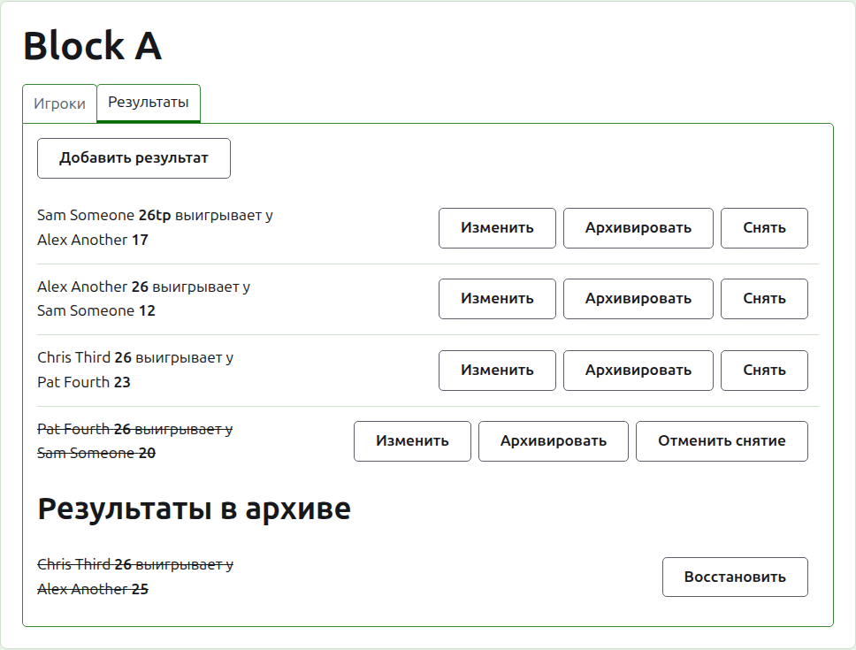
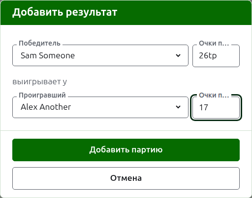
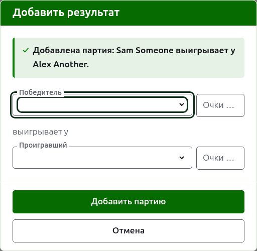
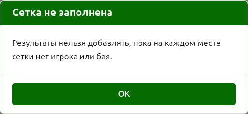
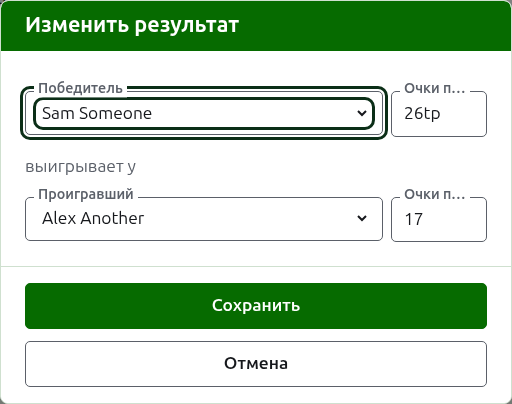

# Результаты

На вкладке **Результаты** страницы соревнования его партии вводят, исправляют и убирают в архив. Секретарь видит только эту вкладку и может делать на ней всё, что может организатор.

## Ввод результата

Нажмите **Добавить результат** над списком. Диалог читается так, как результат произносят вслух: победитель и его очки, затем «выигрывает у», затем проигравший и его очки.

Победитель и проигравший каждый выбираются из играющих игроков соревнования, в порядке соревнования. Изначально никто не выбран, чтобы партия никогда не была записана на игрока, которого вы не выбирали. В сетке плей-офф выбор победителя выбирает проигравшим того, с кем он сведён жеребьёвкой, там, где вы это видите и можете выбрать другого.

Очки набирают так, как записал их секретарь: число очков и всё, что за ним следует, которое сохраняется и показывается как набрано, например «26tp» для 26 воротец и тройного пила. Число — это цифры, с которых начинаются очки; очки, не начинающиеся с цифры, отклоняются.

Партия, выигранная при равных очках, например остановленная по времени и решённая иным способом, говорит, кто выиграл, пометкой после очков победителя: «6w» выигрывает у «6». На Croquet Scores пометки — это «w», «won» и «winner»; Gateball Scores принимает также «cb» и «so». Очков победителя должно быть больше, чем у проигравшего, либо они должны быть помечены, если только турнир не разрешает ничьи — тогда равные очки без пометки сохраняются как ничья.

Нажмите **Добавить партию**. Партия добавлена, диалог сообщает какая, а поля очищаются для следующей, потому что результаты приходят пачкой, считанной с доски в конце раунда. Нажмите **Отмена**, когда все введены.

Отказ объясняется под полем, к которому он относится: не выбран победитель или проигравший, очки не набраны или не начинаются с цифры, один и тот же игрок с обеих сторон, очки проигравшего помечены как выигранные или очки победителя меньше очков проигравшего. В сетке плей-офф два игрока, которым не предстоит играть друг с другом, отклоняются над полями.

## Сетку плей-офф сначала нужно заполнить

Соревнование плей-офф играется только тогда, когда на каждом месте его сетки стоит игрок или бай. До тех пор «Добавление результата» объясняет, почему результаты нельзя добавлять, вместо того чтобы открыть диалог.

## Список результатов

Действующие результаты перечислены в порядке ввода, старейший первым, так что список читается так, как игралось соревнование. Каждый называет победителя и его очки, затем проигравшего и его очки, и предлагает **Изменить** и **В архив**.

## Исправление результата

**Изменить** открывает тот же диалог на этом результате, с заголовком «Изменение результата», с выбранными игроками и очками как они были набраны. Нажмите **Сохранить**, чтобы сохранить исправление и закрыть диалог.

Исправление сохраняет исход: выигранная партия остаётся выигранной, а сыгранная вничью остаётся ничьей. Партию, исход которой был неверен, архивируют и вводят заново.

Там, где результат можно было бы архивировать, его игроков можно менять так же, как и очки. В сетке плей-офф результат, победитель которого уже сыграл в следующем раунде, сохраняет своих игроков, потому что изменение того, кто выиграл, оставило бы следующую партию сыгранной тем, кто туда не попал; исправить можно только его очки.

## Архивирование результата

**В архив** убирает результат в сторону, так что он ни в чём не учитывается. Он показан под заголовком **Результаты в архиве**, зачёркнутым, и ему предлагается только **Восстановить**. Ни то ни другое не спрашивает подтверждения, потому что каждое отменяет другое.

В сетке плей-офф победитель матча проходит в следующий раунд, поэтому результату матча, победитель которого сыграл в следующем раунде, «В архив» не предлагается. Сначала архивируют партию в следующем раунде, а потом можно и те, что перед ней. Где раунд — лучшая из 3 или 5, каждая партия матча удерживается так же. В группе и в швейцарской системе нет раундов, зависящих друг от друга, поэтому в них можно архивировать любой результат.

## Снятие результата

Игрока, покидающего соревнование, обычно снимают с него на вкладке «Игроки», и этого достаточно: он больше не играет, а сыгранные им партии остаются, но больше не учитываются в победах/поражениях и воротцах. Снятие результата — для более редкого случая, когда сыгранная партия не должна учитываться. Например, в австралийском President's Eights при снятии игрока результаты первого круга остаются, а из подсчёта убирают только его партии второго круга: снимите эти партии.

В группе или в швейцарской системе результат, который был сыгран, но не должен учитываться, снимают, а не архивируют. **Снять** оставляет его среди действующих результатов, на своём месте, но зачёркнутым и ни в чём не учитываемым на публичных страницах. **Вернуть** снова заставляет его учитываться. Ни то ни другое не спрашивает подтверждения. Результатам сетки плей-офф «Снять» не предлагается, потому что там результат решает больше, чем таблицу.

Далее: [Заметки](notes.md).
