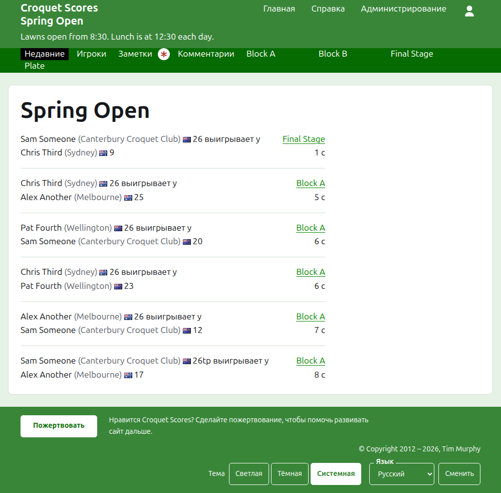
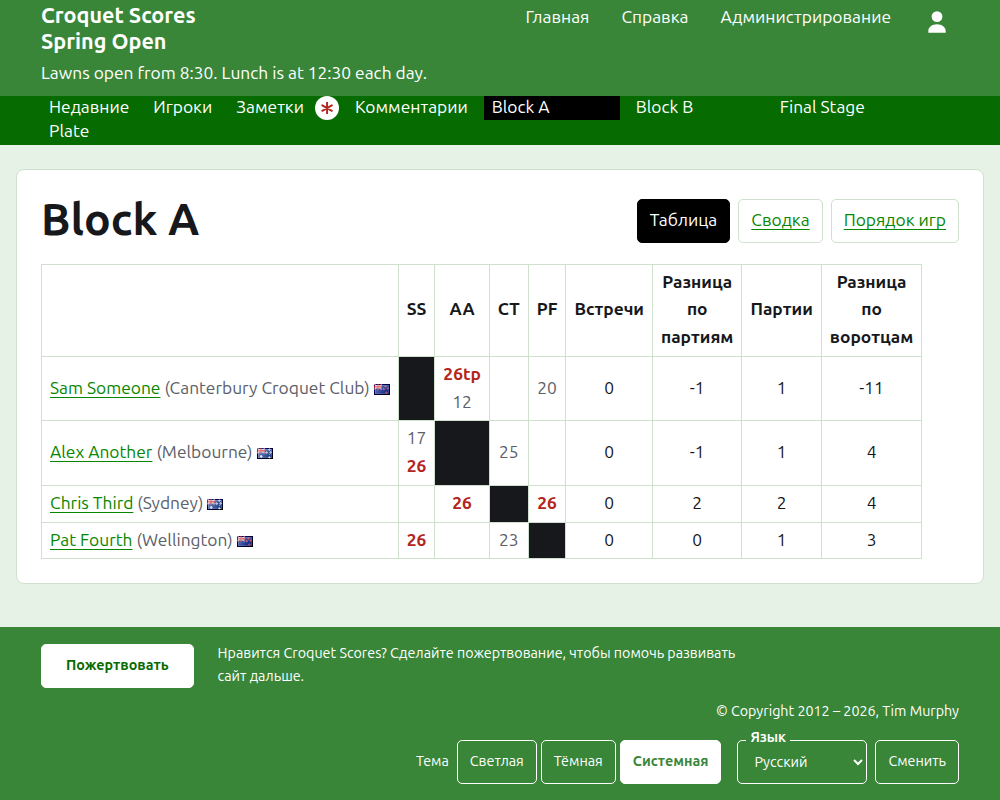
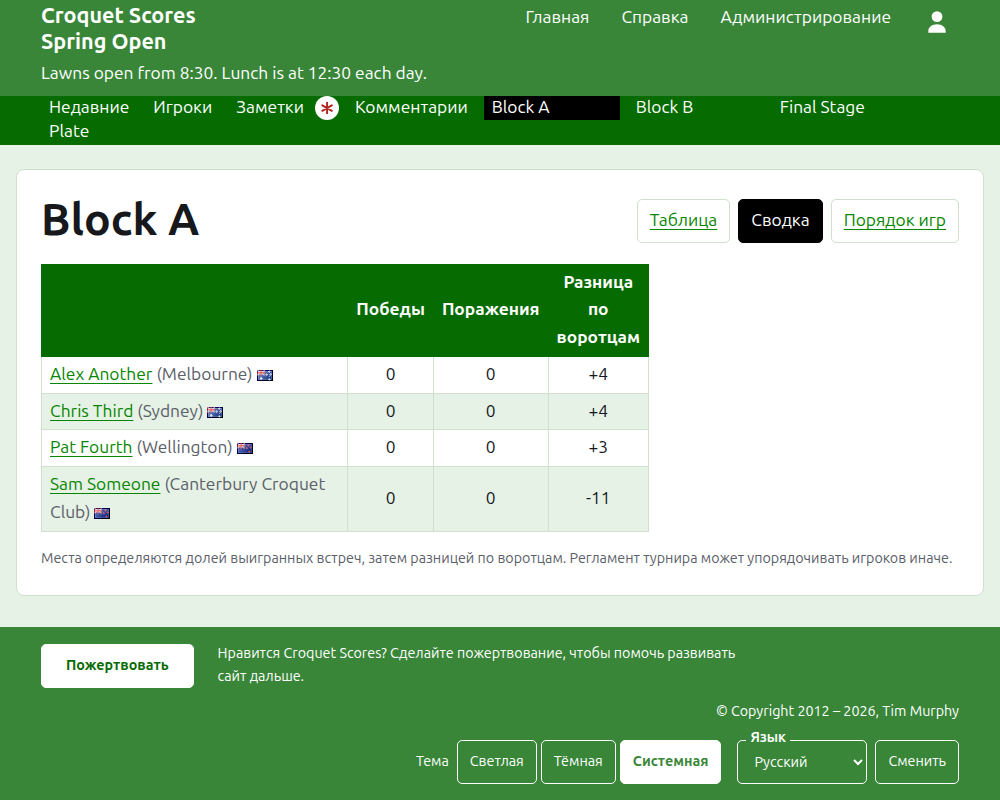
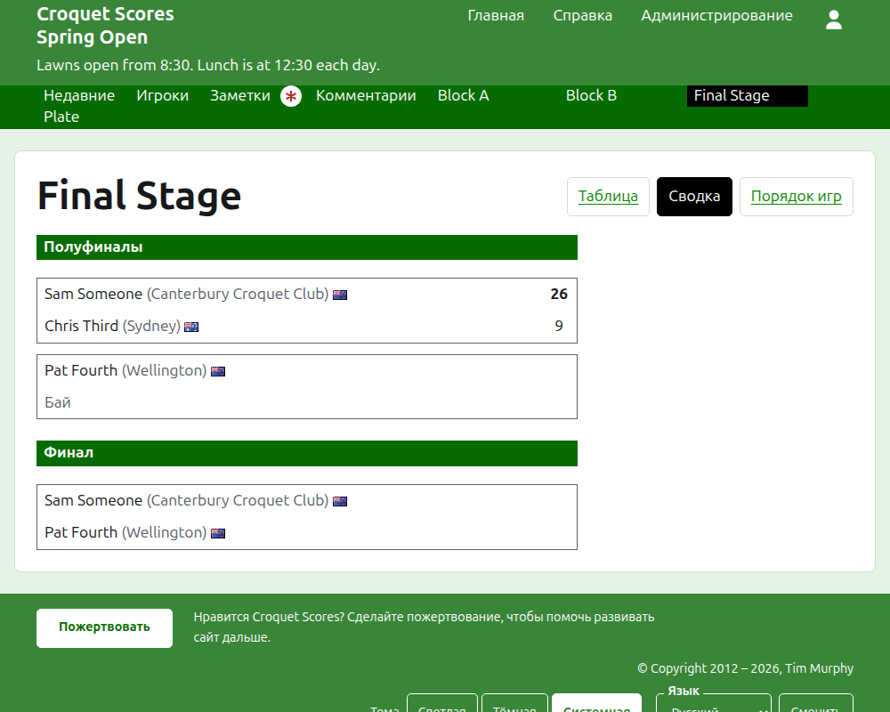
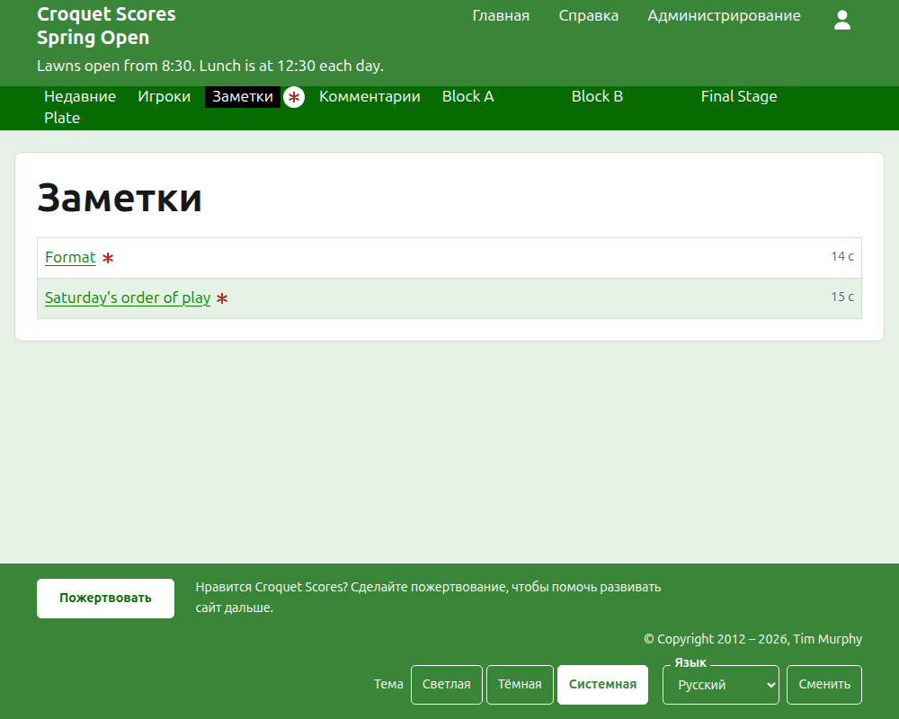

# Что видит публика

Ничего не публикуется: публичные страницы строятся из того, что хранит раздел администрирования, поэтому введённый результат сразу же на них. Им не нужны ни аккаунт, ни скрипты, и они свёрстаны для телефона.

## Страница турнира

Страница турнира находится по его году, виду спорта и названию, например `/2026/ac/spring-open`. Её возглавляет название турнира, а под ним подзаголовок. Она перечисляет каждую действующую партию, последняя добавленная первой, чтобы вернувшийся читатель видел, что произошло с тех пор. Каждая партия называет победителя, кого он представляет, его флаг и очки, затем проигравшего и его очки, а также соревнование, в котором она сыграна, и как давно её добавили.

Тёмно-зелёная полоса предлагает разделы турнира: **Недавние**, то есть эту страницу, **Игроки**, **Заметки** и **Комментарии**, затем каждое действующее соревнование в том порядке, в котором они стоят на вкладке «Соревнования». «Заметки» отмечены красной звёздочкой, пока есть заметка, которую читатель не прочитал.

## Группа

Страница группы показывает её результаты таблицей: строка и столбец для каждого игрока в порядке группы, а партии между двумя игроками — там, где строка встречается со столбцом, каждая отмечена как выигранная, проигранная или вничью для игрока строки. После столбцов игроков идут итоги каждого игрока. Где каждый матч — одна партия, это победы и разница по воротцам; где матч — лучшая из нескольких, это матчи, разница по партиям, партии и разница по воротцам.

Группа показывается тремя способами, предлагаемыми на строке её названия: **Таблица**, **Итоги** и **Порядок игр**. Сводка — вариант для телефона: игроки по местам, с их победами, поражениями и разницей по воротцам. Порядок игр перечисляет каждую партию, старейшую первой. Читатель, выбравший представление, сохраняет его для каждого соревнования, пока не выберет другое.

Строка снятого игрока говорит об этом. Снятый результат показан зачёркнутым и ни в чём не учитывается. Результат в архиве не показывается.

## Сетка плей-офф

Страница соревнования плей-офф рисует его сетку раунд за раундом: столбец для каждого раунда от первого до финала, две стороны каждого матча одна над другой и ячейка для каждой партии, из скольких матч — лучший. Матч следующего раунда стоит рядом с двумя матчами, между победителями которых он играется. На телефоне сетка прокручивается вбок, со стрелками к финалу и обратно.

## Швейцарская система

Страница швейцарской системы расставляет игроков по местам в таблице: их партии, победы, процент побед и результаты, каждый назван соперником и разницей, например «+4» для партии, выигранной с разницей в четыре.

## Игроки

Страница «Игроки» перечисляет каждого игрока турнира, который не в архиве, в алфавитном порядке, с тем, кого он представляет, и его флагом.

## Заметки

Страница «Заметки» перечисляет заметки турнира, последняя написанная первой, каждая ведёт на свою страницу и говорит, как давно её написали. Заметка, которую читатель не прочитал, отмечена красной звёздочкой, пока он её не откроет.

## Адреса, которые переезжают

Турнир сохраняет свой адрес, когда его название исправляют. Где он переезжает, потому что изменился его год или вид спорта, старый адрес ведёт на новый, так что сохранённая ранее ссылка по-прежнему работает. Страницы турнира в архиве не находятся, пока его не восстановят.
