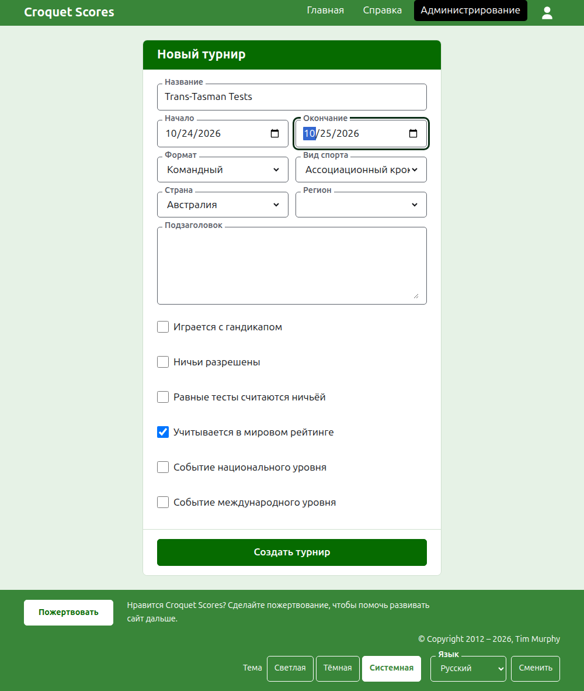
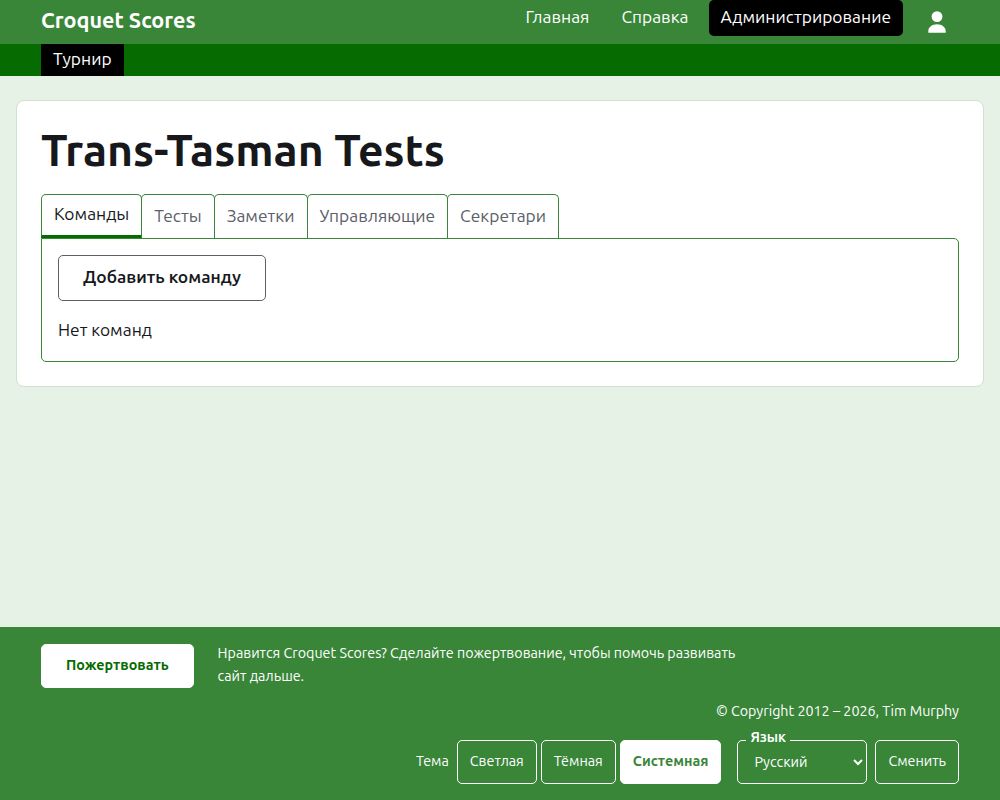

# Создание турнира

Нажмите **Новый турнир** над списком турниров в разделе администрирования. Кнопка стоит над списком, а не под ним, чтобы длинный список не вытеснил её с экрана телефона.

Форма спрашивает всё, с чего начинается турнир. Важнее всего здесь **Формат** — именно он делает турнир командным.

## Что спрашивает форма

**Название.** То, по чему читатели ищут турнир, например «Trans-Tasman Tests». От 3 до 254 символов. Название целиком строчными или целиком заглавными буквами отклоняется, потому что на каждой странице оно выглядело бы как ошибка. У двух турниров может быть одно и то же название, ведь один и тот же турнир проводится каждый год.

**Начало** и **Окончание.** Дни, в которые идёт турнир. Каждый тест играется внутри них, так что задайте их так, чтобы они охватывали всё событие. Турнир не может закончиться раньше, чем начался, и не может начаться или закончиться позже конца следующего года. Турнир относится к году, в котором начинается, и этот же год стоит в его адресе.

**Формат.** Выберите один из командных форматов:

- **Командный** — общий формат для любого события между командами.
- **Кубок Эйре**, **Межштатный щит** и **Командный чемпионат мира по гольф-крокету** — конкретные события, каждое выделено в собственный формат, чтобы его можно было проводить так, как проводится это событие.

Стандартный — единственный формат, не играемый командами, и здесь он вам не нужен. Gateball Scores не предлагает формат, потому что каждый турнир там — стандартный турнир по гейтболу; командный турнир создают на Croquet Scores.

**Вид спорта.** Виды спорта, которые предлагает сайт, в его порядке: Ассоциационный крокет, Гольф-крокет, Американский крокет на 6 воротах и Рикошет.

**Страна** и **Регион.** Где проводится турнир. Регион спрашивается только там, где выбранная страна делится на регионы, как штаты Австралии, и даже тогда его можно не выбирать.

**Подзаголовок.** Всё, что вы хотите сообщить читателям и для чего нет отдельного поля: где парковаться, когда обед, кому звонить. Он показывается под названием турнира на каждой публичной странице. Он пишется на Markdown, так что слово можно выделить жирным, окружив его звёздочками, а список сделать, поставив дефис в начале каждой строки. Он может быть до 2000 символов, и его можно оставить пустым.

Как играются и учитываются его тесты — с форой, с ничьими, в мировых рейтингах — каждый тест говорит сам, когда его добавляют.

**Событие национального уровня** и **Событие международного уровня.** Турнир может быть одним, другим или ни тем ни другим, но никогда обоими: отметка одного снимает другое.

## Создание

Нажмите **Создать турнир**. Вы попадёте на страницу турнира в разделе администрирования, открытую на вкладке «Команды», и вы — его первый организатор. В разделе администрирования он показан под годом, в котором начинается.

Публичный адрес турнира составляется из его года, вида спорта и названия, например `/2026/ac/trans-tasman-tests`. Он сохраняет этот адрес, когда название потом исправляют, чтобы уже отправленная ссылка по-прежнему его находила; он переезжает только тогда, когда меняется год начала или вид спорта.

## Если что-то отклонено

Что отклонено, сказано под полем, к которому это относится, а введённое вами остаётся на месте. Ничего не сохраняется, пока не принято каждое поле. Чаще всего отклоняют название, набранное целиком строчными буквами, окончание раньше начала и невыбранную страну.

Далее: [Команды](teams.md).
