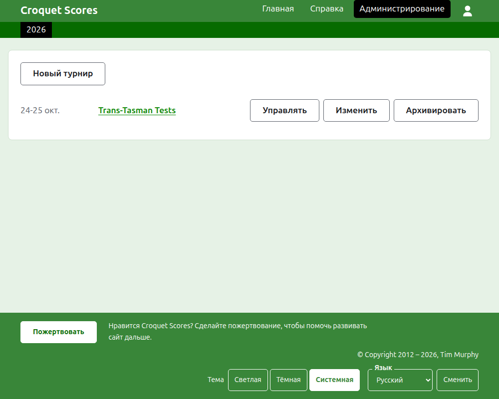
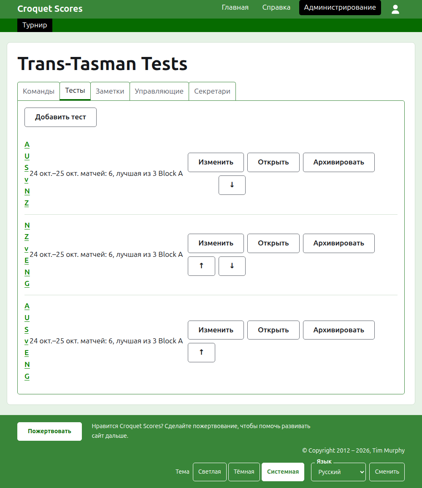

# Проведение командного турнира

Командный турнир — это турнир, в котором встречаются стороны, а не игроки, заявленные по одному: тестовая серия между двумя странами, межштатный щит, командный чемпионат мира. Его команды создают вместе с их игроками, добавляют тесты между командами, и партии каждого теста появляются по мере того, как они сыграны. Это руководство ведёт управляющего от входа на сайт до турнира, результаты которого открыты публике.

Оно самостоятельно. Ничто в нём не зависит от руководства по стандартному турниру, которое написано отдельно.

## Прежде чем начать

Вам нужна учётная запись. Нажмите [здесь](/account/register), чтобы зарегистрироваться.

Всё, что делает управляющий, делается в разделе администрирования сайта. Публичные страницы, на которых игроки и зрители следят за турниром, строятся из того, что хранит раздел администрирования, поэтому ничего не нужно публиковать: введённый результат сразу же оказывается на публичных страницах.

## Слова

**Команда** — это сторона, например Австралия, с названием, кратким названием, таким как «AUS», и флагом. У команды есть свои **игроки**, которые играют за неё и ни за кого другого. **Тест** — это встреча двух команд, называемая по их кратким названиям, как «AUS v ENG», и составленная из некоторого числа **матчей** между игроком одной команды и игроком другой, где каждый матч — лучшая из некоторого числа **партий**. Тесты можно объединять в **группы**, как «Block A», когда много команд играют между собой.

## Страницы по порядку

1. [Создание турнира](creating-a-tournament.md): его название, дни, вид спорта, формат и место проведения.
2. [Команды](teams.md): как добавить команды с их краткими названиями и флагами.
3. [Игроки команды](team-players.md): как заявить игроков каждой команды на её собственной странице.
4. [Тесты](tests.md): как добавить тесты между командами, их дни, сколько матчей в каждом и их группы.
5. [Результаты](scores.md): как вводить партии теста, исправлять их и убирать введённые по ошибке.
6. [Заметки](notes.md): как сообщать игрокам то, что им нужно знать по ходу турнира.
7. [Управляющие и секретари](managers-and-scorers.md): как разделить управление турниром с другими и позволить кому-то вводить результаты, не давая менять ничего другого.
8. [Рейтинги](rankings.md): файл, который отправляется в мировой рейтинг, и то, что остаётся заполнить вам.
9. [Изменение, архивирование и восстановление турнира](changing-and-archiving.md): как исправить сведения о турнире и убрать турнир в архив.
10. [Что видит публика](what-the-public-sees.md): страницы, за которыми следят ваши игроки, и как на них появляется то, что вы вводите.

## Как устроен раздел администрирования

Главная страница раздела администрирования показывает турниры, в которых вы участвуете, по одному году за раз.

Нажатие на название турнира или на **Управлять** открывает его страницу. Всё, чем нужно управлять, находится на шести вкладках под его названием: **Команды**, **Тесты**, **Заметки**, **Управляющие**, **Секретари** и **Рейтинги**. Страница открывается на вкладке «Команды», потому что команды создают первыми.

Тёмно-зелёная полоса под шапкой служит для перехода между страницами. На странице турнира и на странице теста она ведёт к турниру, как **Турнир**, и к каждому тесту по его названию. На странице команды она вместо этого ведёт к турниру и к каждой команде по её краткому названию, потому что управляющий на странице команды заявляет игроков команда за командой. Страница, на которой вы находитесь, отмечена чёрным.

## Что действует везде

**Безвозвратно удаляется только заметка.** Команды, игроки, тесты, результаты и сам турнир не удаляются, а архивируются: их убирают в сторону, зачёркивают и показывают под отдельным заголовком, с кнопкой **Восстановить**, чтобы вернуть. Архивирование, восстановление и перемещение выше и ниже никогда не просят подтверждения, потому что каждое из них отменяется нажатием в обратную сторону. То, что отменить нельзя, например удаление заметки или удаление управляющего, сначала спрашивает.

**Диалог поверх страницы ничего не сохраняет, пока вы не нажмёте его кнопку.** «Отмена» или клавиша Escape закрывает его и оставляет всё как было. Диалоги, которые что-то добавляют, такие как «Добавить команду» и «Добавить результат», остаются открытыми после каждого добавления, чтобы список можно было ввести подряд.

**Отказ объясняется рядом с полем, к которому он относится.** Отклонённое не сохраняется, а введённое вами остаётся на месте, чтобы его можно было исправить, а не вводить заново.

**Раздел администрирования работает на телефоне.** Каждая кнопка достаточно велика, чтобы нажать её большим пальцем, и ничто не шире экрана.

Далее: [Создание турнира](creating-a-tournament.md).
