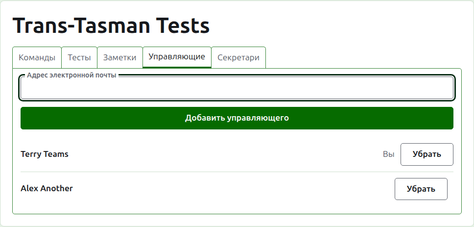
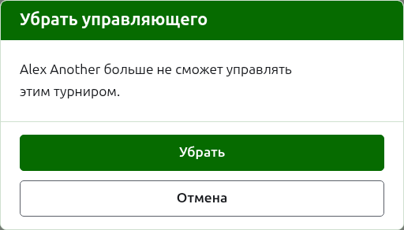
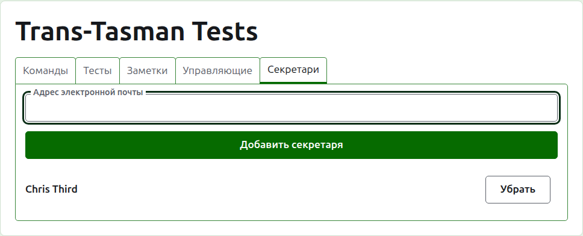
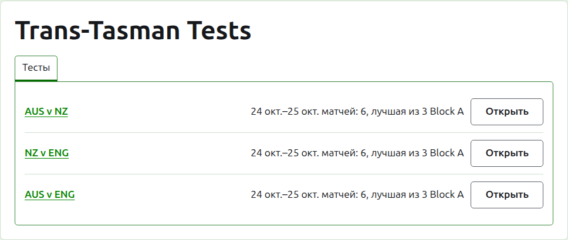

# Управляющие и секретари

У турнира есть управляющие, которые могут делать с ним всё, что с ним можно делать, и могут быть секретари, которые вводят его результаты и ничего больше. Тот, кто создал турнир, — его первый управляющий.

## Управляющие

Вкладка **Управляющие** перечисляет, кто управляет турниром, в порядке назначения, и ваше собственное имя отмечено как ваше. Здесь турнир делят с другими или передают.

Управляющим человека делают по адресу электронной почты. Введите его в поле над списком и нажмите **Добавить управляющего**. Адрес должен принадлежать зарегистрированной и подтверждённой учётной записи; адрес без неё отклоняется под полем, и сайт больше ничего об этом не говорит. Секретарь, ставший управляющим, перестаёт быть секретарём.

**Убрать** снимает управляющего. От убранного управляющего ничего не сохраняется, поэтому «Убрать» сначала спрашивает; если он снова нужен, его снова делают управляющим по адресу. У турнира всегда есть управляющий, поэтому последнему «Убрать» не предлагается.

Вы можете убрать себя. Вопрос тогда говорит, что это значит: вы теряете собственный путь обратно к турниру, и никто на странице не сможет отменить это за вас. Другой управляющий может снова сделать вас управляющим.

## Секретари

Вкладка **Секретари** — та же вкладка «Управляющие», но для секретарей, и работает так же: адрес электронной почты и **Добавить секретаря** над списком и **Убрать** у каждого.

Секретарь видит турнир в своём списке в разделе администрирования, с **Результаты** вместо «Управлять», и ему предлагаются только его тесты: ни команд, ни заметок, ни управляющих, ни секретарей, ни рейтингов. Он не может открыть страницу команды, потому что кто играет за команду, решают управляющие. На странице теста он может вводить, исправлять, архивировать, восстанавливать и переставлять результаты, как управляющий.

Управляющего не делают секретарём, потому что управляющий уже может делать всё, что может секретарь. Турниру секретарь не нужен, поэтому убрать можно любого секретаря, включая последнего.

Далее: [Рейтинги](rankings.md).
