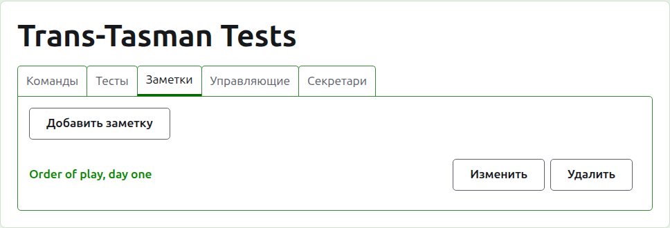
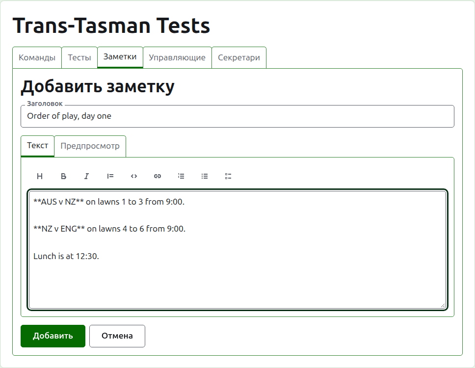
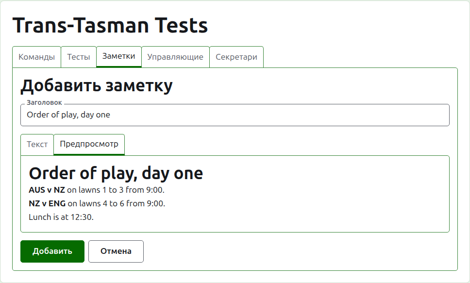
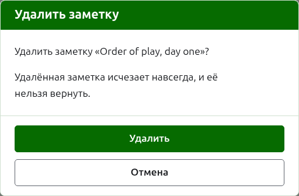

# Заметки

На вкладке **Заметки** страницы турнира его управляющие пишут то, что игрокам нужно знать по ходу турнира: порядок игр, смену площадок, время обеда. Читатели находят их на публичной странице «Заметки» турнира, и непрочитанная заметка отмечена там красной звёздочкой, которая также отмечает раздел «Заметки» на каждой странице турнира, пока её не откроют.

## Написание заметки

Нажмите **Добавить заметку** над списком. Место списка занимает панель, потому что заметка пишется подробно и ей нужно место.

**Заголовок** обязателен, и по нему заметка показана в списке. Это простой текст.

**Описание** пишется на Markdown, и его можно оставить пустым, когда заголовок говорит всё, что нужно сказать. Панель инструментов над полем пишет Markdown за вас: Заголовок, Жирный, Курсив, Цитата, Код, Ссылка, Нумерованный список, Маркированный список и Список задач. Каждый инструмент работает с выделенным, или в начале каждой выделенной строки, или ставит курсор туда, куда идут слова.

**Предпросмотр** показывает заметку такой, какой читатель увидит её на её странице.

Нажмите **Добавить**. Заметка сохранена, список возвращается с ней наверху, и она сразу же на публичной странице «Заметки».

## Изменение заметки

Нажмите на заголовок заметки или на её **Изменить**, чтобы открыть панель на этой заметке. Нажмите **Сохранить**, чтобы сохранить изменение. Заметка, изменённая после того, как читатель её прочитал, снова отмечается для него.

## Удаление заметки

Заметку, которая больше не относится к делу, удаляют. Удалённая заметка исчезает навсегда, поэтому **Удалить** сначала спрашивает.

Далее: [Управляющие и секретари](managers-and-scorers.md).
