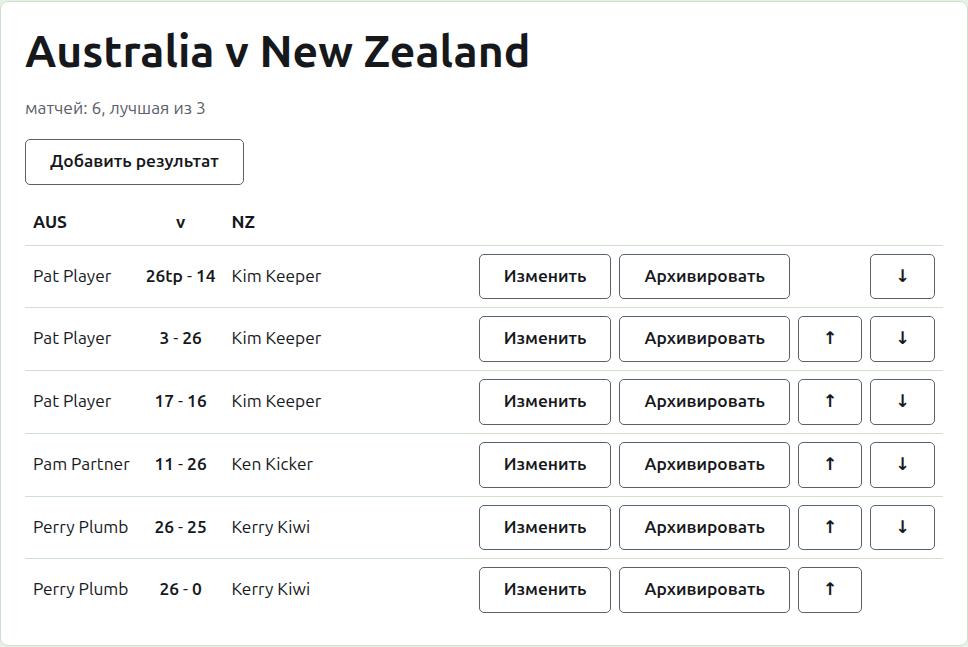
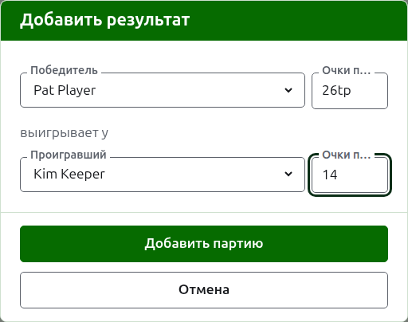

# Результаты

Страница теста открывается по его названию на вкладке «Тесты» или из тёмно-зелёной полосы. Её возглавляют полные названия его команд, как «Australia v New Zealand», а под ними — сколько матчей в нём ожидается и из скольких партий каждый. Его результаты и есть страница, без вкладок. Организатор и секретарь видят одну и ту же страницу, потому что секретарь может делать с результатом всё, что может организатор.

## Как расположены результаты

Результаты расположены по командам, а не по тому, кто выиграл, в таблице, озаглавленной кратким названием первой команды, «v» и кратким названием второй. Каждый результат — строка: игрок первой команды, затем оба счёта, первым счёт первой команды, как «26tp - 14», затем игрок второй команды, кто бы из них ни выиграл. Результаты в архиве расположены так же ниже.

## Ввод результата {#entering-a-score}

Нажмите **Добавить результат** над списком. Диалог читается так, как результат произносят вслух: победитель и его очки, затем «выигрывает у», затем проигравший и его очки.

Победитель выбирается из действующих игроков обеих команд, под названием каждой команды, сначала игроки первой команды, а игроки каждой команды — в порядке команды. Изначально никто не выбран. Как только победитель выбран, проигравший предлагается только из другой команды, потому что партия между двумя игроками одной команды — не партия между командами. Игрок в архиве не предлагается.

Очки набирают так, как записал их секретарь: число очков и всё, что за ним следует, которое сохраняется и показывается как набрано, например «26tp» для 26 воротец и тройного пила. Число — это цифры, с которых начинаются очки; очки, не начинающиеся с цифры, отклоняются.

Партия, выигранная при равных очках, например остановленная по времени и решённая иным способом, говорит, кто выиграл, пометкой после очков победителя: «6w» выигрывает у «6». Пометки — это «w», «won» и «winner». Очков победителя должно быть больше, чем у проигравшего, либо они должны быть помечены, если только турнир не разрешает ничьи — тогда равные очки без пометки сохраняются как ничья.

Нажмите **Добавить партию**. Партия добавлена, диалог сообщает какая, а поля очищаются для следующей, потому что результаты приходят пачкой, считанной с доски в конце сессии. Нажмите **Отмена**, когда все введены.

## Матчи

Два встретившихся игрока играют матч из того числа партий, какое задано тесту. Партии между ними — партии этого матча, и партия между двумя игроками, матч которых уже решён, отклоняется: один из них выиграл больше партий, чем другой ещё мог бы выиграть, или сыграны все партии матча.

Матч начат, когда у его двух игроков есть действующая партия. Тест начинает не больше матчей, чем в нём ожидается: как только начато столько, партия между двумя ещё не встречавшимися игроками отклоняется, а ещё одна партия уже начатого матча принимается. Где в тесте должно быть больше матчей, измените его на вкладке «Тесты», чтобы он их ожидал.

## Исправление результата {#correcting-a-score}

**Изменить** открывает тот же диалог на этом результате, с заголовком «Изменение результата», с выбранными игроками и очками как они были набраны. Его игроков можно менять так же, как и очки, выбирая их как при добавлении. Нажмите **Сохранить**, чтобы сохранить исправление и закрыть диалог. Исправление сохраняет исход: выигранная партия остаётся выигранной, а сыгранная вничью остаётся ничьей. Партию, исход которой был неверен, архивируют и вводят заново.

## Порядок результатов

Результаты приходят в том порядке, в котором их вводят, поэтому каждый действующий результат предлагает **Вверх** и **Вниз**, которые меняют его местами с соседним, чтобы список можно было расставить в порядке, в котором игрались партии.

## Архивирование результата

**В архив** убирает результат в сторону, так что он ни в чём не учитывается. Он показан под заголовком **Результаты в архиве**, зачёркнутым, и ему предлагается только **Восстановить**. Ни то ни другое не спрашивает подтверждения, потому что каждое отменяет другое. В тесте можно архивировать любой результат, потому что у теста нет раундов, зависящих друг от друга.

Результат, игрок которого с тех пор архивирован, не восстанавливается, пока не восстановлен игрок, и страница говорит об этом.

Далее: [Заметки](notes.md).
