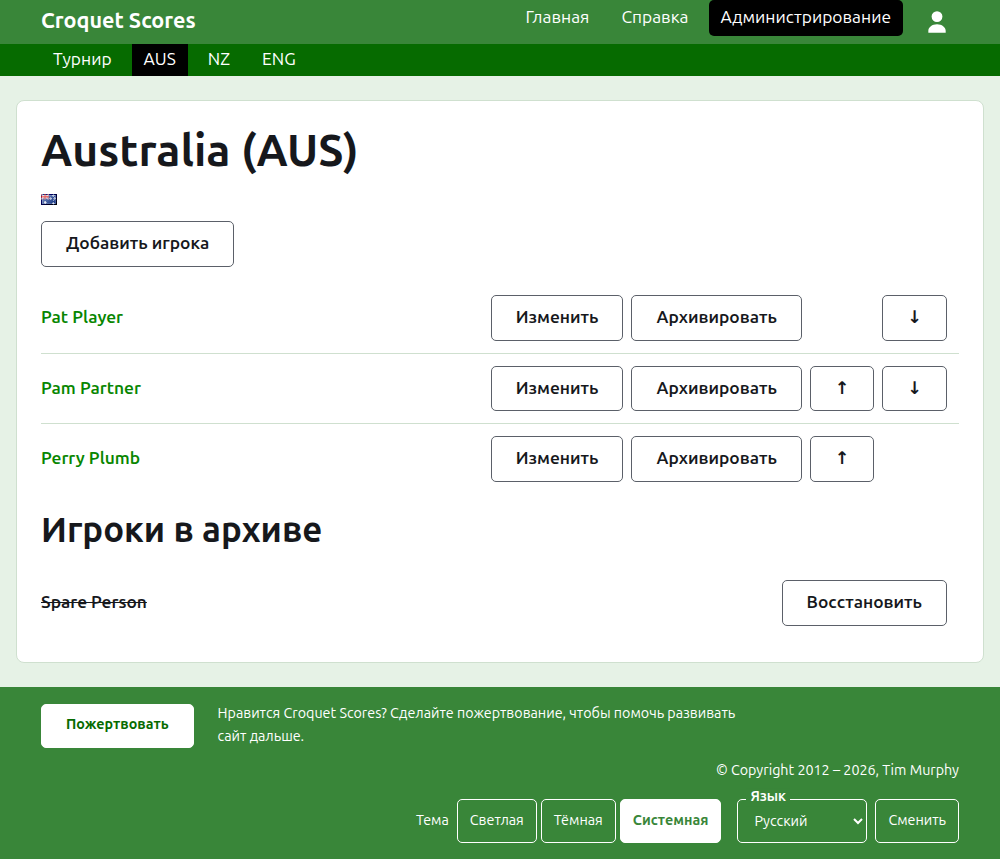
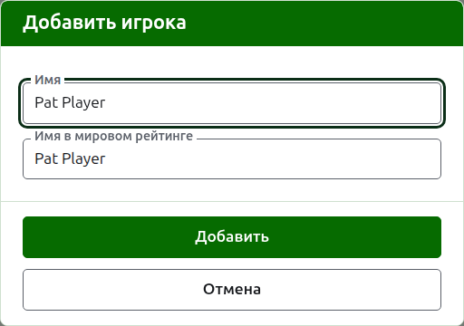

# Игроки команды

Страница команды открывается по её названию или по её **Открыть** на вкладке «Команды». Её возглавляют название команды с кратким названием в скобках и её флаг, чтобы организатор, попавший не к той команде, сразу это увидел. Показывать ей нужно одно — игроков команды, поэтому список и есть страница.

Тёмно-зелёная полоса на странице команды ведёт к турниру и к каждой действующей команде по её краткому названию, чтобы игроков можно было заявлять команда за командой, не возвращаясь на вкладку «Команды».

Игрок в команде принадлежит только этой команде, представляет команду и играет под флагом команды, а не под своим собственным. Один и тот же человек, играющий за две команды или в двух турнирах, — игрок в каждой из них.

## Добавление игрока {#adding-a-player}

Нажмите **Добавить игрока** над списком. Поверх страницы откроется диалог.

**Имя** обязательно, от 3 до 254 символов. У двух игроков одной команды не может быть одного и того же имени, как бы ни различались заглавные буквы; игрок другой команды может носить такое же.

**Имя игрока в мировом рейтинге** — имя, под которым игрока знает мировой рейтинг. Спрашивается только в турнире по ассоциационному крокету или гольф-крокету — двум видам спорта, игроков которых мировой рейтинг ведёт списком. Игроки американского крокета на 6 воротах известны рейтингу под собственными именами, поэтому там оно не спрашивается, а имя каждого игрока в мировом рейтинге всегда совпадает с его именем. Пока вы добавляете игрока, оно повторяет имя по мере того, как вы его набираете, и перестаёт повторять, как только вы начнёте набирать в нём. Оставленное пустым, оно сохраняется как имя игрока. Пока вы набираете, предлагаются известные мировому рейтингу игроки, чьи имена так начинаются, а рядом с именем в мировом рейтинге галочка говорит, что рейтинг знает это имя, а вопросительный знак — что не знает. Это только подсказка: имя, неизвестное рейтингу, сохраняется так же легко, как известное.

Игрока никогда не называют «Bye»: имя, первое слово которого — английское «bye», отклоняется.

Нажмите **Добавить**. Игрок добавлен, диалог сообщает об этом, его поля очищаются для следующего, а курсор возвращается в имя. Добавьте так всю команду, затем нажмите **Отмена**, чтобы закрыть диалог.

## Исправление игрока {#correcting-a-player}

Нажмите на имя игрока или на его **Изменить**, чтобы открыть тот же диалог на этом игроке, с заголовком «Изменение игрока». Нажмите **Сохранить**, чтобы сохранить изменение. Игрок, чьё имя исправлено, сохраняет прежнее имя в мировом рейтинге, кроме американского крокета на 6 воротах, где имя игрока в мировом рейтинге всегда совпадает с его именем.

## Порядок

Игроки перечислены в порядке команды — в том порядке, в котором их предлагают при вводе результата теста. **Вверх** и **Вниз** перемещают игрока на одно место внутри команды.

## Архивирование игрока

**В архив** убирает игрока в сторону: добавленного по ошибке или больше не состоящего в команде. Игрок в архиве показан под заголовком **Игроки в архиве**, зачёркнутым, после действующих игроков, и ему предлагается только **Восстановить**. Архивирование никогда не спрашивает подтверждения, потому что игрок команды ни во что другое не заявлен, и восстановление возвращает всё обратно.

Игрока, сыгравшего хотя бы одну действующую партию в тесте, архивировать нельзя, потому что партии тогда оказались бы против того, кого больше нет, поэтому такому игроку «В архив» не предлагается. Игрока, все партии которого в архиве, архивировать можно.

Далее: [Тесты](tests.md).
