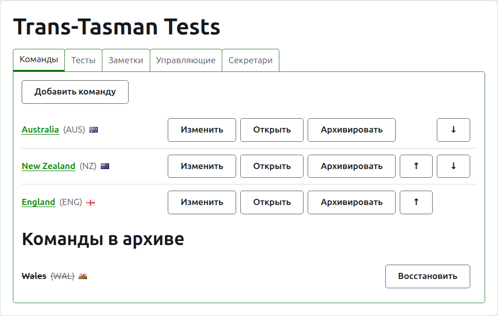
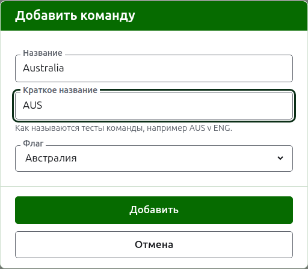
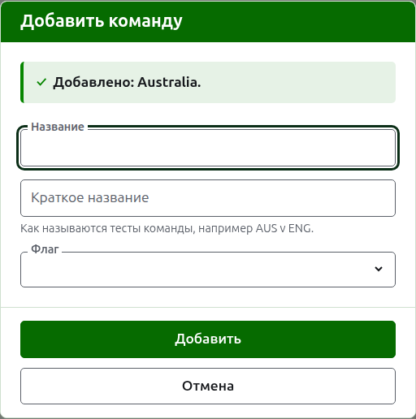
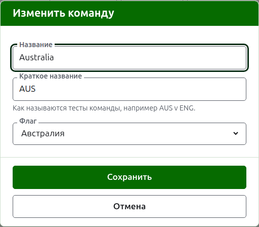

# Команды

На вкладке **Команды** страницы турнира его команды добавляют, исправляют, расставляют по порядку и убирают в архив. Страница открывается на этой вкладке, потому что команды создают первыми. Тест играется между двумя командами, поэтому прежде чем добавить хотя бы один тест, нужны как минимум две.

## Добавление команды

Нажмите **Добавить команду** над списком. Поверх страницы откроется диалог.

**Название** обязательно: полное название команды, как «Australia», которое возглавляет страницу команды и таблицы публичных страниц. У двух команд одного турнира не может быть одного и того же названия.

**Краткое название** тоже обязательно: по нему называются тесты команды, как «AUS v ENG», и так называет команду тёмно-зелёная полоса. Оно не длиннее 10 символов и не длиннее названия, потому что краткое название длиннее того, что оно сокращает, — это два поля, перепутанные местами. У двух команд не может быть и одного краткого названия.

**Флаг** показывается рядом с названием команды везде, где оно появляется. Можно оставить без флага, как для команды клуба или региона.

Нажмите **Добавить**. Команда добавлена, диалог сообщает об этом, и его поля очищаются для следующей. Добавьте так весь список, затем нажмите **Отмена**, чтобы закрыть диалог. «Отмена» не сохраняет ничего, что ещё не было добавлено.

## Исправление команды

Нажмите **Изменить** у команды, чтобы открыть тот же диалог на этой команде, с заголовком «Изменение команды». Исправьте то, что неверно, и нажмите **Сохранить**. Команда, у которой меняется краткое название, везде называется новым, так что её тесты переименовываются вместе с ней.

## Порядок

Команды перечислены в порядке турнира — в том порядке, в котором их предлагают при добавлении теста, в котором их показывает тёмно-зелёная полоса и в котором их перечисляет публичная страница «Игроки». **Вверх** и **Вниз**, стрелки в конце каждой строки, перемещают команду на одно место.

## Переход к команде

Название команды или **Открыть** открывает собственную страницу команды, где заявляют её игроков. См. [Игроки команды](team-players.md).

## Архивирование команды

**В архив** убирает команду в сторону. Её игроки остаются с ней и возвращаются при восстановлении, поэтому архивирование не спрашивает подтверждения. Команда в архиве показана под заголовком **Команды в архиве**, зачёркнутой, ей предлагается только **Восстановить**, и её страница закрыта, пока её не восстановят.

Команду, играющую в действующем тесте, архивировать нельзя, потому что тест тогда оказался бы против команды, которой больше нет, поэтому такой команде «В архив» не предлагается. Команду, все тесты которой в архиве, архивировать можно.

Далее: [Игроки команды](team-players.md).
