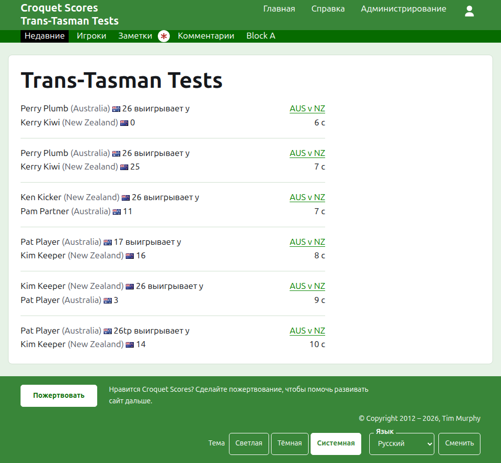
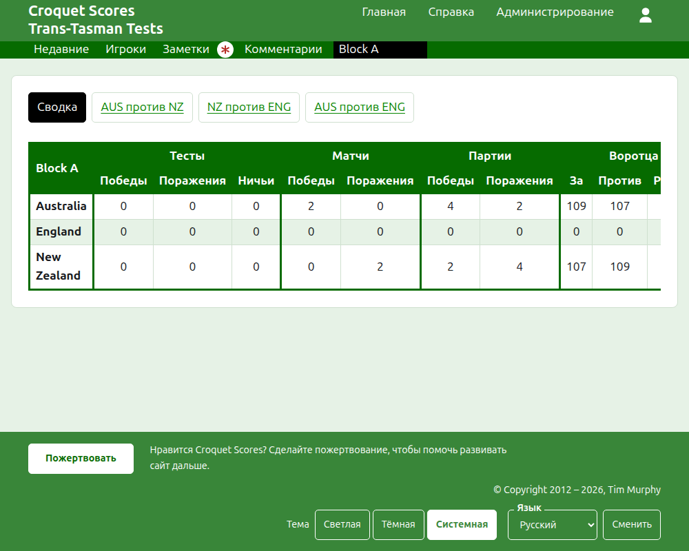
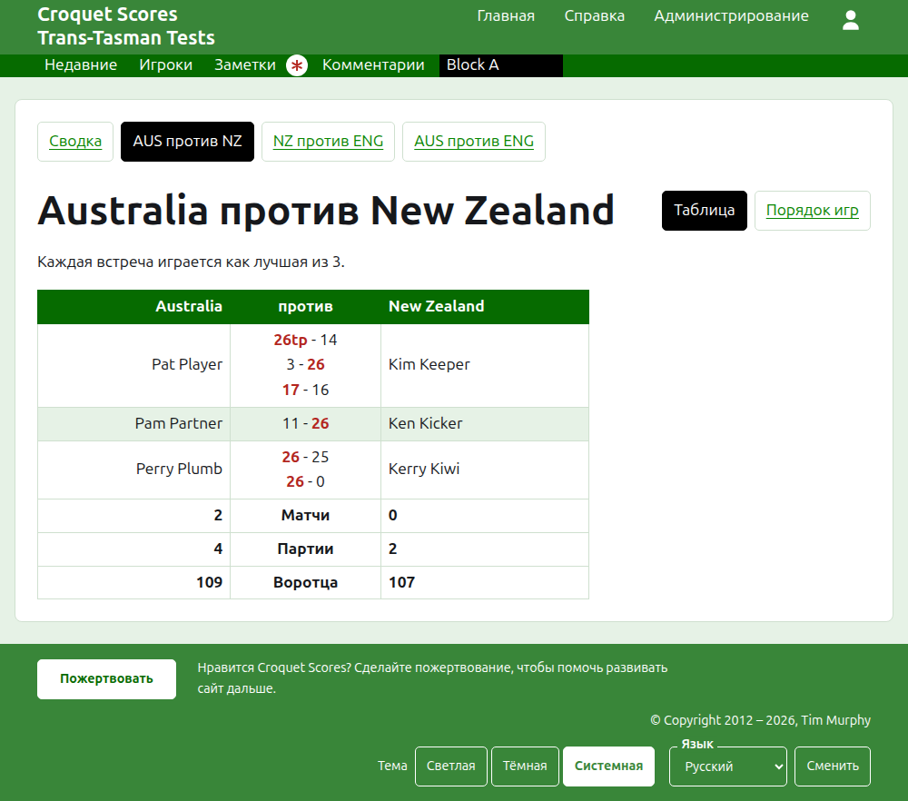
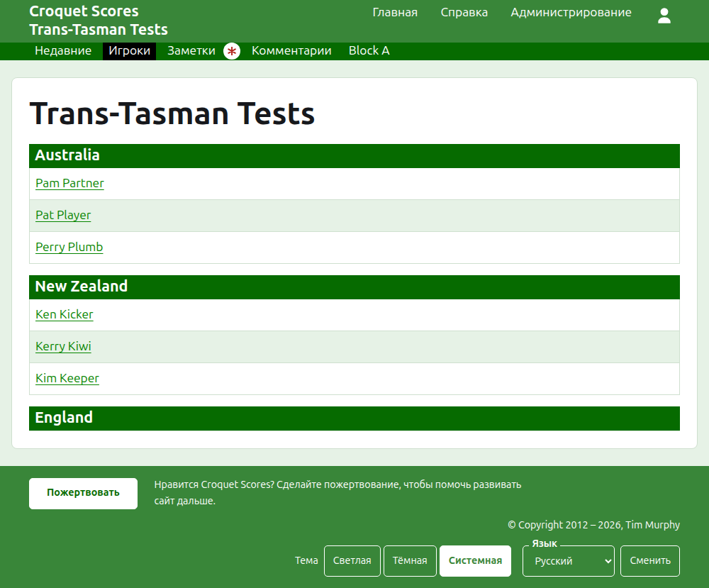

# Что видит публика

Ничего не публикуется: публичные страницы строятся из того, что хранит раздел администрирования, поэтому введённый результат сразу же на них. Им не нужны ни аккаунт, ни скрипты, и они свёрстаны для телефона.

## Страница турнира

Страница турнира находится по его году, виду спорта и названию, например `/2026/ac/trans-tasman-tests`. Её возглавляет название турнира, а под ним подзаголовок. Она перечисляет каждую действующую партию, последняя добавленная первой, чтобы вернувшийся читатель видел, что произошло с тех пор. Каждая партия называет победителя, его команду и очки, затем проигравшего и его очки, а также тест, в котором она сыграна, и как давно её добавили.

Тёмно-зелёная полоса предлагает разделы турнира: **Недавние**, то есть эту страницу, **Итоги**, **Игроки**, **Заметки** и **Комментарии**, затем тесты. Тест назван кратким названиями его команд со словом «против» между ними, как «AUS против NZ». Тесты в группе не предлагаются по одному: группа — один раздел, названный как группа, стоящий там, где стоял бы её первый тест. «Заметки» отмечены красной звёздочкой, пока есть заметка, которую читатель не прочитал.

## Сводка

У турнира, тесты которого не состоят ни в одной группе, есть **Итоги**: одна таблица всех команд по местам, с выигранными, проигранными и сыгранными вничью тестами, выигранными и проигранными партиями, воротцами за, против и разницей. Где матчи какого-либо теста — лучшие из нескольких партий, выигранные и проигранные матчи идут после тестов. В сводке читатель ищет каждую команду как целое.

У турнира, в котором есть тест в группе, сводки нет. Вместо неё страница каждой группы показывает положение команд этой группы, потому что одна таблица команд из разных групп, никогда не игравших между собой, ничего бы не ранжировала.

## Группа

Страница группы показывает положение команд группы, считая только тесты группы, в той же таблице, что и сводка. Над таблицей, отдельным рядом, она предлагает **Итоги**, то есть эту страницу, и каждый из тестов группы, ведущий на страницу теста.

## Тест

Страницу теста возглавляют полные названия его команд, как «Australia против New Zealand», и она говорит, из скольких партий каждый матч. Её таблица озаглавлена двумя командами, первая слева. Каждый сыгранный матч — строка, в порядке начала, с игроком первой команды слева, игроком второй справа и партиями матча между ними, в каждой сначала очки первой стороны, затем второй, очки победителя отмечены. Под матчами — партии и воротца каждой команды, а где каждый матч — лучший из нескольких партий, и её выигранные матчи, каждое на своей стороне.

Тест показывается двумя способами, предлагаемыми на строке его названия: **Таблица**, то есть эта таблица, и **Порядок игр**, который перечисляет каждую партию теста, старейшую первой. Тест в группе предлагает сводку и тесты своей группы рядом над своим заголовком, с этим тестом отмеченным.

## Игроки

Страница «Игроки» перечисляет игроков команда за командой: каждая команда под заголовком со своим названием, в порядке команд турнира, а под ней её игроки в алфавитном порядке.

## Заметки

Страница «Заметки» перечисляет заметки турнира, последняя написанная первой, каждая ведёт на свою страницу и говорит, как давно её написали. Заметка, которую читатель не прочитал, отмечена красной звёздочкой, пока он её не откроет.

## Адреса, которые переезжают

Турнир сохраняет свой адрес, когда его название исправляют. Где он переезжает, потому что изменился его год или вид спорта, старый адрес ведёт на новый, так что сохранённая ранее ссылка по-прежнему работает. Страницы турнира в архиве не находятся, пока его не восстановят.
