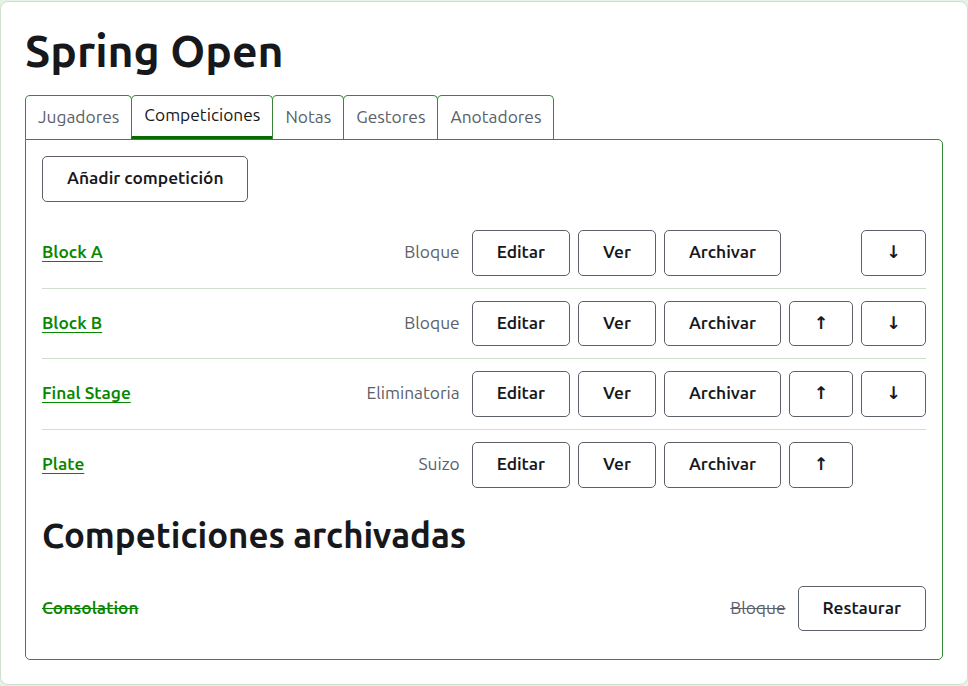
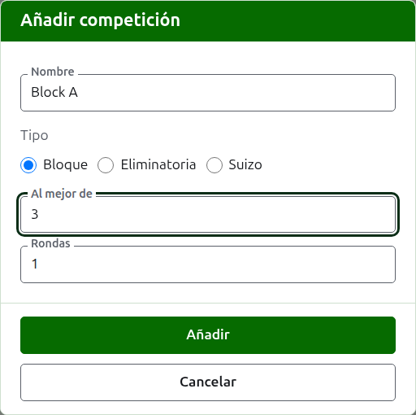
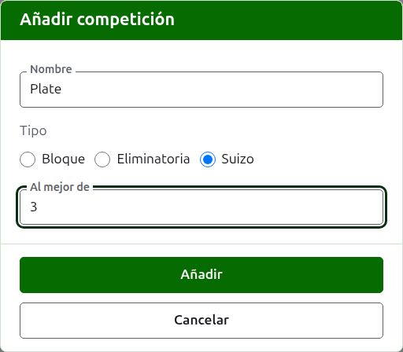
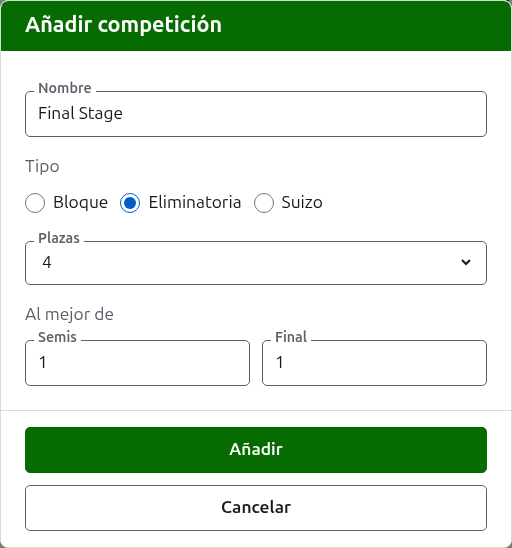

# Competiciones

La pestaña **Competiciones** de la página de un torneo es donde sus competiciones se añaden, se ponen en orden y se apartan. Una competición es un grupo, una eliminatoria o un suizo. Cada una tiene página propia, donde se inscriben sus jugadores y se introducen sus resultados.

## Añadir una competición {#adding-a-competition}

Pulsa **Añadir competición**, encima de la lista. Se abre un diálogo sobre la página, que pide el nombre de la competición, su tipo y la forma que tiene ese tipo.

**Nombre** es lo que buscan los jugadores en la página del torneo para encontrar sus partidas. Tiene entre 1 y 254 caracteres, y basta con una sola letra, porque un grupo suele llamarse por una. Dos competiciones de un mismo torneo no pueden tener el mismo nombre.

**Tipo** es grupo, eliminatoria o suizo. El diálogo empieza en grupo, que es lo que son la mayoría de las competiciones.

### Un grupo

Un grupo pregunta al mejor de cuántas partidas es cada partido, **Al mejor de**, y en cuántas rondas se juega, **Rondas**.

**Al mejor de** empieza en 1. Al mejor de 3 lo gana quien gane dos partidas. Puede ser un número par, porque en un grupo un jugador se clasifica por las partidas que gana, y un partido de dos partidas repartidas una a cada uno es un resultado como cualquier otro.

**Rondas** es cuántas veces se enfrenta cada pareja de jugadores del grupo, con un partido en cada ronda. Empieza en 1, y 1 es casi siempre lo que un grupo necesita: cada jugador juega una vez contra cada otro. Súbelo solo para un grupo en el que se vuelven a enfrentar, como una doble liguilla, donde 2 hace que cada pareja juegue dos partidos.

### Un suizo

Un suizo pregunta solo **Al mejor de** cuántas partidas es cada partido, que empieza en 1, igual que un grupo. Al mejor de 3 lo gana quien gane dos partidas. Puede ser un número par, porque en un suizo un jugador se clasifica por las partidas que gana, y un partido de dos partidas repartidas una a cada uno es un resultado como cualquier otro.

### Una eliminatoria

Una eliminatoria pregunta cuántas **Plazas** tiene su cuadro, y al mejor de cuántas partidas es cada ronda. Las plazas que se ofrecen son 2, 4, 8, 16, 32, 64 y 128, porque ningún otro número podría dividirse por la mitad ronda a ronda hasta una final, y el diálogo empieza en 8. Las plazas que quedan libres una vez inscritos los jugadores se rellenan con byes, que se añaden donde se añaden los jugadores.

Un cuadro tiene tantas rondas como hacen falta para reducir sus plazas a una, así que un cuadro de 8 plazas tiene tres rondas. El diálogo pregunta al mejor de cuántas es cada una, juntas bajo **Al mejor de (por ronda)**, en el orden en que se juegan. Las tres últimas se nombran como se habla de las rondas de un cuadro, **Cuartos**, **Semifinales** y **Final**, y las anteriores por su número, Ronda 1 la primera. Elegir más plazas añade rondas al principio del cuadro, y elegir menos las quita del principio, de modo que lo escrito para la final sigue siendo de la final. Cada ronda es al mejor de un número impar de partidas, porque un partido de eliminatoria tiene que tener ganador.

### Cómo se juega y se cuenta

Todos los tipos preguntan lo mismo bajo su forma.

**Se juega con hándicap.** Márcalo para una competición que se juega con hándicap.

**Permite resultados con empate.** Márcalo cuando una partida pueda acabar sin que ninguno de los dos jugadores gane. La mayoría de las competiciones no lo permiten. Si está marcado, un resultado introducido con los puntos igualados y sin marca se guarda como empate; si no, una partida con los puntos igualados tiene que decir quién la ganó con una marca detrás de la puntuación del ganador, como "6w". El partido de una eliminatoria siempre tiene ganador, así que una partida empatada no lo decide.

**Cuenta para los rankings mundiales.** Se pregunta solo cuando puede contar: una competición de Croquet de asociación o de Croquet golf que ni se juega con hándicap ni permite empates. Empieza marcado, así que desmárcalo para una competición que no deba contar.

### Añadir varias de una vez

Pulsa **Añadir**. La competición se añade, el diálogo lo dice y el nombre se vacía para la siguiente, dejando el tipo y su forma como estaban: las competiciones que se añaden juntas suelen parecerse, así que "Block B" después de "Block A" es solo su nombre. Pulsa **Cancelar** para cerrar el diálogo cuando estén todas.

## Cambiar una competición {#changing-a-competition}

**Editar** abre el mismo diálogo sobre la competición, titulado Editar competición, con su nombre, su forma y cómo se juega y se cuenta tal como están. No se pregunta su tipo, porque un grupo no se convierte en eliminatoria cambiándolo: una competición del tipo equivocado se archiva y se añade de nuevo. Pulsa **Guardar** para guardar el cambio y cerrar el diálogo.

Una eliminatoria que tiene una partida tiene a sus jugadores colocados en su cuadro, y un cambio de sus plazas los movería, así que se rechaza una vez introducida una partida. Aquello de lo que cada ronda es al mejor de sí puede cambiarse.

## Orden

Las competiciones se listan en el orden del torneo, que es el orden en que aparecen en las páginas públicas y en la barra verde oscuro. **Subir** y **Bajar** mueven una competición un puesto.

## Ir a una competición

El nombre de una competición, o **Ver**, abre su página, donde se inscriben sus jugadores y se introducen sus resultados. La barra verde oscuro bajo la cabecera también lleva allí, desde cualquier página del torneo.

## Archivar una competición

**Archivar** aparta una competición, tenga partidas o no, que se guardan con ella y vuelven cuando se restaura. Una competición archivada se lista bajo **Competiciones archivadas**, tachada, ofrece solo **Restaurar** y no está en las páginas públicas. Archivar no pregunta antes, porque restaurar lo deshace.

Siguiente: [Inscribir jugadores en una competición](entering-players-in-a-competition.md).
