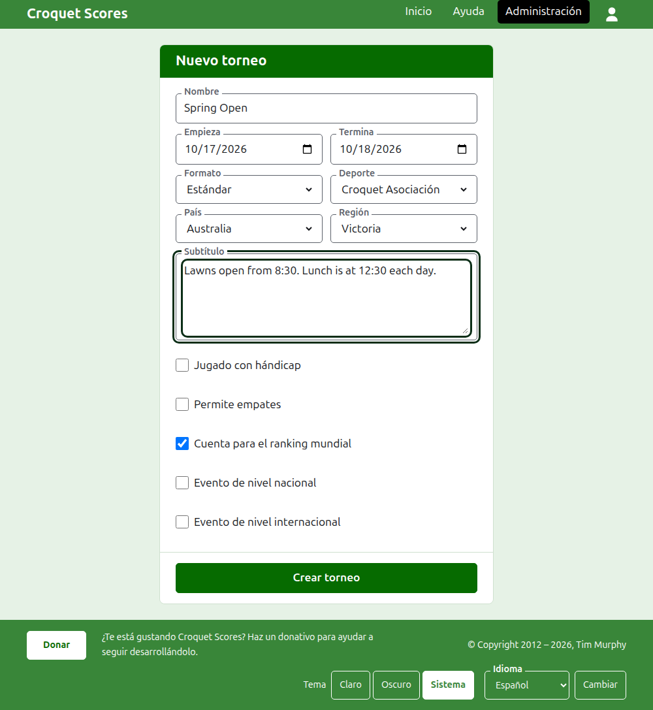

# Crear un torneo

Pulsa **Nuevo torneo**, encima de la lista de torneos de la administración. Está encima de la lista y no debajo para que una lista larga no lo saque de la pantalla de un teléfono.

El formulario pide todo aquello con lo que empieza un torneo. Un torneo de los corrientes está a un nombre, dos días y un país de distancia: todo lo demás se decide por ti y se puede cambiar.

## Lo que pide el formulario

**Nombre.** Lo que buscan los lectores para encontrar el torneo, como "Spring Open". Tiene entre 3 y 254 caracteres. Un nombre todo en minúsculas, o todo en mayúsculas, se rechaza, porque parecería un error en cada página en que se muestre. Dos torneos pueden tener el mismo nombre, ya que el mismo torneo se juega cada año.

**Empieza** y **Termina.** Los días en que se juega el torneo. Un torneo no puede terminar antes de empezar, ni empezar o terminar después del final del año que viene. Un torneo pertenece al año en que empieza, que es también el año de su dirección, así que uno que pasa por el cambio de año se lista en el año en que empieza.

**Formato.** Elige **Estándar** para un torneo que se juega entre jugadores. Los demás formatos son para torneos que se juegan entre equipos, que tienen guía propia.

**Deporte.** Los deportes que ofrece el sitio web, en su orden: Croquet Asociación, Golf Croquet, Croquet americano de 6 aros y Ricochet en Croquet Scores. Gateball Scores no pide ni deporte ni formato, ya que todos sus torneos son torneos estándar de gateball.

**País** y **Región.** Dónde se juega el torneo. La región se pide solo cuando el país que eliges está dividido en regiones, como los estados de Australia; un país que es él mismo su única región no pide ninguna. No hace falta elegir región ni siquiera cuando se ofrece.

**Subtítulo.** Lo que quieras que sepan los lectores y no tiene campo propio: dónde aparcar, a qué hora se come, a quién llamar. Se muestra bajo el nombre del torneo en todas las páginas públicas. Se escribe en Markdown, así que una palabra se pone en negrita con asteriscos alrededor y una lista se hace con un guion al principio de cada línea. Puede tener hasta 2000 caracteres, y puede dejarse vacío.

**Jugado con hándicap.** Márcalo para un torneo con hándicap.

**Permite empates.** Márcalo cuando una partida pueda acabar sin que ninguno de los dos jugadores gane. La mayoría de los torneos no lo permiten. Si está marcado, un resultado introducido con los puntos igualados y sin marca se guarda como empate; si no lo está, una partida con los puntos igualados tiene que decir quién ganó mediante una marca tras los puntos del ganador, como "6w".

**Cuenta para el ranking mundial.** Se pregunta solo cuando puede contar: un torneo de Croquet Asociación o de Golf Croquet que ni se juega con hándicap ni permite empates. Empieza marcado, así que desmárcalo para un torneo que no deba contar.

**Evento de nivel nacional** y **Evento de nivel internacional.** Un torneo puede ser lo uno, lo otro o ninguno, pero nunca ambos: marcar uno desmarca el otro.

## Crearlo

Pulsa **Crear torneo**. Se te lleva a la página del torneo en la administración, desde donde se gestiona, y eres su primer gestor. Queda listado en la administración bajo el año en que empieza.

La dirección pública del torneo se forma con su año, su deporte y su nombre, como `/2026/ac/spring-open`. Conserva esa dirección cuando más adelante se corrige su nombre, para que un enlace ya enviado siga encontrándolo; solo se mueve cuando cambia el año en que empieza o su deporte.

## Si algo se rechaza

Lo que se rechaza se dice bajo el campo al que se refiere, y lo que has escrito sigue escrito. No se guarda nada hasta que se acepta cada campo. Lo que más a menudo se rechaza es un nombre escrito todo en minúsculas, un final anterior al comienzo y un país sin elegir.

Siguiente: [Jugadores](players.md).
