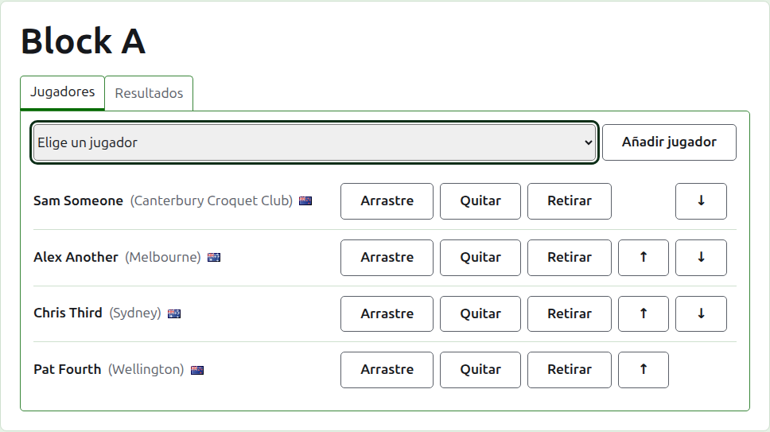
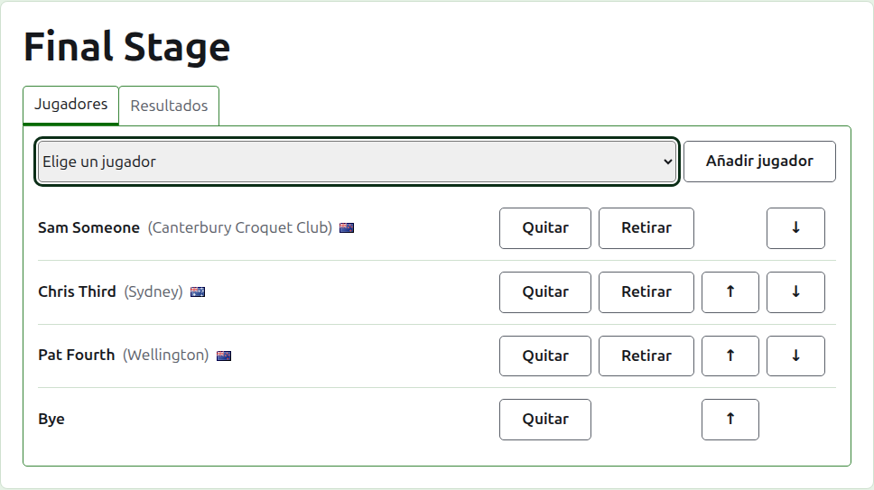
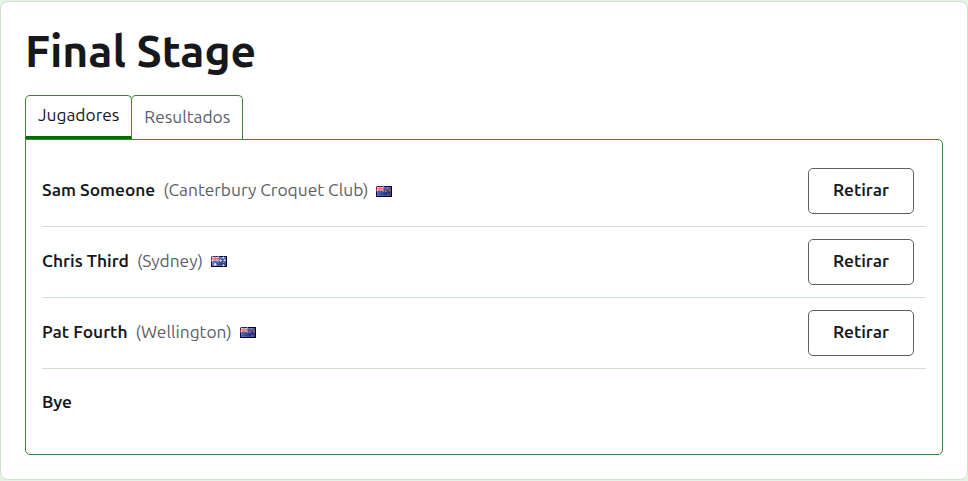
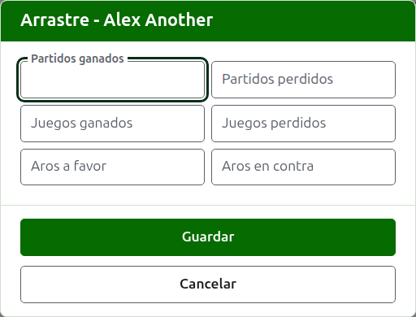
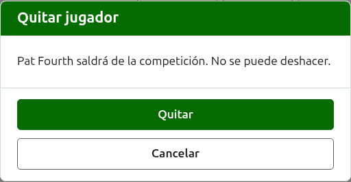
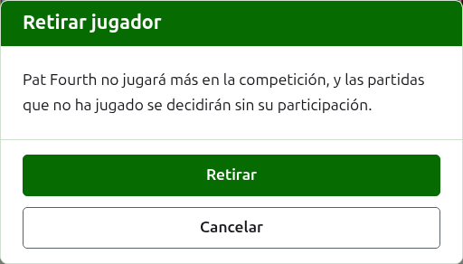
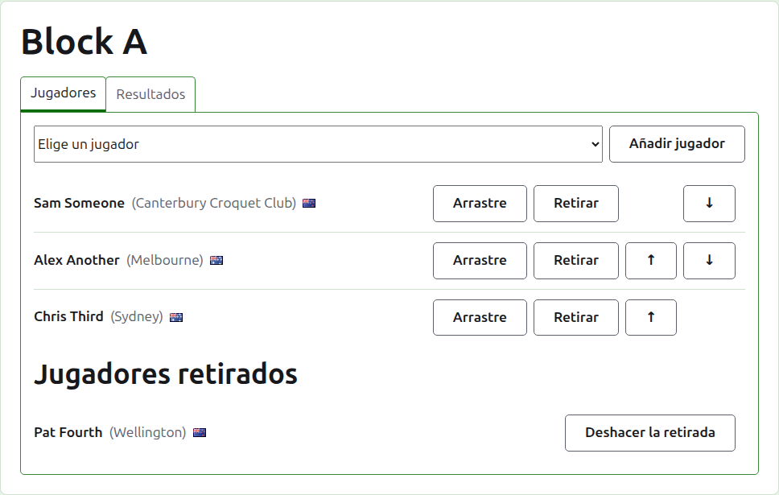

# Inscribir jugadores en una competición

La página de una competición se abre desde su nombre en la pestaña Competiciones, o desde la barra verde oscuro. La encabeza el nombre de la competición, con dos pestañas debajo: **Jugadores** y **Resultados**. Se abre en Jugadores, porque los jugadores se inscriben antes de que se juegue nada.

Un jugador de una competición es uno de los jugadores del torneo, así que se inscribe eligiéndolo en vez de escribiéndolo. Todo lo suyo salvo su puesto en la competición, y lo que traslada a ella, se cambia en la pestaña Jugadores del torneo.

## Añadir un jugador

Encima de la lista, una lista desplegable ofrece a todos los jugadores del torneo que aún no están en la competición, en el orden del torneo. Elige uno y pulsa **Añadir jugador**. El jugador se coloca, en el orden del torneo, entre los ya inscritos; el desplegable deja de ofrecerlo y el cursor vuelve al desplegable para que el siguiente pueda elegirse desde el teclado. Cuando todos los jugadores del torneo están en la competición, el desplegable no se muestra y la pestaña lo dice.

Los jugadores archivados del torneo no se ofrecen.

## Byes en una eliminatoria

Una eliminatoria se juega solo cuando todas las plazas de su cuadro están ocupadas, y las plazas que dejan libres sus jugadores se rellenan con byes. Por eso en una eliminatoria el desplegable ofrece **Bye** primero, antes que los jugadores, y sigue ofreciéndolo por muchos byes que se añadan, porque un cuadro puede necesitar varios.

Un bye se coloca en el cuadro como un jugador: se puede subir, bajar y quitar, pero no se puede retirar, porque no juega nada. Un jugador inscrito en una eliminatoria con todas las plazas ocupadas se rechaza, y la pestaña lo dice bajo el desplegable.

El orden de los jugadores de una eliminatoria es su cuadro. Las dos primeras plazas se enfrentan en el primer partido, las dos siguientes en el siguiente, y así sucesivamente. Pon a los jugadores en el orden en que se va a jugar el cuadro antes de introducir ningún resultado, porque en cuanto la eliminatoria tiene una partida en uso sus jugadores quedan fijos: nadie puede añadirse, quitarse ni moverse. Un jugador sí puede retirarse.

## Orden

Los jugadores se listan en el orden de la competición, que es el orden en que se sortea una eliminatoria y en que se lista un grupo en su página pública. **Subir** y **Bajar** mueven a un jugador un puesto.

## Traslado

**Trasladar** dice lo que un jugador trae a una competición de partidas que no se anotaron aquí: los resultados de una fase anterior, o de partidas jugadas antes de que la competición se anotara en este sitio. Se ofrece en un grupo y en un suizo, que tienen clasificación en la que contarlo, y no en una eliminatoria.

El diálogo pide seis cuentas: partidos ganados y perdidos, partidas ganadas y perdidas, y aros a favor y en contra. Todas son opcionales. Una cuenta dejada vacía no arrastra nada, que no es lo mismo que arrastrar 0, de modo que quien la cambie después la vea tal como se dejó. Pulsa **Guardar** para guardar las seis.

## Quitar a un jugador

**Quitar** saca a un jugador inscrito por error. Sigue siendo uno de los jugadores del torneo, y vuelve a ofrecerse en el desplegable, pero no se guarda nada de su puesto en la competición, así que Quitar pregunta antes.

Un jugador que tiene alguna partida en uso en la competición no puede quitarse, porque las partidas quedarían contra alguien que ya no está, y no se le ofrece Quitar. Un jugador cuyas únicas partidas están archivadas sí puede, y sus resultados archivados se van con él.

## Retirar a un jugador

**Retirar** es para un jugador que no va a jugar más en la competición. Sigue en ella, con las partidas que ha jugado, y se lista bajo **Jugadores retirados** después de los que siguen jugando. En una eliminatoria, su rival en un partido aún no decidido pasa a la siguiente ronda.

Retirar pregunta antes, porque cambia el desenlace de la competición: las partidas que el jugador no ha jugado se deciden sin él.

Un jugador retirado ofrece solo **Anular retirada**, que lo devuelve entre los que juegan, después de los que se quedaron, sin preguntar.

Siguiente: [Resultados](scores.md).
