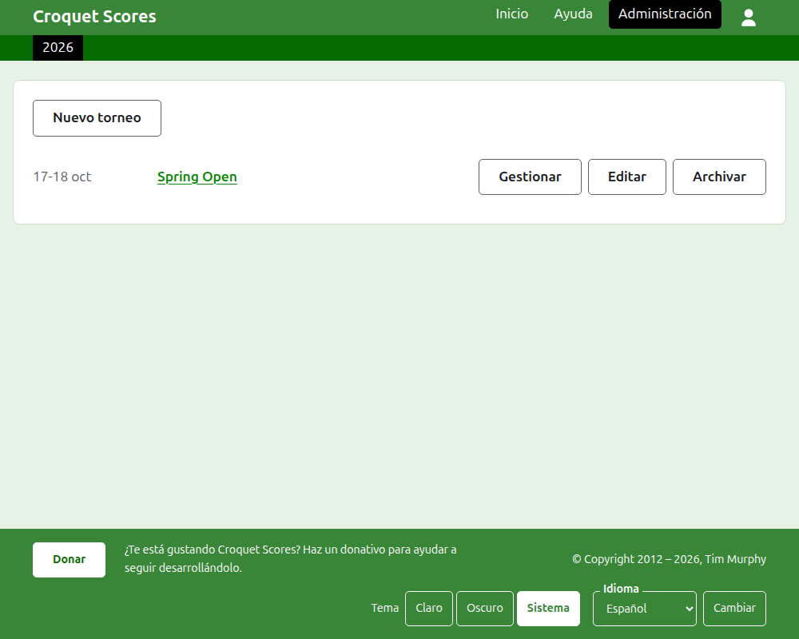
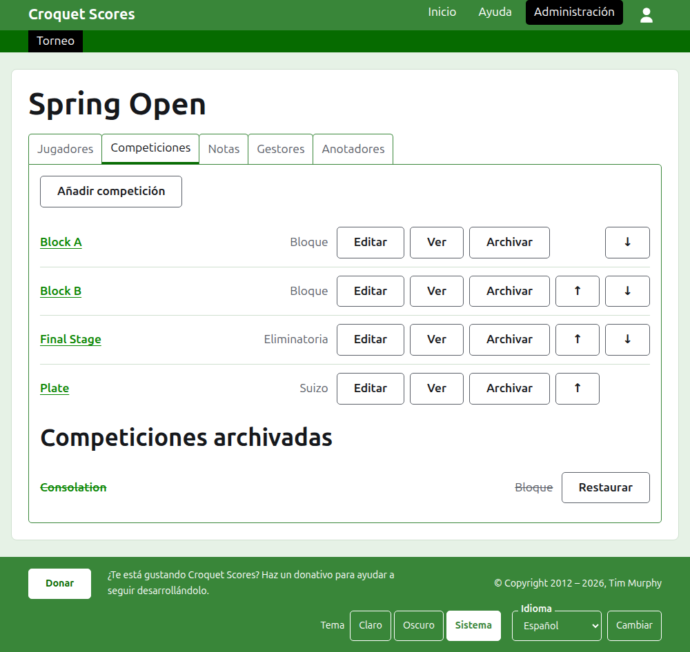

# Llevar un torneo estándar

Un torneo estándar es el que se juega entre jugadores inscritos uno a uno: un fin de semana de club, un abierto, un campeonato. Sus jugadores se inscriben en bloques, eliminatorias y suizos, y sus resultados se publican conforme se juegan. Esta guía lleva a un gestor desde iniciar sesión hasta tener un torneo cuyos resultados puede ver el público.

Se sostiene por sí sola. Nada en ella depende de la guía del torneo por equipos, que está escrita aparte.

## Antes de empezar

Necesitas una cuenta. Pulsa [aquí](/account/register) para registrar una.

Todo lo que hace un gestor se hace en la sección de administración del sitio web. Las páginas públicas, donde jugadores y espectadores siguen el torneo, se construyen a partir de lo que guarda la administración, así que no hay que publicar nada: un resultado introducido está en las páginas públicas al momento.

## Las páginas en orden

1. [Crear un torneo](creating-a-tournament.md): su nombre, sus días, su deporte, dónde se juega y para qué cuenta.
2. [Jugadores](players.md): inscribir a los jugadores del torneo, corregirlos y apartar a los inscritos por error.
3. [Competiciones](competitions.md): añadir bloques, eliminatorias y suizos, y ponerlos en orden.
4. [Inscribir jugadores en una competición](entering-players-in-a-competition.md): quién juega en cada competición, los byes en una eliminatoria, los arrastres, quitar y retirar.
5. [Resultados](scores.md): introducir resultados, corregirlos y apartar los introducidos por error.
6. [Notas](notes.md): contar a los jugadores lo que necesitan saber según avanza el torneo.
7. [Gestores y anotadores](managers-and-scorers.md): compartir la gestión del torneo, y dejar que alguien introduzca resultados sin poder cambiar nada más.
8. [Rankings](rankings.md): el archivo que se envía al ranking mundial, y lo que te queda por rellenar.
9. [Cambiar, archivar y restaurar un torneo](changing-and-archiving.md): corregir los datos del torneo y apartar un torneo.
10. [Lo que ve el público](what-the-public-sees.md): las páginas que siguen tus jugadores, y cómo aparece en ellas lo que introduces.

## Cómo está organizada la administración

La puerta de entrada de la administración lista los torneos en los que participas, un año a la vez.

Pulsar el nombre de un torneo, o **Gestionar**, abre su página. Todo lo que hay que gestionar está en seis pestañas bajo su nombre: **Jugadores**, **Competiciones**, **Notas**, **Gestores**, **Anotadores** y **Rankings**. La página se abre en Jugadores, porque los jugadores son lo primero que se introduce.

La barra verde oscuro bajo la cabecera sirve para moverse entre páginas. Lleva al torneo, como **Torneo**, y a cada una de sus competiciones por su nombre, de modo que puedes ir del torneo a una competición y de una competición a otra sin volver a pasar por la pestaña Competiciones. La página en la que estás se marca en negro.

## Cosas que valen en todas partes

**Nada se elimina del todo salvo una nota.** Los jugadores, las competiciones, los resultados y el propio torneo se archivan en vez de eliminarse: se apartan, se tachan y se listan bajo un encabezado propio, con **Restaurar** para recuperarlos. Archivar, restaurar y subir o bajar nunca te piden confirmación, porque cada uno se deshace pulsando en sentido contrario. Lo que no se puede deshacer, como quitar a un jugador de una competición o eliminar una nota, pregunta antes.

**Un diálogo sobre la página no guarda nada hasta que pulsas su botón.** Cancelar, o la tecla Escape, lo cierra y deja todo como estaba. Los diálogos que añaden cosas, como Añadir jugador y Añadir resultado, siguen abiertos después de añadir cada una, de modo que una lista se puede teclear de una tirada.

**Lo que se rechaza se dice junto al campo al que se refiere.** Nada rechazado se guarda, y lo que has escrito sigue escrito, para poder corregirlo en vez de escribirlo otra vez.

**La administración funciona en un teléfono.** Cada botón es lo bastante grande para pulsarlo con el pulgar, y nada es más ancho que la pantalla.

Siguiente: [Crear un torneo](creating-a-tournament.md).
