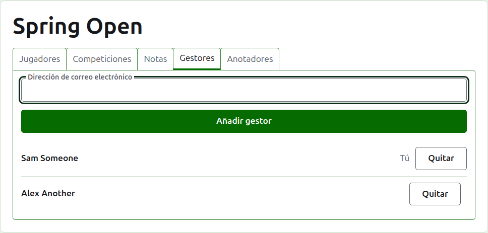
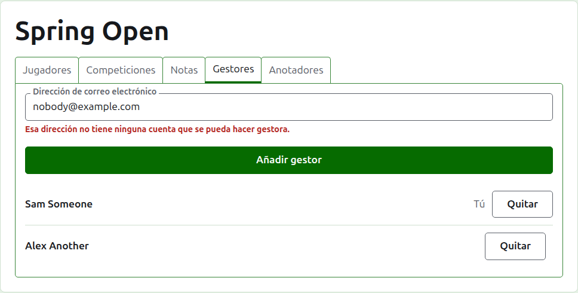
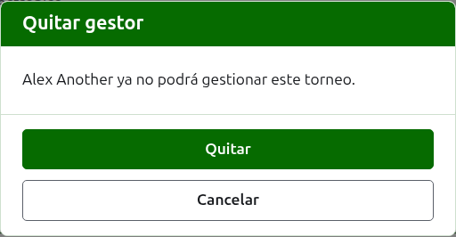
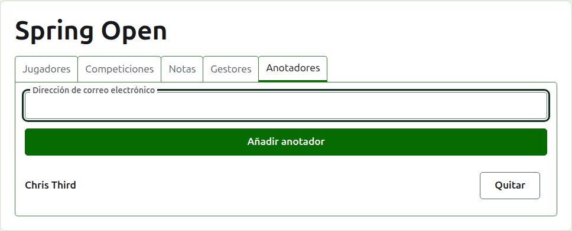
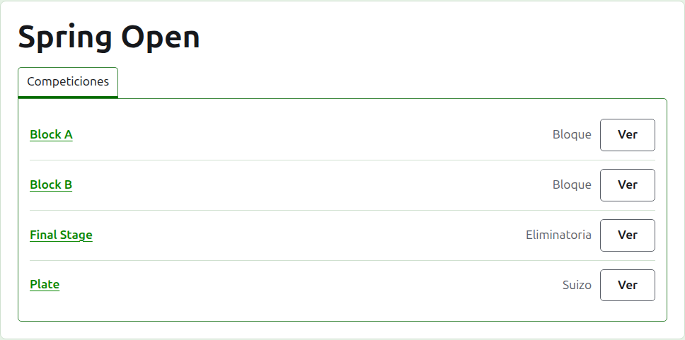

# Gestores y anotadores

Un torneo tiene gestores, que pueden hacer con él todo lo que se puede hacer, y puede tener anotadores, que introducen sus resultados y nada más. Quien creó el torneo es su primer gestor.

## Gestores {#managers}

La pestaña **Gestores** lista quién lleva el torneo, en el orden en que se hicieron gestores, con tu propio nombre marcado como tuyo. Es donde un torneo se comparte, o se traspasa.

A alguien se le hace gestor por su dirección de correo electrónico. Escríbela en el campo de encima de la lista y pulsa **Añadir gestor**. La dirección tiene que pertenecer a una cuenta registrada y confirmada; una dirección sin cuenta se rechaza bajo el campo, y el sitio no dice más que eso. Un anotador hecho gestor deja de ser anotador.

**Quitar** saca a un gestor. No se guarda nada de un gestor quitado, así que Quitar pregunta antes; si se le quiere de vuelta, se le hace gestor de nuevo por su dirección. Un torneo siempre tiene un gestor, así que al último no se le ofrece Quitar.

Puedes quitarte a ti mismo. La pregunta dice entonces lo que eso significa: pierdes tu propio camino de vuelta al torneo, y nadie en la página puede deshacerlo por ti. Otro gestor puede volver a hacerte gestor.

## Anotadores {#scorers}

La pestaña **Anotadores** es la pestaña Gestores para los anotadores, y funciona igual: una dirección de correo electrónico y **Añadir anotador** encima de la lista, y **Quitar** en cada uno.

Un anotador ve el torneo en su propia lista de la administración, con **Resultados** en lugar de Gestionar, y se le ofrecen solo sus competiciones: ni jugadores, ni notas, ni gestores, ni anotadores, ni rankings. En la página de una competición ve solo la pestaña Resultados, donde puede introducir, corregir, archivar y restaurar resultados como un gestor. Quién juega en una competición lo deciden los gestores.

A un gestor no se le hace anotador, porque un gestor ya puede hacer todo lo que hace un anotador. Un torneo no necesita anotadores, así que todos pueden quitarse, incluido el último.

Siguiente: [Rankings](rankings.md).
