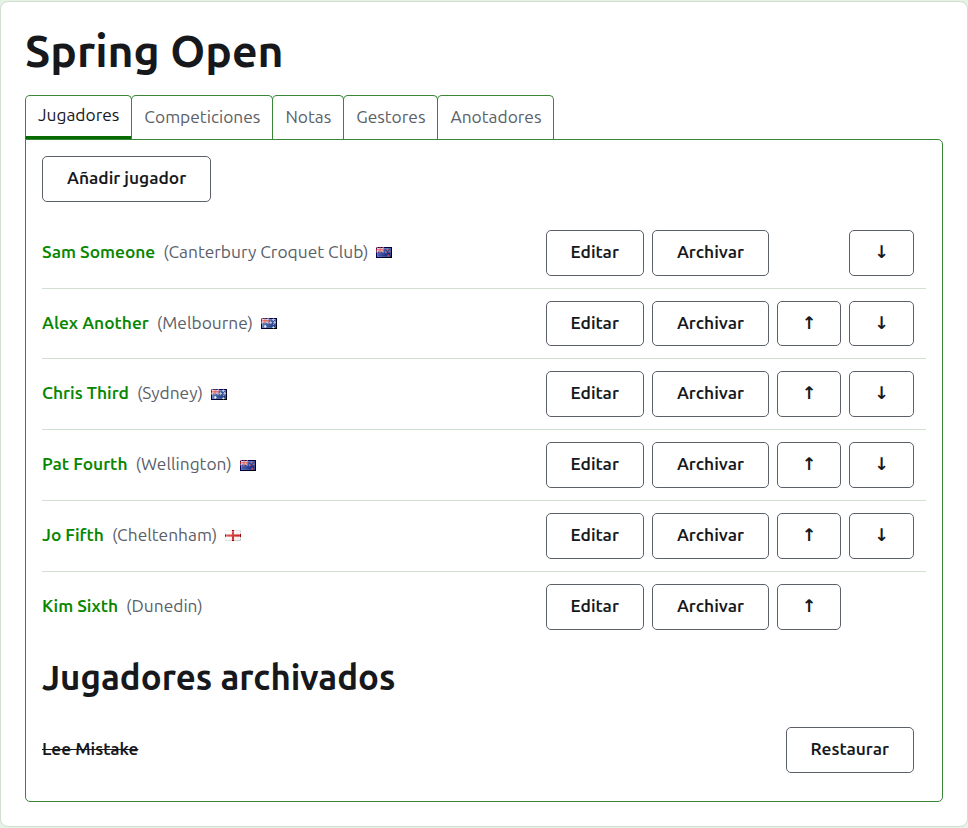
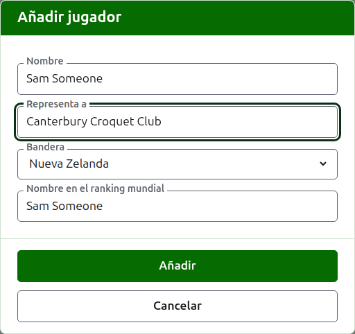
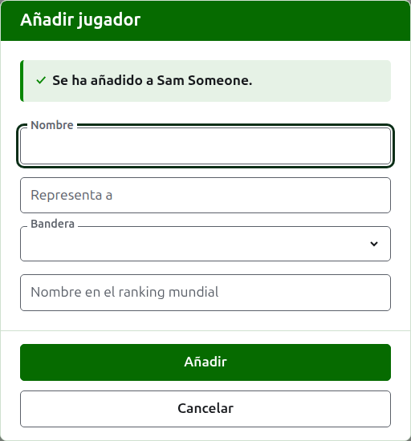
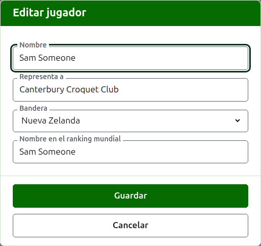
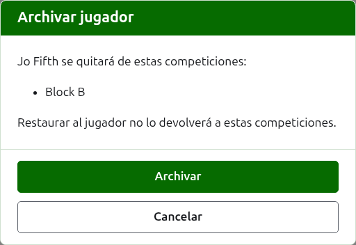

# Jugadores

La pestaña **Jugadores** de la página de un torneo es donde sus jugadores se inscriben, se corrigen, se ponen en orden y se apartan. Es la pestaña en la que se abre la página, porque inscribir a los jugadores es lo primero que se hace con un torneo.

Los jugadores se inscriben aquí una sola vez, en el torneo. En qué competiciones juega cada uno se elige después, en la página de cada competición, de entre los jugadores inscritos aquí. Véase [Inscribir jugadores en una competición](entering-players-in-a-competition.md).



## Añadir jugadores {#add-a-player}

Pulsa **Añadir jugador**, encima de la lista. Se abre un diálogo sobre la página.



**Nombre** es obligatorio. Es el nombre del jugador tal como se mostrará en todas las páginas, de entre 3 y 254 caracteres. Dos jugadores de un mismo torneo no pueden tener el mismo nombre, sea cual sea su uso de mayúsculas; cuando dos jugadores comparten nombre de verdad, distínguelos en el propio nombre, como "Andrew Hobbs (2)".

**Representa a** es aquello por lo que juega el jugador, escrito como lo diría un lector: un club, una región o un país, como "Canterbury Croquet Club". Se muestra entre paréntesis tras el nombre. Puede dejarse vacío.

**Bandera** es la bandera que se muestra junto al nombre del jugador. Puede dejarse en ninguna, como la mayoría de los jugadores. A qué representa un jugador y qué bandera lleva se guardan por separado, porque un jugador puede jugar por un club de un país y llevar la bandera de otro.

**Nombre del jugador en el ranking mundial** es el nombre por el que el ranking mundial conoce al jugador. Se pide solo en un torneo de Croquet de asociación o de Croquet golf, los dos deportes de cuyos jugadores el ranking mundial lleva una lista. Los jugadores de American 6 Wicket son conocidos en el ranking por su propio nombre, así que ahí no se pide, y el nombre en el ranking mundial de cada jugador es siempre su nombre. Mientras añades a un jugador, sigue al nombre según lo escribes, porque la mayoría de los jugadores son conocidos en el ranking por su propio nombre, y deja de seguirlo en cuanto escribes en él. Si se deja vacío, se guarda como el nombre del jugador.

Según escribes un nombre, se ofrecen los jugadores que el ranking mundial conoce cuyos nombres empiezan así, para que puedas tomar un nombre tal como lo escribe el ranking en vez de teclearlo entero. Junto al nombre en el ranking mundial, una marca de verificación dice que el ranking conoce el nombre, y un signo de interrogación dice que no: puede que el nombre esté mal escrito, o que el jugador sea nuevo en el ranking. Es solo un aviso. Un nombre que el ranking no conoce se guarda igual que uno que sí.

Pulsa **Añadir**. El jugador se añade, el diálogo lo dice y sus campos se vacían para el siguiente, con el cursor de vuelta en el nombre. Añade toda la lista de este modo y después pulsa **Cancelar** para cerrar el diálogo. Cancelar no guarda nada que no estuviera ya añadido.



Un jugador nunca se llama "Bye". Los byes de una eliminatoria se añaden en la propia eliminatoria, allí donde se inscriben sus jugadores, así que un nombre cuya primera palabra sea "bye" (la palabra inglesa) se rechaza, y el diálogo explica por qué.

## Añadir varios jugadores {#adding-multiple-players}

Para añadir de una vez una lista entera, pulsa **Añadir jugadores**, junto a **Añadir jugador**. Se abre un diálogo sobre la página con un solo cuadro, que admite varias líneas de texto. Puedes copiar la lista de una hoja de cálculo y pegarla en el cuadro.

**La primera línea nombra los campos**, separados por comas o por tabulaciones: **Name** y cualquiera de **Representing**, **Flag**, **Handicap** y **WorldRankingPlayerName**, en cualquier orden. Estos nombres se escriben en inglés, sea cual sea el idioma del sitio. **Name** debe ser uno de ellos. **Cada línea siguiente es un jugador**, con un valor para cada campo en el mismo orden, separados del mismo modo. Un jugador sin nada en un campo lo deja vacío, pero conserva la coma o la tabulación. Por ejemplo, con comas:

```
Name,Representing,Flag
Sam Someone,Canterbury Croquet Club,New Zealand
Alex Another,,England
```

- **Nombre, Representa a y Nombre del jugador en el ranking mundial** se rigen por las mismas reglas que al añadir un solo jugador (véase [Añadir jugadores](players.md#add-a-player)). Un nombre tiene entre 3 y 254 caracteres, no está ya en el torneo, sea cual sea su uso de mayúsculas, y no es "Bye".
- **Bandera** es el nombre del país o lugar, en tu idioma, tal como lo ofrece la lista del diálogo Añadir jugador, como Nueva Zelanda.
- **Hándicap** es un signo, hasta dos cifras y una fracción de una cifra, como 4, +4 o -1.5.
- Un jugador sin **WorldRankingPlayerName** es conocido por su nombre, como cuando se añade de uno en uno.
- **Comas o tabulaciones.** Las celdas copiadas de una hoja de cálculo están separadas por tabulaciones, y una lista escrita a mano suele estar separada por comas. Sirve cualquiera de las dos. Si la primera línea tiene una tabulación, toda la lista se lee con tabulaciones, y si no, con comas.
- Un valor que contiene el separador se escribe entre comillas dobles, como lo escribe una hoja de cálculo: "Smith, John" en una lista separada por comas. Una comilla dentro de un valor se escribe dos veces.
- A cada valor se le quitan los espacios de los extremos, y una línea sin nada se ignora.
- Una lista contiene como máximo 500 jugadores. Añade el resto en otra lista.

Pulsa **Añadir**. Toda la lista se comprueba antes de guardar nada, así que una lista con algo mal no añade a nadie. Lo que está mal se dice debajo del cuadro, en la línea donde está, contando la primera línea como línea 1. Se enumeran todos los fallos, no solo el primero, y lo que escribiste se queda para que puedas corregirlo. Una vez guardada la lista, el diálogo se cierra y la pestaña **Jugadores** muestra a los nuevos jugadores, en el orden en que los escribiste. A diferencia de **Añadir jugador**, que sigue abierto para el siguiente jugador, aquí no hay siguiente: la lista era el siguiente.

El **?** de la barra de título del diálogo lleva hasta aquí.

## Corregir un jugador {#correcting-a-player}

Pulsa el nombre de un jugador, o su **Editar**, para abrir el mismo diálogo sobre ese jugador, titulado Editar jugador. Cambia lo que esté mal y pulsa **Guardar**, que guarda el cambio y cierra el diálogo. Un jugador cuyo nombre se corrige conserva el nombre en el ranking mundial que tenía, porque el ranking sigue conociéndolo por él. En American 6 Wicket el nombre de un jugador en el ranking mundial es siempre su nombre, así que corregir el nombre lo corrige también.



Un jugador corregido aquí queda corregido en todas partes: en todas las competiciones en que está y en todas las páginas públicas.

## Poner en orden a los jugadores

Los jugadores se listan en el orden del torneo, que es el orden en que se ofrecen al inscribirlos en las competiciones y el orden en que se sortea una eliminatoria. **Subir** y **Bajar**, las flechas al final de cada fila, mueven a un jugador un puesto. Al primer jugador no se le ofrece Subir y al último no se le ofrece Bajar.

## Archivar un jugador {#archiving-a-player}

**Archivar** aparta a un jugador: inscrito por error, o retirado de todo el torneo. Un jugador archivado se lista bajo **Jugadores archivados**, tachado, después de los jugadores en uso, y ofrece solo **Restaurar**. Un jugador archivado no está en ninguna competición ni aparece en ninguna página pública.

Un jugador que ha jugado alguna partida no puede archivarse, porque sus partidas quedarían contra alguien que ya no está, así que a ese jugador no se le ofrece Archivar. Un jugador cuyas únicas partidas están archivadas sí puede.

Archivar a un jugador que no está en ninguna competición no pregunta antes, porque restaurarlo lo devuelve todo a su sitio. Archivar a un jugador que está en alguna competición pregunta antes, porque archivarlo lo quita de todas las competiciones en que está, y restaurarlo no lo devuelve a ellas.



Siguiente: [Competiciones](competitions.md).
