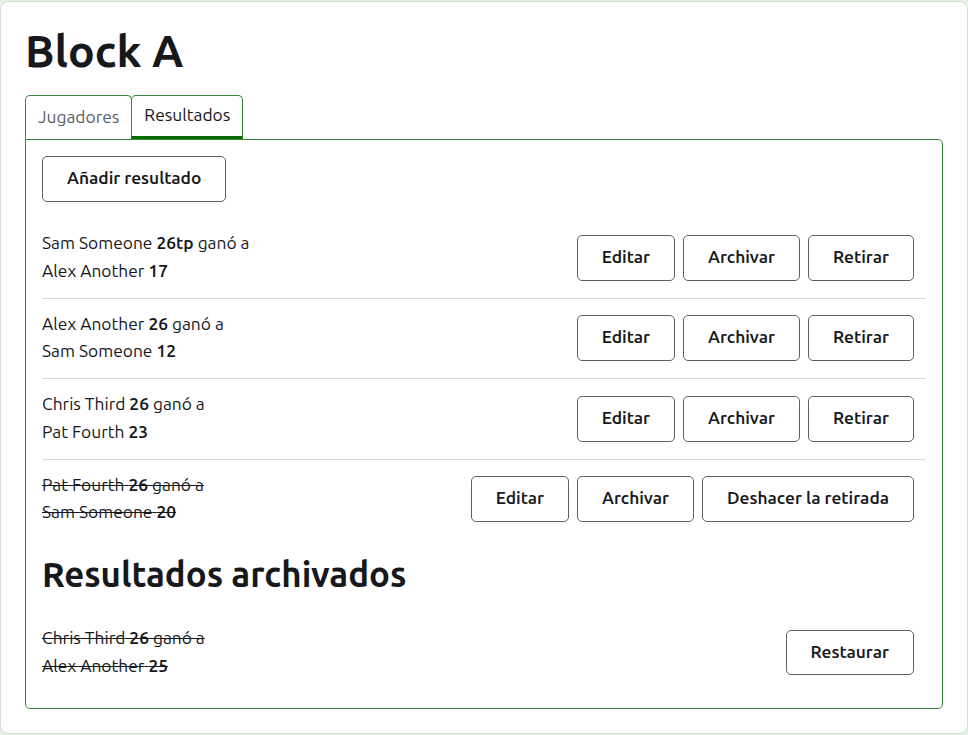
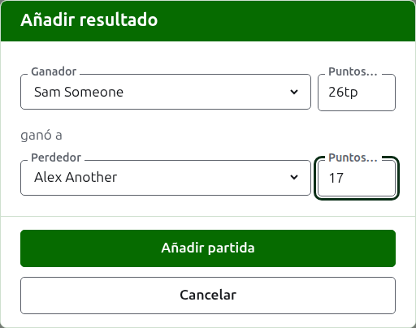
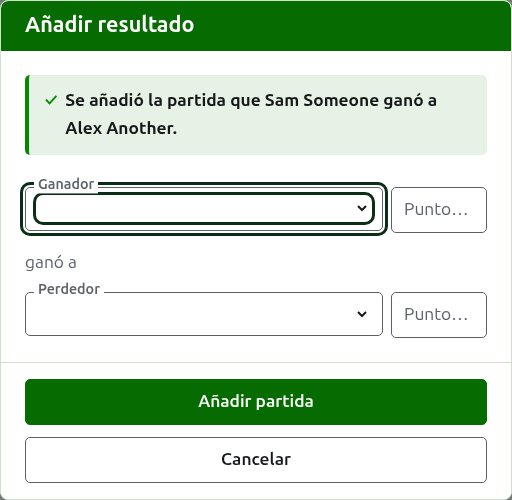
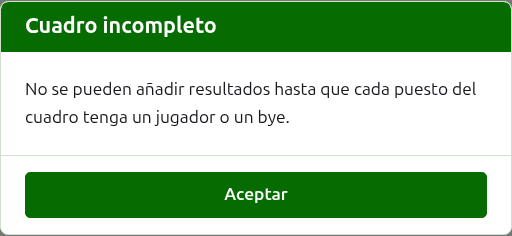
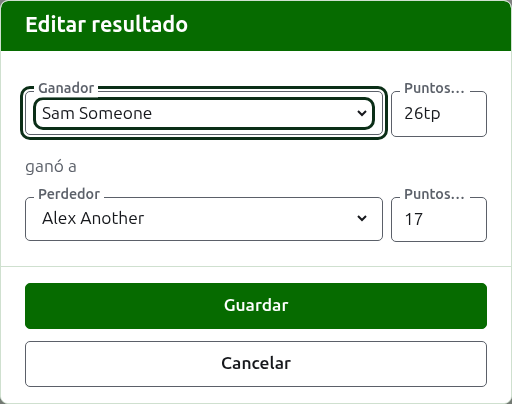

# Resultados

La pestaña **Resultados** de la página de una competición es donde sus partidas se introducen, se corrigen y se apartan. Un anotador ve solo esta pestaña, y puede hacer en ella todo lo que hace un gestor.

## Introducir un resultado {#entering-a-score}

Pulsa **Añadir resultado**, encima de la lista. El diálogo se lee como se dice un resultado en voz alta: el ganador y sus puntos, después "ganó a", después el perdedor y sus puntos.

El ganador y el perdedor se eligen cada uno de entre los jugadores de la competición que siguen jugando, en el orden de la competición. Al principio no hay nadie elegido, para que una partida nunca se apunte a un jugador que no has elegido. En una eliminatoria, elegir al ganador elige como perdedor a quien le toca enfrentarse en el cuadro, donde puedes verlo y elegir a otro.

Un resultado se escribe tal como lo apuntó el anotador: su número de puntos y lo que venga después, que se guarda y se muestra tal como se escribió, como "26tp" para 26 aros y un triple peel. El número son los dígitos con que empieza el resultado; un resultado que no empieza por un dígito se rechaza.

Una partida ganada con los puntos igualados, como cuando la detiene el tiempo y se decide de otra manera, dice quién la ganó mediante una marca tras los puntos del ganador: "6w" ganó a "6". En Croquet Scores las marcas son "w", "won" y "winner"; Gateball Scores admite también "cb" y "so". Los puntos del ganador tienen que ser más que los del perdedor, o llevar marca, a menos que el torneo permita empates, en cuyo caso unos puntos igualados sin marca se guardan como empate.

Pulsa **Añadir partida**. La partida se añade, el diálogo dice cuál y los campos se vacían para la siguiente, porque los resultados llegan en tanda, leídos de un tablón al final de una ronda. Pulsa **Cancelar** cuando estén todos.

Lo que se rechaza se dice bajo el campo al que se refiere: un ganador o un perdedor sin elegir, un resultado sin escribir o que no empieza por un dígito, el mismo jugador en ambos lados, los puntos del perdedor marcados como ganados, o los puntos del ganador por detrás de los del perdedor. En una eliminatoria, dos jugadores a los que no les toca enfrentarse se rechazan encima de los campos.

## El cuadro de una eliminatoria tiene que estar completo {#draw-filled-first}

Una eliminatoria se juega solo cuando cada plaza de su cuadro tiene un jugador o un bye. Hasta entonces, Añadir resultado explica por qué no se pueden añadir resultados en vez de abrir el diálogo.

## La lista de resultados

Los resultados en uso se listan en el orden en que se introdujeron, el más antiguo primero, para que la lista se lea como se jugó la competición. Cada uno dice el ganador y sus puntos, después el perdedor y los suyos, y ofrece **Editar** y **Archivar**.

## Corregir un resultado {#correcting-a-score}

**Editar** abre el mismo diálogo sobre ese resultado, titulado Editar resultado, con sus jugadores elegidos y sus puntos tal como se escribieron. Pulsa **Guardar** para guardar la corrección y cerrar el diálogo.

Una corrección mantiene el desenlace: una partida ganada sigue ganada, y una empatada sigue empatada. Una partida cuyo desenlace estaba mal se archiva y se introduce de nuevo.

Cuando un resultado podría archivarse, sus jugadores pueden cambiarse igual que sus puntos. En una eliminatoria, un resultado cuyo ganador ya ha jugado en la ronda siguiente conserva sus jugadores, porque cambiar quién lo ganó dejaría la partida siguiente jugada por alguien que no había llegado a ella; solo se pueden corregir sus puntos.

## Archivar un resultado

**Archivar** aparta un resultado para que no cuente para nada. Se lista bajo **Resultados archivados**, tachado, y ofrece solo **Restaurar**. Ninguno de los dos pregunta antes, porque cada uno deshace el otro.

En una eliminatoria, el ganador de un partido pasa a la ronda siguiente, así que al resultado de un partido cuyo ganador ha jugado en la ronda siguiente no se le ofrece Archivar. Primero se archiva la partida de la ronda siguiente, y después pueden archivarse las anteriores. Cuando una ronda es al mejor de 3 o de 5, todas las partidas del partido se tratan igual. Un grupo y un suizo no tienen rondas que dependan unas de otras, así que todos sus resultados pueden archivarse.

## Retirar un resultado

Un jugador que deja una competición normalmente se retira de ella, en la pestaña Jugadores, y con eso basta: no juega más, y las partidas que jugó se mantienen pero dejan de contar para las victorias y derrotas y para los aros. Retirar un resultado es para el caso más raro en que una partida que se jugó no debe contar. En el President's Eights australiano, por ejemplo, los resultados de la primera vuelta se mantienen cuando un jugador se retira, y solo sus partidas de la segunda vuelta se sacan del cómputo: retira esas partidas.

En un grupo o en un suizo, un resultado que se jugó pero no debe contar se retira en vez de archivarse. **Retirar** lo mantiene entre los resultados en uso, en su sitio, pero tachado y sin contar para nada en las páginas públicas. **Anular retirada** hace que cuente de nuevo. Ninguno de los dos pregunta antes. A los resultados de una eliminatoria no se les ofrece Retirar, porque allí un resultado decide más que la clasificación.

Siguiente: [Notas](notes.md).
