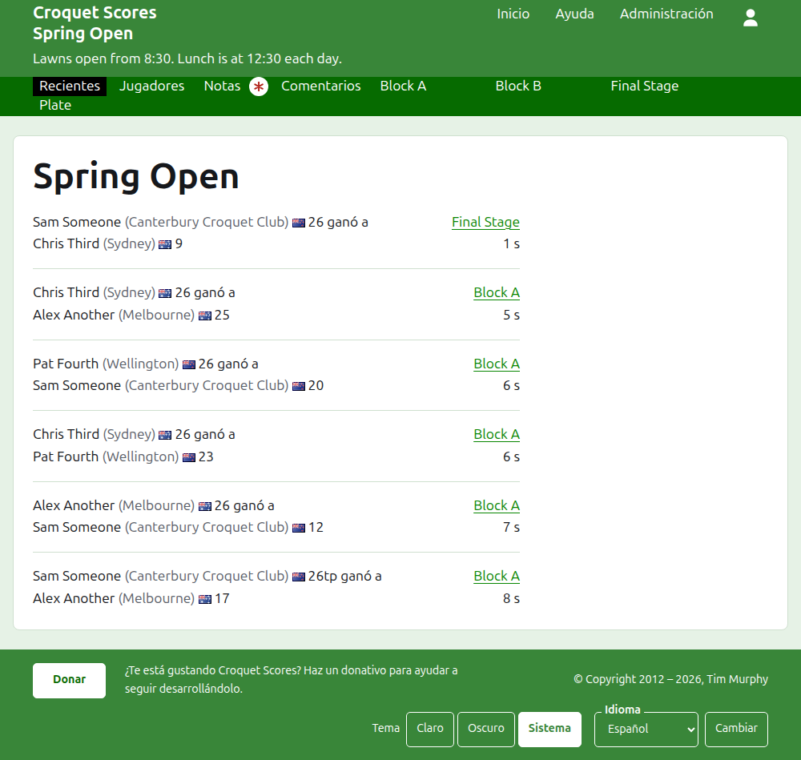
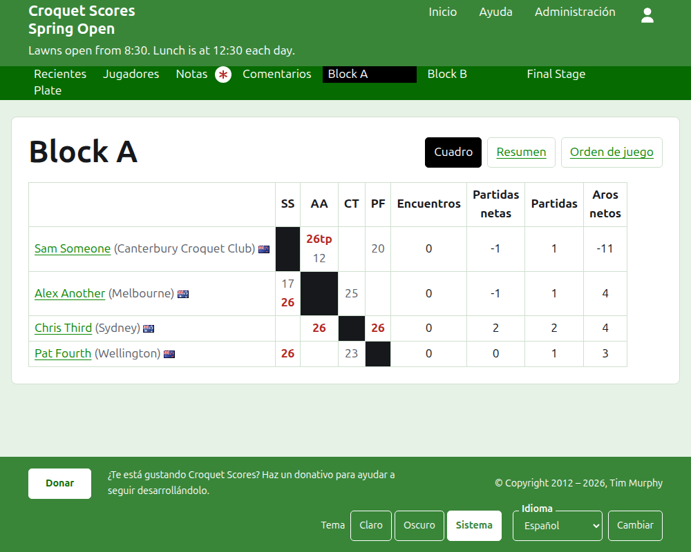
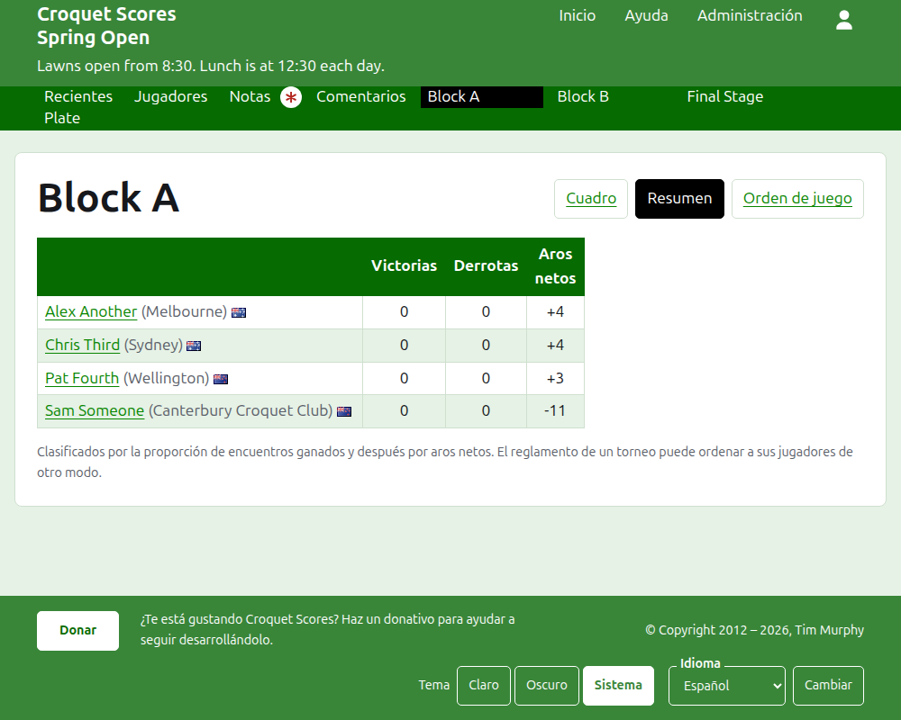
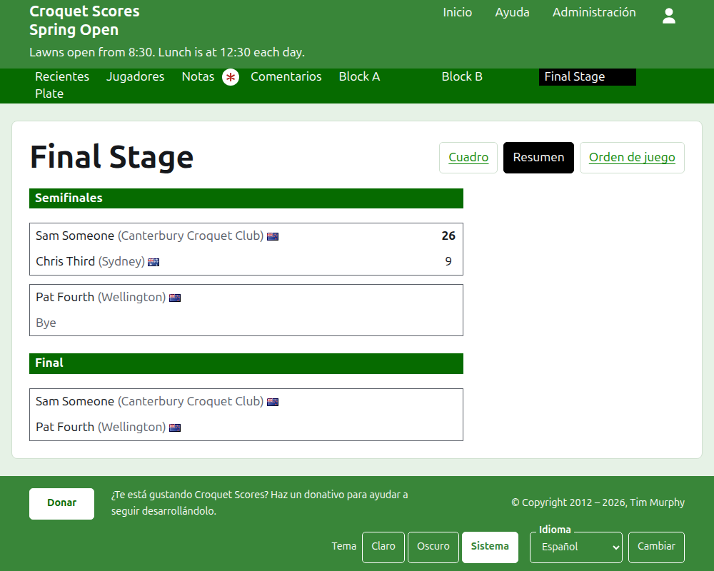
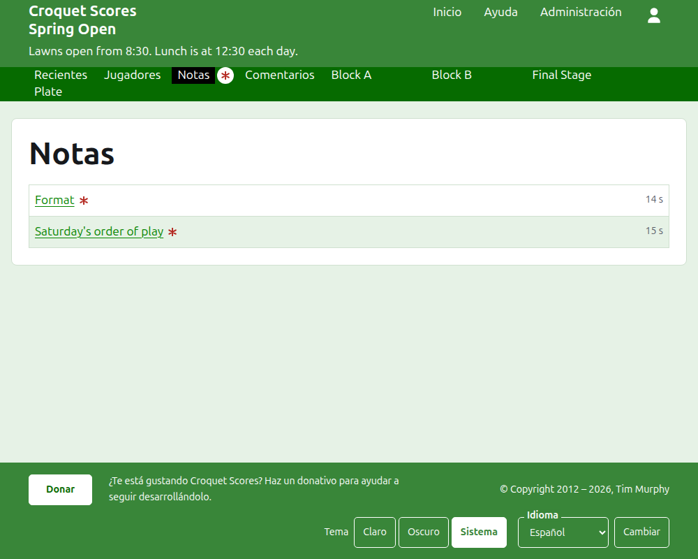

# Lo que ve el público

No se publica nada: las páginas públicas se construyen a partir de lo que guarda la administración, así que un resultado introducido está en ellas al momento. No necesitan cuenta ni scripts, y están pensadas para un teléfono.

## La página del torneo

La página del torneo está en su año, su deporte y su nombre, como `/2026/ac/spring-open`. La encabeza el nombre del torneo, con su subtítulo debajo. Lista todas las partidas en uso, la añadida más recientemente primero, para que un lector que vuelve vea lo que ha pasado desde entonces. Cada partida dice el ganador, a quién representa, su bandera y sus puntos, después el perdedor y los suyos, con la competición en que se jugó y cuánto hace que se añadió.

La barra verde oscuro ofrece las secciones del torneo: **Recientes**, que es esta página, **Jugadores**, **Notas** y **Crónica**, y después cada competición en uso, en el orden en que las tiene la pestaña Competiciones. Notas se marca con un asterisco rojo mientras haya una nota que el lector no ha leído.

## Un grupo

La página de un grupo muestra sus resultados como un cuadro: una fila y una columna por cada jugador en el orden del grupo, con las partidas entre dos jugadores donde la fila se cruza con la columna, cada una marcada como ganada, perdida o empatada para el jugador de la fila. Tras las columnas de los jugadores vienen los totales de cada uno. Cuando cada partido es una sola partida, son victorias y aros netos; cuando un partido es al mejor de más de una, son partidos, partidas netas, partidas y aros netos.

Un grupo se muestra de tres maneras, ofrecidas en la línea de su nombre: **Cuadrícula**, **Resumen** y **Orden de juego**. El resumen es el pensado para un teléfono: los jugadores clasificados, con sus victorias, derrotas y aros netos. El orden de juego lista todas las partidas, la más antigua primero. Un lector que elige una vista la conserva para todas las competiciones hasta que elige otra.

La fila de un jugador retirado lo dice. Un resultado retirado se muestra tachado y no cuenta para nada. Un resultado archivado no se muestra.

## Una eliminatoria

La página de una eliminatoria dibuja su cuadro ronda a ronda, una columna por cada ronda desde la primera hasta la final, con los dos lados de cada partido uno sobre otro y una celda por cada partida de las que el partido es al mejor de. El partido de una ronda posterior está junto a los dos partidos entre cuyos ganadores se juega. En un teléfono el cuadro se desplaza a los lados, con flechas hacia la final y de vuelta.

## Un suizo

La página de un suizo clasifica a sus jugadores en una tabla: sus partidas, sus victorias, su porcentaje de victorias y sus resultados, cada uno dicho como el rival y el margen, como "+4" para una partida ganada por cuatro.

## Jugadores

La página Jugadores lista a todos los jugadores del torneo que no están archivados, en orden alfabético, con a quién representan y su bandera.

## Notas

La página Notas lista las notas del torneo, la escrita más recientemente primero, cada una llevando a su propia página y diciendo cuánto hace que se escribió. Una nota que el lector no ha leído se marca con un asterisco rojo hasta que la abre.

## Direcciones que se mueven

Un torneo conserva su dirección cuando se corrige su nombre. Cuando se mueve, porque cambió su año o su deporte, su dirección antigua lleva a la nueva, para que un enlace guardado de antes siga funcionando. Las páginas de un torneo archivado no se encuentran hasta que se restaura.
