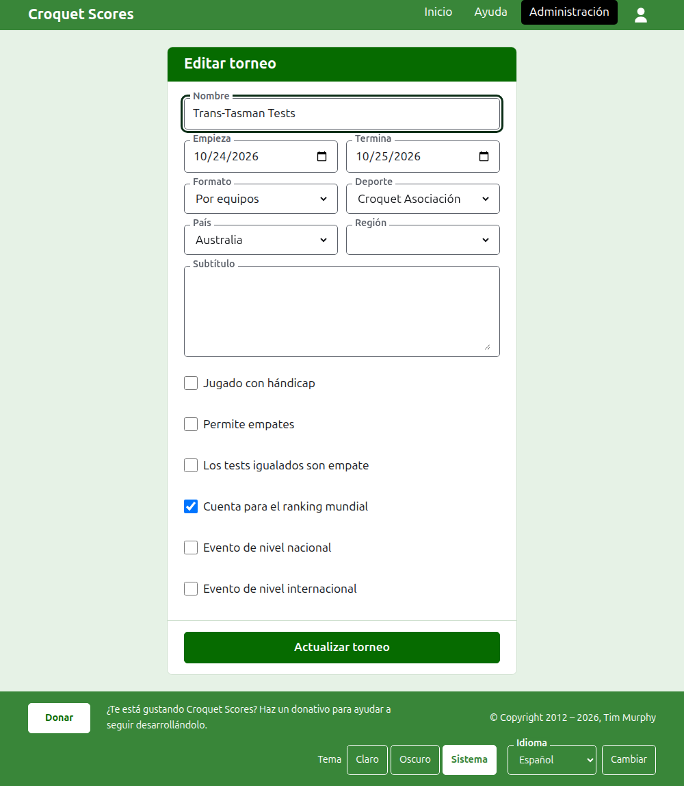
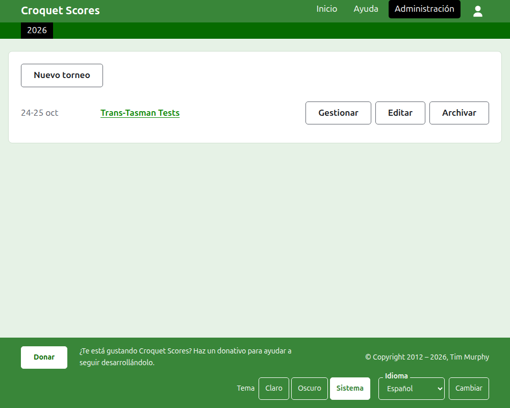

# Cambiar, archivar y restaurar un torneo

## Cambiar los datos del torneo

En la lista de torneos de la administración, pulsa **Editar** en el torneo. El formulario es el mismo que lo creó, rellenado tal como está el torneo. Cambia lo que esté mal y pulsa **Actualizar torneo**.

Los días del torneo pueden ampliarse aquí cuando un test necesita un día fuera de ellos, porque un test se juega dentro de su torneo. Un formato por equipos puede cambiarse por otro, porque el torneo contiene las mismas cosas en cada uno. Una vez que el torneo tiene algún equipo o algún test, contando los archivados, no puede cambiarse al formato Estándar, que tiene jugadores y competiciones en su lugar.

Un torneo conserva su dirección cuando se corrige su nombre, para que un enlace que alguien ya ha enviado siga encontrándolo. Solo se mueve cuando cambia el año en que empieza o su deporte, y entonces su dirección antigua lleva a la nueva. Al guardar se te lleva al torneo allí donde esté ahora.

Solo un gestor puede cambiar un torneo. A un anotador, o a cualquier otro, se le dice eso en vez de mostrarle el formulario.

## La lista de torneos

La administración lista un año a la vez, empezando por este, el torneo más reciente primero. Los años en que tienes algún torneo son pestañas en la barra verde oscuro, el más reciente primero; cuando hay más de los que caben en un teléfono, los más antiguos van en una lista desplegable al final de la fila. El año está en la dirección, así que se puede enlazar a un año.

## Archivar un torneo

**Archivar** en un torneo de la lista lo aparta. Sigue listado, tachado y después de los torneos en uso, pero ofrece solo **Restaurar**: su página en la administración, y sus páginas públicas, quedan cerradas hasta que se restaura. Archivar no pregunta antes, porque restaurar lo deshace.

Siguiente: [Lo que ve el público](what-the-public-sees.md).
