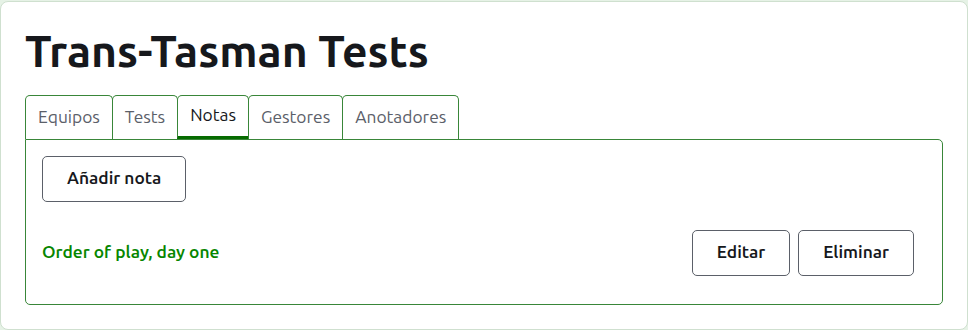
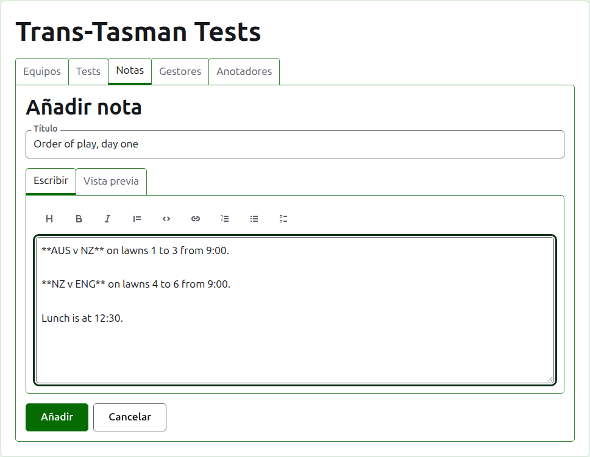
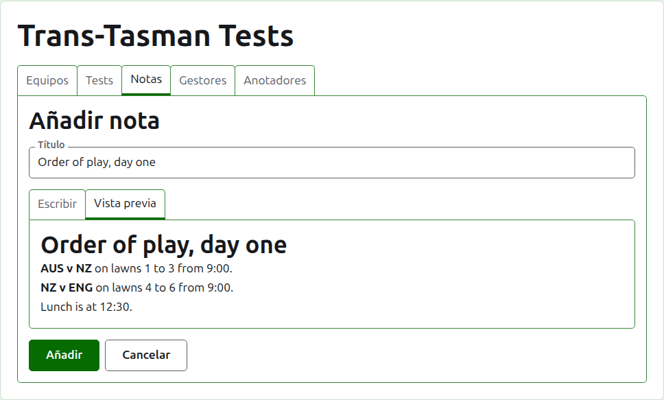
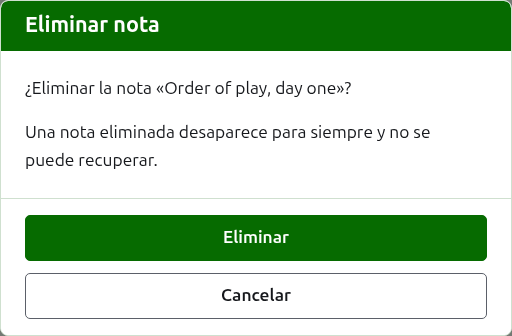

# Notas

La pestaña **Notas** de la página de un torneo es donde sus gestores escriben lo que los jugadores necesitan saber según avanza el torneo: el orden de juego, un cambio de canchas, la hora de la comida. Los lectores las encuentran en la página pública Notas del torneo, y una nota que no han leído se marca allí con un asterisco rojo, que marca también la sección Notas en todas las páginas del torneo hasta que la abren.

## Escribir una nota

Pulsa **Añadir nota**, encima de la lista. Un panel ocupa el lugar de la lista, porque una nota se escribe con extensión y necesita sitio.

**Título** es obligatorio, y es aquello por lo que se lista la nota. Es texto sin formato.

**Descripción** se escribe en Markdown y puede dejarse vacía cuando el título dice todo lo que hay que decir. La barra de herramientas sobre el cuadro escribe el Markdown por ti: Encabezado, Negrita, Cursiva, Cita, Código, Enlace, Lista numerada, Lista con viñetas y Lista de tareas. Cada una actúa sobre lo seleccionado, o al principio de cada línea seleccionada, o pone el cursor donde van las palabras.

**Vista previa** muestra la nota tal como la verá un lector en su página.

Pulsa **Añadir**. La nota se guarda, la lista vuelve con ella al principio, y está en la página pública Notas al momento.

## Editar una nota

Pulsa el título de una nota, o su **Editar**, para abrir el panel sobre esa nota. Pulsa **Guardar** para guardar el cambio. Una nota editada después de que un lector la leyera se le marca de nuevo.

## Eliminar una nota

Una nota que ya no vale se elimina. Una nota eliminada desaparece para siempre, así que **Eliminar** pregunta antes.

Siguiente: [Gestores y anotadores](managers-and-scorers.md).
