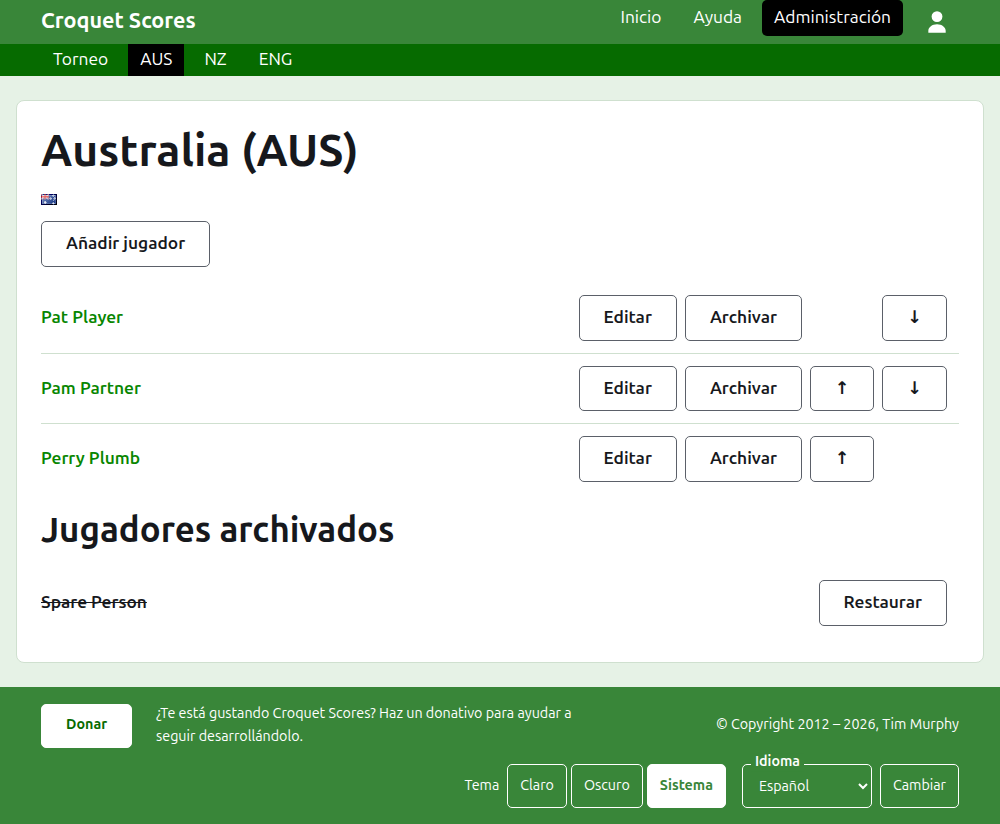
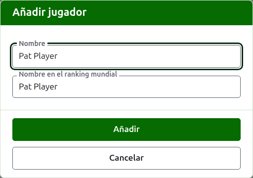

# Los jugadores de un equipo

La página de un equipo se abre desde su nombre, o su **Ver**, en la pestaña Equipos. La encabeza el nombre del equipo con su nombre corto entre paréntesis, y su bandera, para que un gestor que ha llegado al equipo equivocado lo vea al momento. Tiene una sola cosa que mostrar, los jugadores del equipo, así que la lista es la página.

La barra verde oscuro en la página de un equipo lleva al torneo y a cada equipo en uso por su nombre corto, para que los jugadores se inscriban equipo por equipo sin volver a la pestaña Equipos.

Un jugador de un equipo pertenece solo a ese equipo, representa al equipo y lleva la bandera del equipo en vez de una propia. La misma persona jugando por dos equipos, o en dos torneos, es un jugador en cada uno.

## Añadir un jugador {#adding-a-player}

Pulsa **Añadir jugador**, encima de la lista. Se abre un diálogo sobre la página.

**Nombre** es obligatorio, de entre 3 y 254 caracteres. Dos jugadores de un mismo equipo no pueden tener el mismo nombre, sea cual sea su uso de mayúsculas; un jugador de otro equipo sí puede compartirlo.

**Nombre del jugador en el ranking mundial** es el nombre por el que el ranking mundial conoce al jugador. Se pide solo en un torneo de Croquet de asociación o de Croquet golf, los dos deportes de cuyos jugadores el ranking mundial lleva una lista. Los jugadores de American 6 Wicket son conocidos en el ranking por su propio nombre, así que ahí no se pide, y el nombre en el ranking mundial de cada jugador es siempre su nombre. Mientras añades a un jugador, sigue al nombre según lo escribes, y deja de seguirlo en cuanto escribes en él. Si se deja vacío, se guarda como el nombre del jugador. Según escribes, se ofrecen los jugadores que el ranking mundial conoce cuyos nombres empiezan así, y junto al nombre en el ranking mundial una marca de verificación dice que el ranking conoce el nombre y un signo de interrogación dice que no. Es solo un aviso: un nombre que el ranking no conoce se guarda igual que uno que sí.

Un jugador nunca se llama "Bye": un nombre cuya primera palabra sea "bye" (la palabra inglesa) se rechaza.

Pulsa **Añadir**. El jugador se añade, el diálogo lo dice y sus campos se vacían para el siguiente, con el cursor de vuelta en el nombre. Añade todo el equipo de este modo y después pulsa **Cancelar** para cerrar el diálogo.

## Corregir un jugador {#correcting-a-player}

Pulsa el nombre de un jugador, o su **Editar**, para abrir el mismo diálogo sobre ese jugador, titulado Editar jugador. Pulsa **Guardar** para guardar el cambio. Un jugador cuyo nombre se corrige conserva el nombre en el ranking mundial que tenía, salvo en American 6 Wicket, donde el nombre de un jugador en el ranking mundial es siempre su nombre.

## Orden

Los jugadores se listan en el orden del equipo, que es el orden en que se ofrecen al introducir el resultado de un test. **Subir** y **Bajar** mueven a un jugador un puesto dentro del equipo.

## Archivar un jugador

**Archivar** aparta a un jugador: inscrito por error, o que ya no está con el equipo. Un jugador archivado se lista bajo **Jugadores archivados**, tachado, después de los jugadores en uso, y ofrece solo **Restaurar**. Archivar nunca pregunta antes, porque un jugador de un equipo no está inscrito en nada más y restaurarlo lo devuelve todo a su sitio.

Un jugador que ha jugado alguna partida en uso en un test no puede archivarse, porque sus partidas quedarían contra alguien que ya no está, así que a ese jugador no se le ofrece Archivar. Un jugador cuyas únicas partidas están archivadas sí puede.

Siguiente: [Tests](tests.md).
