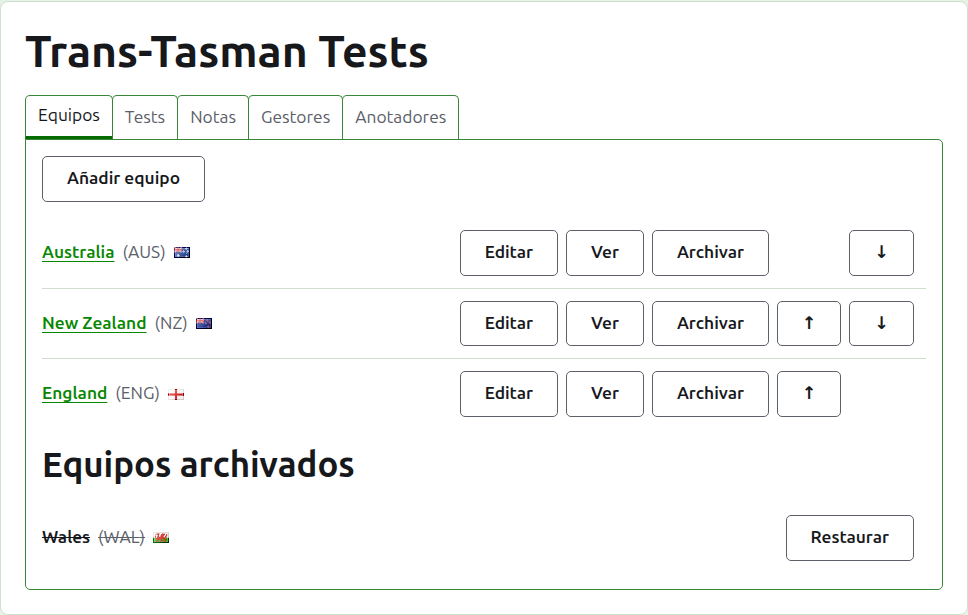
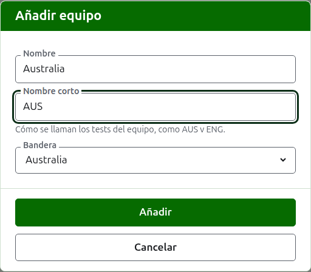
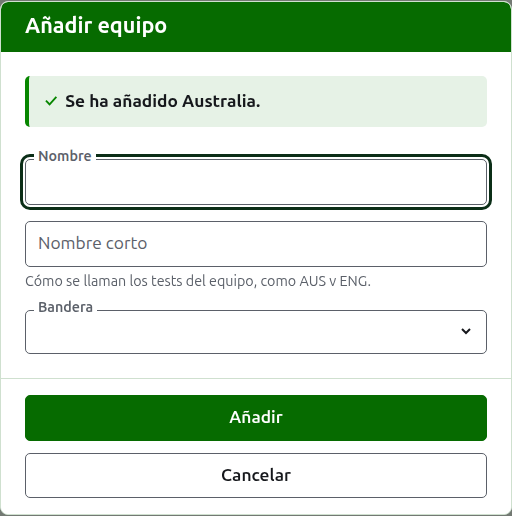
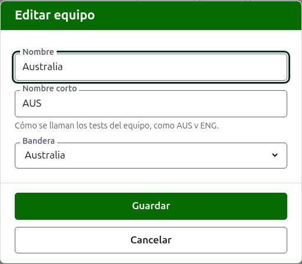

# Equipos

La pestaña **Equipos** de la página de un torneo es donde sus equipos se añaden, se corrigen, se ponen en orden y se apartan. Es la pestaña en la que se abre la página, porque los equipos son lo primero que se prepara. Un test es entre dos equipos, así que hacen falta al menos dos antes de poder añadir ningún test.

## Añadir un equipo {#adding-a-team}

Pulsa **Añadir equipo**, encima de la lista. Se abre un diálogo sobre la página.

**Nombre** es obligatorio: el nombre completo del equipo, como "Australia", que encabeza la página del equipo y las tablas de las páginas públicas. Dos equipos de un mismo torneo no pueden tener el mismo nombre.

**Nombre corto** también es obligatorio: aquello por lo que se nombran los tests del equipo, como "AUS v ENG", y como la barra verde oscuro llama al equipo. Tiene como mucho 10 caracteres, y no es más largo que el nombre, porque un nombre corto más largo que el nombre que abrevia son los dos escritos al revés. Dos equipos tampoco pueden tener el mismo nombre corto.

**Bandera** se muestra junto al nombre del equipo allí donde aparece. Puede dejarse en ninguna, como para el equipo de un club o de una región.

Pulsa **Añadir**. El equipo se añade, el diálogo lo dice y sus campos se vacían para el siguiente. Añade toda la lista de este modo y después pulsa **Cancelar** para cerrar el diálogo. Cancelar no guarda nada que no estuviera ya añadido.

## Corregir un equipo {#correcting-a-team}

Pulsa el **Editar** de un equipo para abrir el mismo diálogo sobre ese equipo, titulado Editar equipo. Cambia lo que esté mal y pulsa **Guardar**. Un equipo cuyo nombre corto cambia se llama por el nuevo en todas partes, así que sus tests cambian de nombre con él.

## Orden

Los equipos se listan en el orden del torneo, que es el orden en que se ofrecen al añadir un test, el orden en que los tiene la barra verde oscuro y el orden en que los lista la página pública Jugadores. **Subir** y **Bajar**, las flechas al final de cada fila, mueven un equipo un puesto.

## Ir a un equipo

El nombre de un equipo, o **Ver**, abre la página del propio equipo, donde se inscriben sus jugadores. Véase [Los jugadores de un equipo](team-players.md).

## Archivar un equipo

**Archivar** aparta un equipo. Sus jugadores se quedan con él y vuelven cuando se restaura, así que archivar no pregunta antes. Un equipo archivado se lista bajo **Equipos archivados**, tachado, ofrece solo **Restaurar**, y su página queda cerrada hasta que se restaura.

Un equipo que juega en un test en uso no puede archivarse, porque el test quedaría contra un equipo que ya no está, así que a ese equipo no se le ofrece Archivar. Un equipo cuyos únicos tests están archivados sí puede.

Siguiente: [Los jugadores de un equipo](team-players.md).
