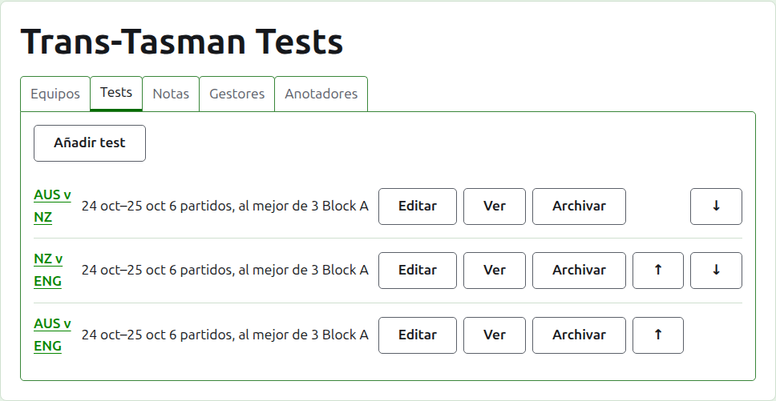
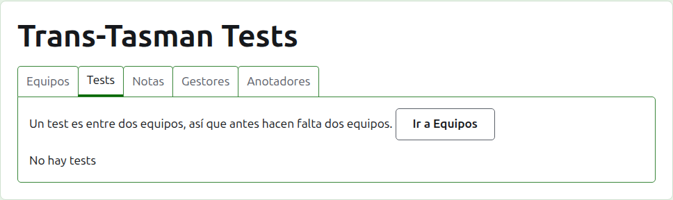
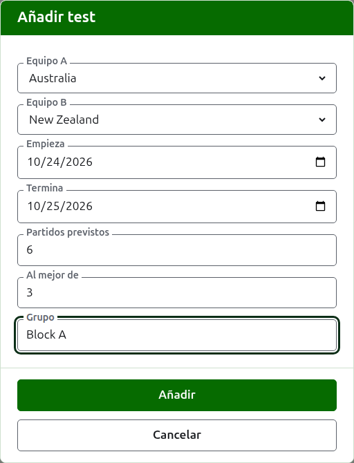
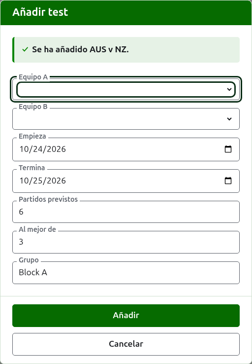
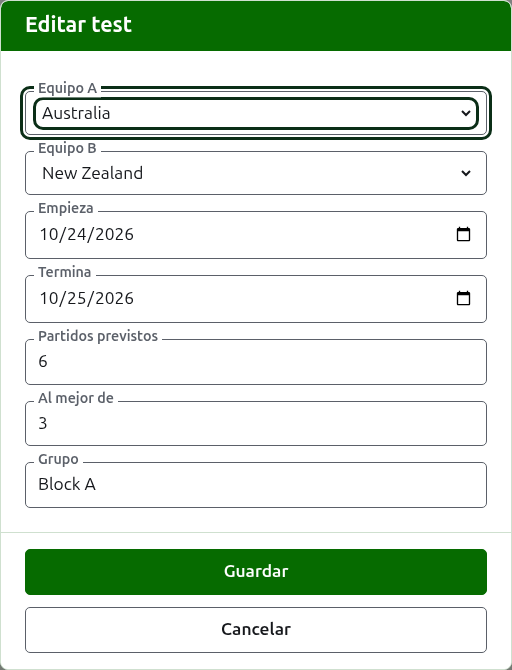

# Tests

La pestaña **Tests** de la página de un torneo es donde los tests entre sus equipos se añaden, se cambian, se ponen en orden y se apartan. Un test es una de las competiciones del torneo: una confrontación entre dos equipos, nombrada por sus nombres cortos, como "AUS v NZ", jugada como cierto número de partidos entre un jugador de cada equipo. Cada test tiene página propia, donde se introducen sus resultados.

Cada test dice su nombre, los días en que se juega, cuántos partidos se prevé que tenga y al mejor de cuántas partidas es cada uno, como "6 partidos, al mejor de 3", y su grupo cuando está en uno.

## Primero dos equipos

Un test es entre dos equipos en uso, así que mientras el torneo tiene menos de dos la pestaña lo dice donde estaría Añadir test, y lleva a la pestaña Equipos.

## Añadir un test

Pulsa **Añadir test**, encima de la lista. Se abre un diálogo sobre la página, que se lee en el orden en que se dice un test en voz alta.

**Equipo A** y **Equipo B** se eligen cada uno de entre los equipos en uso del torneo, por su nombre, en el orden del torneo. Al principio no hay ninguno elegido, para que un test nunca se añada entre equipos que no has elegido. Equipo B ofrece todos los equipos menos el elegido como Equipo A, porque un equipo no juega un test contra sí mismo. Equipo A es el primer equipo: sus jugadores van a la izquierda en la página del test y en la página pública. Un test no tiene nombre propio que escribir; se nombra por los nombres cortos de sus equipos.

**Comienza** y **Termina** son los días en que se juega el test, que empiezan en el primer día del torneo. Un test se juega dentro de su torneo, así que los días anteriores a que empiece el torneo o posteriores a que termine se rechazan.

**Partidos previstos** es cuántos partidos va a tener el test, fijado por el evento antes de que empiece, para que quien lea sus resultados pueda ver cuánto lleva jugado. Es un número entero a partir de 1. Es también un límite: una vez que han empezado tantos partidos como el test tiene previstos, una partida que empezaría otro se rechaza, mientras que los partidos ya empezados se juegan hasta el final. Un test que va a tener más se cambia para que los prevea.

**Al mejor de** es al mejor de cuántas partidas es cada partido. Puede ser par, porque un partido puede quedar repartido.

**Se juega con hándicap**, **Permite resultados con empate** y **Cuenta para los rankings mundiales** se preguntan como en cualquier competición. Lo último se pregunta solo cuando puede contar: un test de Croquet de asociación o de Croquet golf que ni se juega con hándicap ni permite empates. Empieza marcado.

**Grupo** es el grupo en que está el test, cuando el evento se juega por grupos, como "Block A". Es opcional: si se deja vacío, el test no está en ninguno. Los tests de un grupo tienen una página propia en el sitio público, que muestra cómo van los equipos del grupo. La **Copa Eire** y el **Escudo Interestatal** no tienen grupos, así que el cuadro de diálogo no pide uno.

Pulsa **Añadir**. El test se añade, el diálogo dice cuál por su nombre, y los equipos se vacían para el siguiente, dejando los días, los partidos previstos, el al mejor de y el grupo como estaban: los tests se añaden ronda a ronda, entre equipos que se enfrentan el mismo día, así que el siguiente test de la ronda es solo sus dos equipos. Pulsa **Cancelar** cuando estén todos.

## Cambiar un test

**Editar** abre el mismo diálogo sobre el test, titulado Editar test, rellenado tal como está el test. Pulsa **Guardar** para guardar el cambio.

Un test con partidas en uso conserva sus equipos: el diálogo los muestra pero no se pueden cambiar. Lo demás sí puede cambiarse, dentro de lo que se ha jugado: unos partidos previstos menores que los partidos ya empezados se rechazan, y también un al mejor de menor que el mayor número de partidas que hayan jugado dos jugadores.

## Orden

Los tests se listan en el orden del torneo, que es el orden en que aparecen en las páginas públicas y en la barra verde oscuro. **Subir** y **Bajar** mueven un test un puesto.

## Ir a un test

El nombre de un test, o **Ver**, abre su página, donde se introducen sus resultados. La barra verde oscuro también lleva allí, desde la página del torneo o la de cualquier otro test.

## Archivar un test

**Archivar** aparta un test, y **Restaurar** lo deshace, así que ninguno de los dos pregunta antes. Un test archivado se lista bajo **Tests archivados**, tachado, ofrece solo Restaurar y no está en las páginas públicas.

Un test con partidas en uso se ha jugado, y no puede archivarse hasta que lo estén sus partidas. Un test cuyas partidas están todas archivadas sí puede, porque una partida archivada no cuenta para nada. Un test cuyo equipo se ha archivado después no se restaura hasta que lo esté el equipo, y la pestaña lo dice.

Siguiente: [Resultados](scores.md).
