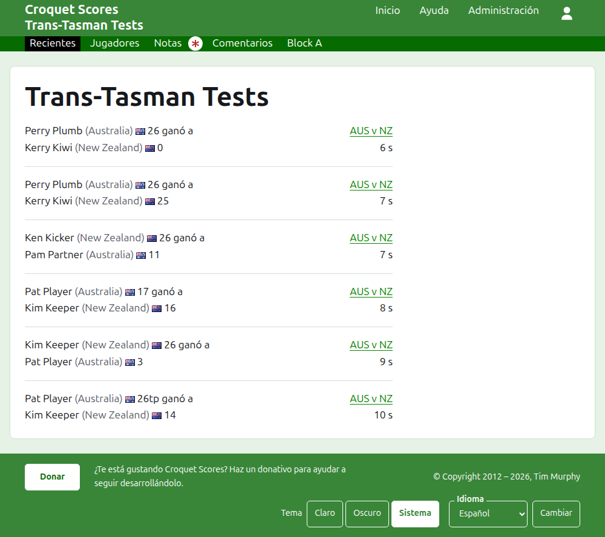
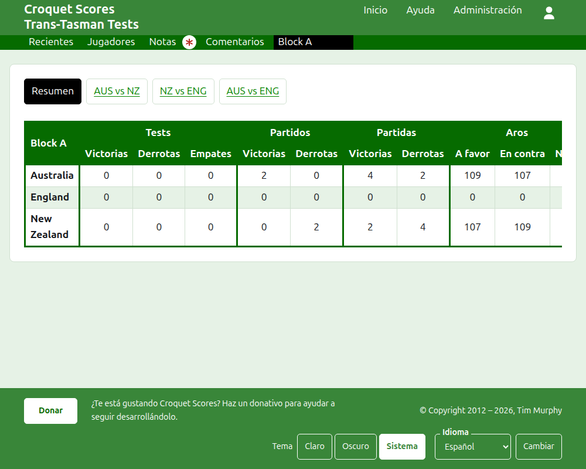
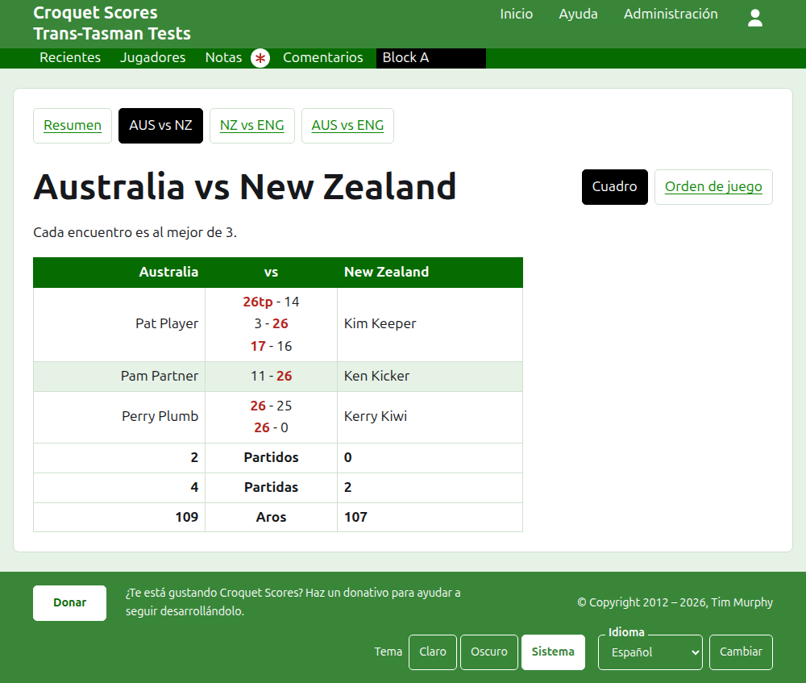
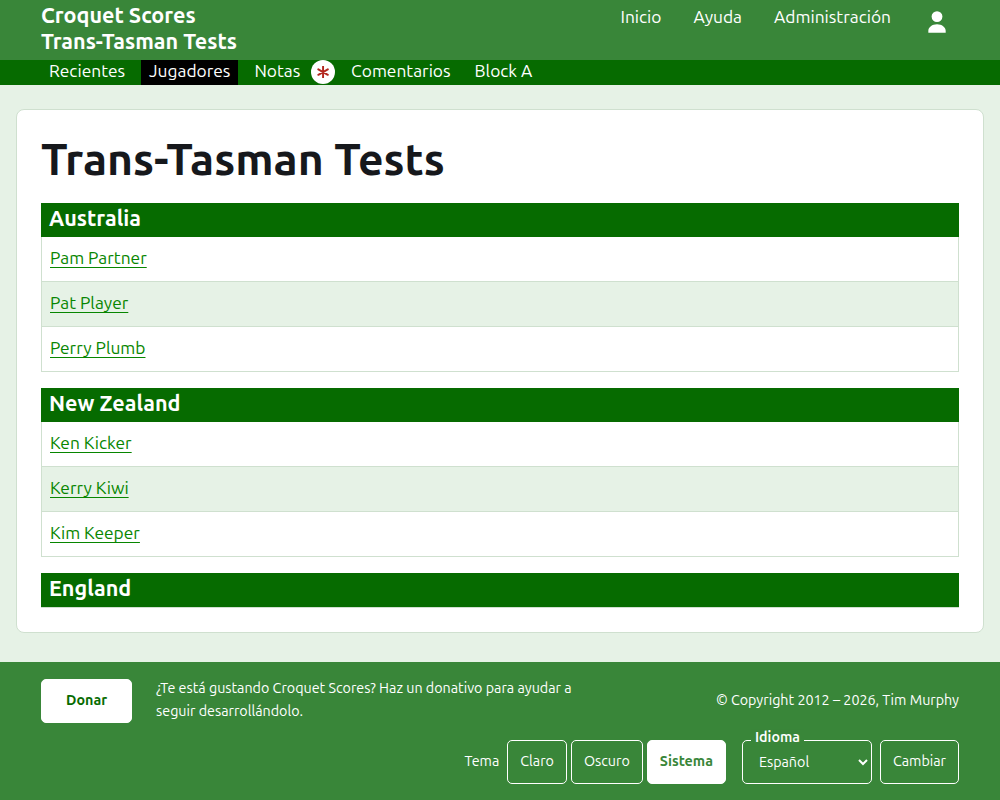

# Lo que ve el público

No se publica nada: las páginas públicas se construyen a partir de lo que guarda la administración, así que un resultado introducido está en ellas al momento. No necesitan cuenta ni scripts, y están pensadas para un teléfono.

## La página del torneo

La página del torneo está en su año, su deporte y su nombre, como `/2026/ac/trans-tasman-tests`. La encabeza el nombre del torneo, con su subtítulo debajo. Lista todas las partidas en uso, la añadida más recientemente primero, para que un lector que vuelve vea lo que ha pasado desde entonces. Cada partida dice el ganador, su equipo y sus puntos, después el perdedor y los suyos, con el test en que se jugó y cuánto hace que se añadió.

La barra verde oscuro ofrece las secciones del torneo: **Recientes**, que es esta página, **Resumen**, **Jugadores**, **Notas** y **Comentarios**, y después los tests. Un test se dice como los nombres cortos de sus equipos con "vs" en medio, como "AUS vs NZ". Los tests de un grupo no se ofrecen uno a uno: el grupo es una sola sección, con el nombre del grupo, en el lugar donde iría su primer test. Notas se marca con un asterisco rojo mientras haya una nota que el lector no ha leído.

## El resumen

Un torneo cuyos tests no están en ningún grupo tiene un **Resumen**: una sola tabla con todos los equipos, clasificados, con los tests que ha ganado, perdido y empatado, sus partidas ganadas y perdidas, y sus aros a favor, en contra y netos. Cuando los partidos de algún test son al mejor de más de una partida, los partidos ganados y perdidos van después de los tests. El resumen es donde un lector busca a cada equipo en su conjunto.

Un torneo con un test en un grupo no tiene Resumen. En su lugar, la página de cada grupo muestra cómo van los equipos de ese grupo, porque una sola tabla de equipos de distintos grupos que nunca han jugado entre sí no clasificaría nada.

## Un grupo

La página de un grupo muestra cómo van los equipos del grupo, contando solo los tests del grupo, en la tabla que usa el resumen. Sobre la tabla, en una fila propia, ofrece **Resumen**, que es esta página, y cada uno de los tests del grupo, que llevan a la página del test.

## Un test

La página de un test la encabezan los nombres completos de sus equipos, como "Australia vs New Zealand", y dice al mejor de cuántas partidas es cada partido. Su tabla la encabezan los dos equipos, el primero a la izquierda. Cada partido jugado es una fila, en el orden en que empezó, con el jugador del primer equipo a la izquierda, el del segundo a la derecha y las partidas del partido entre ambos, cada una con los puntos del primer bando y después los del segundo, los del ganador marcados. Bajo los partidos están las partidas y los aros de cada equipo y, cuando cada partido es al mejor de más de una, sus partidos ganados, cada uno en su lado.

Un test se muestra de dos maneras, ofrecidas en la línea de su nombre: **Cuadro**, que es esta tabla, y **Orden de juego**, que lista todas las partidas del test, la más antigua primero. Un test de un grupo ofrece el Resumen y los tests de su grupo en una fila sobre su encabezado, con este test marcado.

## Jugadores

La página Jugadores lista a los jugadores equipo por equipo: cada equipo bajo un encabezado con su nombre, en el orden que el torneo da a sus equipos, y sus jugadores debajo en orden alfabético.

## Notas

La página Notas lista las notas del torneo, la escrita más recientemente primero, cada una llevando a su propia página y diciendo cuánto hace que se escribió. Una nota que el lector no ha leído se marca con un asterisco rojo hasta que la abre.

## Direcciones que se mueven

Un torneo conserva su dirección cuando se corrige su nombre. Cuando se mueve, porque cambió su año o su deporte, su dirección antigua lleva a la nueva, para que un enlace guardado de antes siga funcionando. Las páginas de un torneo archivado no se encuentran hasta que se restaura.
