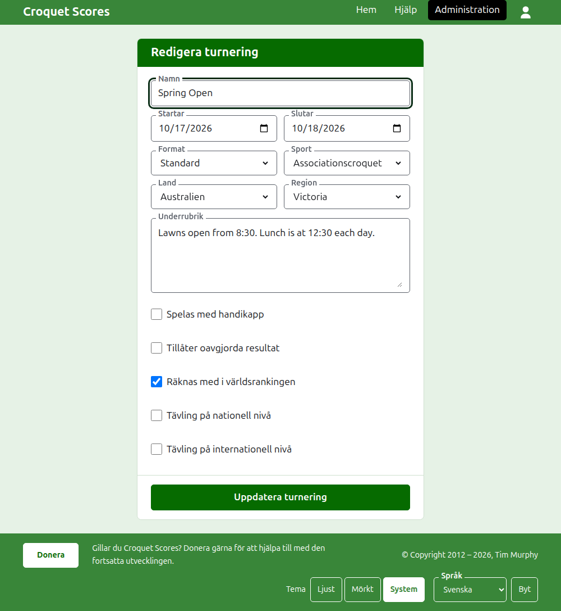
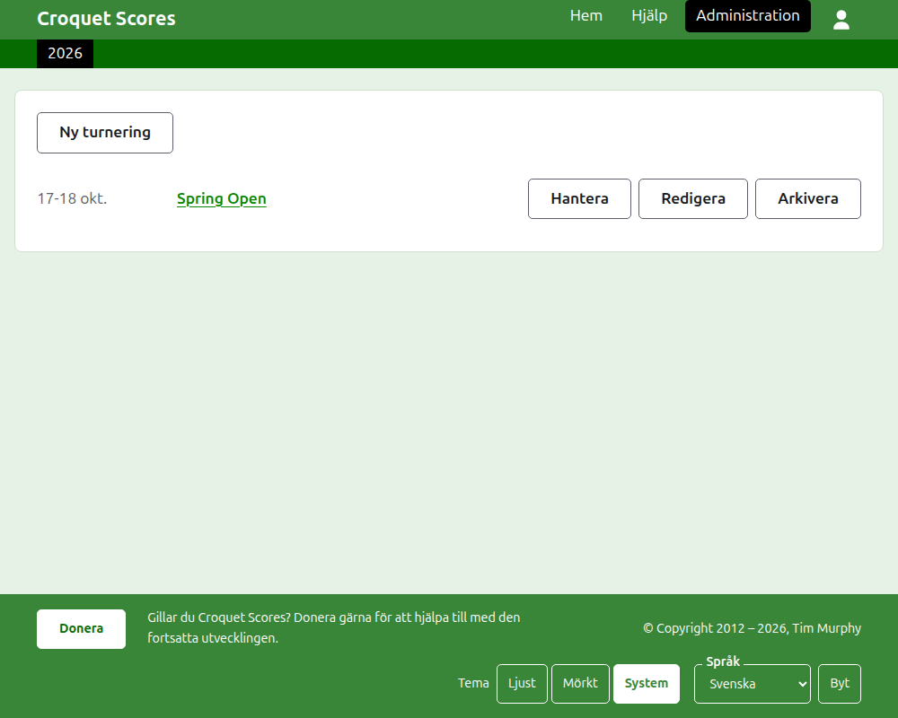
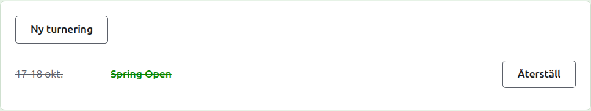

# Ändra, arkivera och återställa en turnering

## Ändra turneringens uppgifter

I listan över turneringar i administrationen, tryck på **Redigera** på turneringen. Formuläret är det som skapade den, ifyllt som turneringen är. Ändra det som är fel och tryck på **Uppdatera turnering**.

När turneringen innehåller någon spelare eller tävling, arkiverade inräknade, kan dess format inte ändras till ett som spelas av lag, som har lag och testmatcher i stället.

En turnering behåller sin adress när namnet rättas, så att en länk någon redan har skickat fortfarande hittar den. Den flyttar bara när det år den startar eller dess sport ändras, och då leder dess gamla adress till den nya. När du sparar förs du till turneringen där den nu finns.

Bara en turneringsledare kan ändra en turnering. En resultatförare, eller vem som helst annan, får veta det i stället för att visas formuläret.

## Listan över turneringar

Administrationen listar ett år i taget, med början på det här året, nyaste turnering först. De år du har en turnering i är flikar i det mörkgröna fältet, nyast först; där det finns fler än vad som ryms på en telefon ligger de äldsta i en rullgardinslista i slutet av raden. Året finns i adressen, så det går att länka till ett år.

## Arkivera en turnering

**Arkivera** på en turnering i listan lägger undan den. Den listas fortfarande, överstruken och efter turneringarna i bruk, men den erbjuder bara **Återställ**: dess sida i administrationen, och dess offentliga sidor, är stängda tills den återställs. Att arkivera frågar inte först, eftersom att återställa ångrar det.

Nästa: [Vad allmänheten ser](what-the-public-sees.md).
